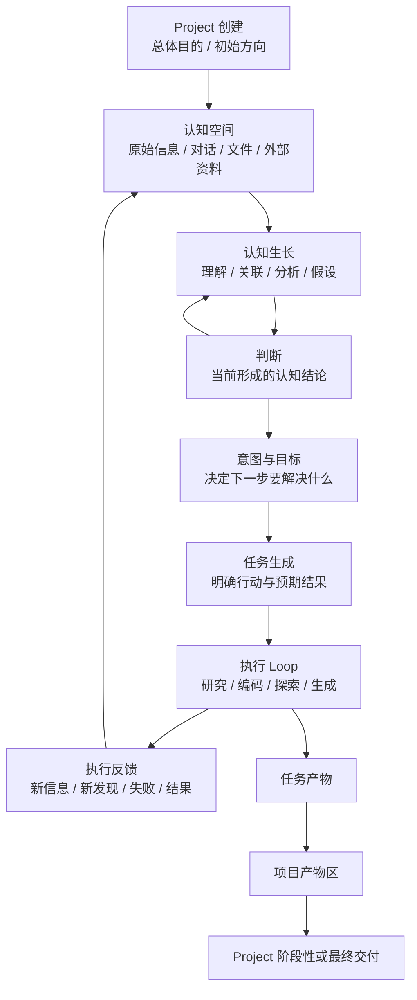
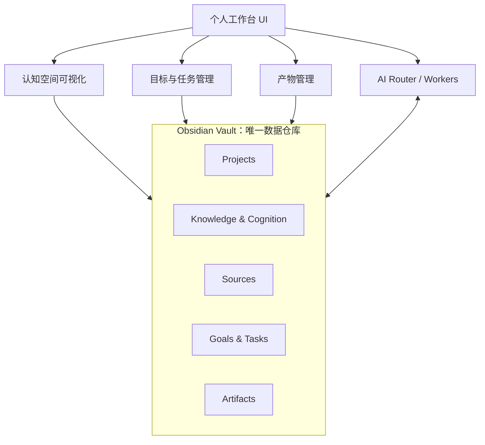
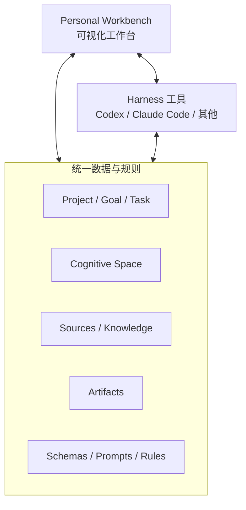
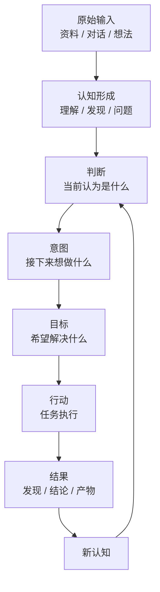
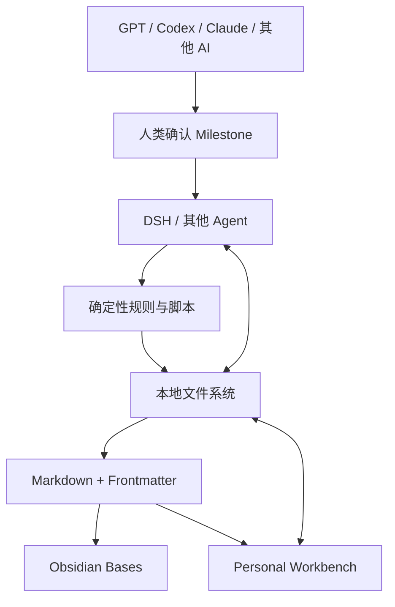
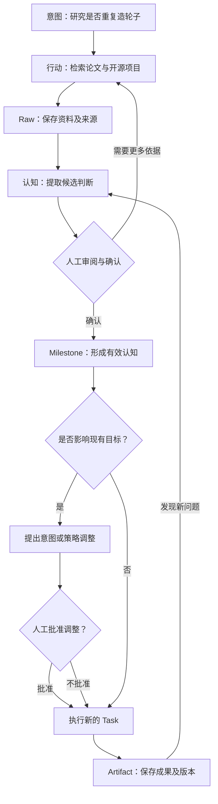

# 构建个人工作台框架

[原始 ChatGPT 对话](https://chatgpt.com/c/6b0163f0-51b0-83e8-aba1-a5dd397ca664) · 158 轮 · 319 条发言

## 第 1 轮

**用户**

我想构建一个个人的工作台，基于刚才聊的关于case研判是同一套运行的原则。我希望通过这轮对话把框架和需求搭出来，一会交给codex进行构建。
<mark style="background:#6D28D9">1.所谓的工作台主要服务的是我自己创建的任务，一般任务都是以学习，探索，研究，构建，代码，生成报告等为主的认知确认工作项目。每个项目总会会有一个总体目的，目的可能是个模糊方向，未必具体。</mark>
2.<mark style="background:#6D28D9">主要启动任务，应该有创建这个流程，创建初期，应该会到达一些原始信息，或者是我和某个ai对话的初始提示词等等，信息到达的位置应该属于一个认知空间。</mark>
3.<mark style="background:#6D28D9">随着认知生长，会形成判断，判断会产生意图和目标。目标推进产生任务，任务进展的过程中，会形成一个工作的loop。loop进行中中，会不断的在认知空间加入新的信息，任务的终点应该会生成或者交付一个结果。</mark>
<mark style="background:#6D28D9">4.整个项目最终会有一个产物区，应该有两种，一种是每个独立任务的产物，另一种是基于总体项目的目的生成的产物。</mark>

**ChatGPT**

我认为这个方向值得独立构建，而且它实际上可以成为你个人的一个 **AI Native 工作操作系统（Personal AI Workbench）**。

我建议我们不要先从传统的任务管理软件、知识库或者 Agent 工作流出发，而是直接沿用前面 Case 研判平台已经逐渐明确的运行原则。

但需要做一个重要的抽象：

**Case 研判解决的是：围绕一个案件，持续获取信息、形成认知、验证假设，最终还原事实。**

<span style="color:#6D28D9"><strong>个人工作台解决的是：围绕一个目的，持续获取信息、形成认知、产生意图、组织行动，最终交付成果。</strong></span>

<mark style="background:#6D28D9">两者底层运行机制高度一致，但工作对象不同</mark>。

<mark style="background:#6D28D9">Case 是案件，工作台是 Project（项目）。</mark>

<mark style="background:#6D28D9">而 Project 不一定是一个明确的工程项目。它可以是：

- 学习一个陌生领域。
- 探索一个新的商业方向。
- 研究一个技术架构。
- 构建一个软件产品。
- 完成一份行业研究报告。
- 编写一段代码或开发一个工具。
- 处理一个暂时还不知道如何解决的问题。

所以我建议，我们把 Project 作为整个系统的最小管理单元。</mark>

### **一、先建立统一的运行模型**

我把你刚才描述的过程整理成一条完整的认知与行动循环：



这里有几个我认为非常重要的设计原则。

**1. Project 的目的可以模糊，但必须持续存在。**

创建 Project 时，不应该强迫用户填写一个明确的 SMART 目标。

例如：

> 我想深入研究 AI Native 组织未来的形态。

这就足够启动一个 Project。

后续 AI 和人通过认知生长，逐渐把这个方向具象化。

**2. 认知先于任务。**

传统项目管理软件是先创建任务，再执行任务。

但这里的逻辑应该反过来：

- 收集信息。
- 形成认知。
- 产生判断。
- 形成意图。
- 再生成任务。

当然，人也可以直接提出一个明确任务，不必强制经过完整的认知过程。

**3. 任务不是一次性指令，而是一个执行闭环。**

任务执行过程中，Agent 可以：

- 自主规划执行步骤。
- 调用工具、代码、搜索和其他 Agent。
- 发现新的信息缺口。
- 形成新的判断。
- 提出新的目标或任务。
- 将执行结果回流认知空间。

但目标变化、重大资源投入等仍然由人确认。

**4. 所有行动都应该反哺认知空间。**

这是整个系统最重要的地方之一。

不能出现任务执行完了，结果只留在某个聊天窗口或者文件夹里，认知空间却没有任何变化的情况。

行动产生的信息、结论、失败经验，都应该能够被重新组织和关联。

---

### <mark style="background:#6D28D9"><strong>二、系统应该由四个核心空间组成</strong></mark>

我建议第一版先不要引入太多实体，四个核心空间足够。

#### **1. Project：项目空间**

这是整个系统的容器，也是人的主要工作入口。

一个 Project 应该有：

| 属性 | 说明 |
| --- | --- |
| Purpose | 总体目的，可以模糊 |
| Context | 项目的背景、初始信息 |
| Cognitive Space | 项目持续生长的认知空间 |
| Goals | 当前已经形成的目标 |
| Tasks | 正在推进或已经完成的任务 |
| Artifacts | 项目产生的成果 |
| Status | 项目当前所处状态 |

这里有一个重要区别：

Project 不应该是一个静态的文件夹，而应该是一个持续运行的认知与行动环境。

#### **2. Cognitive Space：认知空间**

这是整个工作台最核心的资产。

我认为它至少需要承载五种东西：

| 对象 | 含义 | 示例 |
| --- | --- | --- |
| Source | 原始信息 | 文件、网页、对话、代码、数据 |
| Knowledge | 已经整理出来的知识 | 技术原理、概念、资料摘要 |
| Hypothesis | 假设和待验证的问题 | 某种架构可能更适合当前场景 |
| Judgment | 当前形成的判断 | 方案 A 比方案 B 更合理 |
| Relationship | 信息之间的关联 | 某个技术与某个问题之间的关系 |

注意，这里有一个需要坚持的原则：

**原始信息与认知结论必须分开保存。**

AI 的总结不是原始信息，AI 的判断也不是客观事实。

每一个认知节点都应该尽可能保留来源、形成过程和关联关系。

这意味着未来可以追溯：

- 这个判断是怎么产生的？
- 它依据了哪些信息？
- 哪些信息支持它？
- 有没有相反的信息？
- 它是否已经被新的认知修正？

我倾向于让 Cognitive Space 成为一个不断生长的知识网络，而不是简单的 Markdown 笔记集合。

#### <mark style="background:#6D28D9"><strong>3. Goals & Tasks：目标与行动空间</strong></mark>

这里我建议明确区分三个层次：

**Purpose：总体目的**

这个 Project 为什么存在。

**Goal：阶段目标**

当前认知状态下，决定要解决什么问题。

**Task：具体行动**

为了推进某个目标，需要执行什么工作。

举个例子：

- Purpose：研究 AI Native 组织。
- Goal：理解 AI Agent 如何承担组织协调职责。
- Task A：调研相关开源项目。
- Task B：研究多 Agent 协作架构。
- Task C：形成一份架构分析报告。

任务执行过程中，可能发现一个新的问题：

> 现有多 Agent 架构并不能很好地解决动态资源协调问题。

于是产生新判断，再形成新目标。

因此，Goal 和 Task 之间不应该是固定的树状结构，而应该允许动态派生和关联。

任务也可以关联多个目标。

#### <span style="color:#6D28D9"><strong>4. Artifacts：产物空间</strong></span>

你提出的两类产物，我认为非常正确，而且应该在产品上明确分开。

**A. Task Artifacts（任务产物）**

每个独立任务产生的成果。

例如：

- 调研资料。
- 代码文件。
- 数据分析结果。
- 实验记录。
- 技术方案。
- 单次任务报告。

每个任务都应该拥有自己的产物记录。

**B. Project Artifacts（项目产物）**

基于整个 Project 的总体目的，经过多轮认知和任务积累后形成的成果。

例如：

- 最终研究报告。
- 完整的软件产品。
- 一套技术架构。
- 一份商业计划书。
- 一个系统化的知识体系。

两者之间应该有明确的关系：

```
Project
  ├── Cognitive Space
  ├── Goals
  │    ├── Task A
  │    │    └── Task Artifacts
  │    ├── Task B
  │    │    └── Task Artifacts
  │    └── Task C
  │         └── Task Artifacts
  │
  └── Project Artifacts
       ├── 最终报告
       ├── 最终方案
       └── 最终产品
```

特别强调一点：Project Artifacts 不应该只是把所有 Task Artifacts 汇总起来，而应该允许 AI 基于整个认知空间，重新组织、加工和生成新的成果。

---

### **三、运行机制：认知模式与行动模式**

结合我们之前讨论 Case 空间时提到的认知模式、行动模式，我认为这个个人工作台也可以沿用。

两个模式不是两个独立系统，而是同一个 Project 的两种工作状态。

| 认知模式 | 行动模式 |
| --- | --- |
| 收集信息 | 执行任务 |
| 整理知识 | 调用工具 |
| 发现关联 | 编写代码 |
| 形成假设 | 开展研究 |
| 产生判断 | 生成报告 |
| 确定目标 | 交付成果 |

两种模式持续交替。

例如：

人在认知模式中发现一个技术问题，形成一个判断，然后决定启动一个研究任务。

进入行动模式后，Agent 开始执行。

执行过程中发现新的技术信息，又回到认知模式。

这实际上就是一个不断循环的系统。

我不建议把它设计成必须经过的工作流节点。它应该是一个自然发生的运行机制。

---

### **四、Agent 的运行原则**

这里可以直接复用 Case 平台的核心设计思想。

我建议个人工作台采用：

**一个统一的 Router + 独立思考的 Worker + 人类决策者。**

职责大致如下：

- 人：确定总体方向、判断重要性、确认重大目标、审核交付。
- Router：理解当前 Project 状态，组织任务，调度 Worker。
- Worker：承担独立专业工作，具备独立判断和质疑能力。
- Cognitive Space：为人和 Agent 提供共享的项目认知上下文。

有一个关键点：

Agent 不应该每次执行任务都把整个 Project 的所有信息塞进上下文。

而应该根据当前目标和任务，主动检索相关认知节点。

同时，执行结果要回流共享认知空间。

这会形成一个非常重要的能力：

**Agent 不仅能够使用项目积累的认知，还能够推动项目认知持续生长。**

---

### **五、我建议第一版 UI 先考虑这样的结构**

暂时不讨论具体视觉设计，先明确空间布局。

```

Personal Workbench
│
├── Dashboard
│   ├── 当前进行中的 Projects
│   ├── 待我确认的判断与目标
│   ├── 正在执行的 Tasks
│   └── 最近的项目动态
│
└── Project Workspace
    │
    ├── Overview
    │   ├── Purpose
    │   ├── 当前判断
    │   ├── 当前目标
    │   └── 项目进展
    │
    ├── Cognitive Space
    │   ├── 原始信息
    │   ├── 知识节点
    │   ├── 假设与判断
    │   └── 关联关系
    │
    ├── Goals & Tasks
    │   ├── 目标列表
    │   ├── 任务列表
    │   ├── 执行状态
    │   └── 任务执行过程
    │
    └── Artifacts
        ├── Task Artifacts
        └── Project Artifacts
```

我暂时不建议把这四个空间做成四套完全独立的应用。

它们应该是同一个 Project 的不同观察视角。

例如，在认知空间看到一个判断，可以直接查看它产生的任务；在任务中看到一个新发现，可以直接回到认知空间查看它与其他知识的关系。

---

### **六、目前需要进一步明确的几个设计问题**

现在这套框架已经有了雏形。但在交给 Codex 之前，我认为还有几个关键问题不能直接替你做决定。

我建议接下来按以下顺序讨论：

1. **Project 的创建机制**：一个模糊的想法如何进入系统？初始信息如何注入？AI 如何帮助完成项目初始化？
2. **认知空间的数据模型**：到底有哪些认知节点？信息如何形成关联？如何处理新旧判断、冲突和修正？
3. **任务执行机制**：任务如何产生、分解、执行、反馈？Agent 有多大的自主权？
4. **人机交互方式**：人主要通过聊天、画布，还是两者结合来操作？
5. **产物管理机制**：任务成果如何沉淀，如何基于项目整体认知生成最终成果？
6. **整体 UI 与技术架构**：最后再形成 Codex 可以直接执行的开发需求。

#### **我想先和你讨论第一个问题：Project 如何启动？**

我目前想到两种启动方式。

**方式 A：先有目的，再注入信息。**

例如：

> 我想研究一下当前 AI Agent 的长期记忆架构。

创建 Project，输入目的，然后陆续上传文件、网页、对话等。

**方式 B：先有原始信息，再形成目的。**

例如：

你直接把一堆技术资料、聊天记录、代码仓库丢进来，告诉 AI：

> 帮我理解这些东西，看看能做什么。

AI 先建立初始认知，再与你共同确定 Project 的目的和方向。

我倾向于两种方式都支持，而且它们最终进入同一套初始化机制。

**我真正想确认的是：你是否希望 Project 创建之后，AI 就立即成为这个项目的持续参与者，而不是等你创建任务、明确指令之后才开始工作？**

这会决定整个工作台究竟是一个传统的 AI 任务管理工具，还是一个真正持续生长的个人认知与行动系统。

## 第 2 轮

**用户**

其实基于这个规则，创建一个obsidan的专属仓库就行了，但是没有前端可视化

**ChatGPT**

对。这样整个事情就简单很多了，而且我认为这是一个更合理的 MVP 路径。

我们不需要重新发明一套知识管理和存储系统。

**直接把 Obsidian Vault 作为个人工作台的底层数据仓库，在它之上构建一个专属的可视化交互前端。**

我建议采用这样的架构：

### **1. 整体架构**



这里有一个重要原则：

- Obsidian 负责数据存储、知识组织和持久化。
- 前端负责可视化、交互和工作状态呈现。
- Agent 负责认知加工、判断、任务规划和执行。
- Vault 是唯一事实来源（Single Source of Truth）。

不要再额外建立一套平行的知识数据库。

### **2. Obsidian 仓库结构**

我初步建议这样组织：

```
Personal-Workbench/
│
├── 00_Inbox/
│   ├── Raw-Inputs/
│   └── Conversations/
│
├── 01_Projects/
│   └── Project-001/
│       ├── project.md
│       │
│       ├── cognition/
│       │   ├── sources/
│       │   ├── knowledge/
│       │   ├── hypotheses/
│       │   ├── judgments/
│       │   └── relationships/
│       │
│       ├── goals/
│       │
│       ├── tasks/
│       │   ├── active/
│       │   └── completed/
│       │
│       └── artifacts/
│           ├── task-artifacts/
│           └── project-artifacts/
│
├── 02_Shared-Knowledge/
│
├── 03_Templates/
│
└── 04_System/
    ├── schemas/
    ├── prompts/
    └── configurations/
```


这只是初步目录设计，具体哪些对象独立成文件、哪些通过 YAML Properties 和双向链接组织，还需要进一步确定。

### **3. 真正需要开发的是前端**

我认为前端不应该只是一个 Obsidian 的文件浏览器。

它应该是一个独立的 Personal Workbench。

初步设计四个核心视图：

| 视图 | 核心功能 |
| --- | --- |
| Dashboard | 全局项目、进度、待处理事项 |
| Project | 项目总体目的、当前认知和目标 |
| Cognitive Space | 可视化认知节点、关联关系及演进 |
| Tasks & Artifacts | 任务执行、结果和产物管理 |

其中，我认为最值得投入设计的是 Cognitive Space。

Obsidian 原生 Graph View 并不能完全满足需求。我们需要自己的认知可视化界面，能够：

- 展示认知节点及其关联。
- 区分原始信息、知识、假设、判断和目标。
- 展示判断如何产生，以及它引发了哪些行动。
- 点击节点展开上下文和来源。
- 从认知节点直接发起任务。
- 将任务执行结果重新注入认知网络。

这才是工作台真正的价值。

### **4. 技术实现建议**

第一版可以采用：

- **存储：** Obsidian Vault（Markdown + YAML + 附件）
- **前端：** React + TypeScript
- **可视化：** React Flow 或 Cytoscape.js
- **Agent：** 独立 Router + Worker 执行层
- **文件访问：** 直接读写 Vault
- **运行方式：** 本地 Web App

我倾向于先做独立前端，而不是先开发 Obsidian Plugin。

这样不受 Obsidian 插件 UI 的限制，同时仍然能够使用 Obsidian 管理全部底层数据。

### **5. 我认为还有一个关键设计原则**

**不要让前端成为新的数据中心。**

例如：

你在前端创建一个任务，本质上就是在 Vault 中创建一份任务记录。

Agent 执行任务，产生判断和成果，本质上也是在 Vault 中更新对应文件。

前端只是把这些数据组织成一个更容易理解和操作的工作环境。

这样未来即使换掉前端，所有知识、项目、任务和成果仍然完整保留在 Obsidian 中。

### **下一步，我想先确定一个架构选择**

你希望这个前端是什么形态？

**A. 独立桌面工作台**

单独打开一个应用，直接读取 Obsidian Vault。Obsidian 作为后台知识仓库，日常工作主要在新工作台完成。

**B. Obsidian 内嵌工作台**

开发 Obsidian Plugin，在 Obsidian 内增加专属工作台界面。

**我的建议是 A。**

因为你要构建的不是一个更好用的 Obsidian，而是一个以 Obsidian 为底层存储的个人 AI 工作操作系统。

## 第 3 轮

**用户**

A可以，还需要什么信息

**ChatGPT**

A 确定：独立桌面工作台，Obsidian Vault 作为底层数据仓库。

接下来我们需要把需求从产品构想推进到可交付给 Codex 的工程规格。

我建议分成三个层次：**产品规则、交互设计、技术约束**。

不需要一次性把所有细节都确定，但有几个架构决策最好在开发前明确。

### **一、需要确认的 7 个问题**

#### **1. Obsidian 仓库**

我建议新建一个专属 Vault，不与现有个人知识库混用。

需要确认：

- 是否新建独立 Vault？
- Vault 是否完全本地化？
- 是否允许 Agent 直接创建、修改和整理 Markdown 文件？
- 是否保留 Obsidian 原生可读性和兼容性？

我的建议：全部支持。Obsidian 是底层数据仓库，任何时候都可以脱离工作台独立使用。

#### **2. 工作台的使用方式**

我建议采用一个主工作台 + Project 工作空间的结构。

主工作台：

- 所有项目概览。
- 当前活跃任务。
- 待确认事项。
- 最近的认知变化。
- 快速创建 Project。

Project 工作空间：

- 项目概览。
- 认知空间。
- 目标与任务。
- 产物。

这里有一个设计重点：不同项目之间默认隔离，不主动混合认知上下文。

#### **3. 认知空间如何可视化**

这是我认为最值得认真设计的部分。

我不建议简单复制 Obsidian 的 Graph View。

我更倾向于：

- 节点：信息、知识、假设、判断、目标。
- 边：来源、支持、反驳、推导、关联、产生。
- 时间：认知节点的形成和修订过程。
- 交互：点击节点展开内容，查看来源和上下游关系。

另外，我认为认知空间应该支持两种观察方式：

**全局观察：** 查看整个 Project 的认知结构。

**局部观察：** 聚焦某个判断、问题或目标，查看相关信息和推理链。

#### **4. Agent 的自主权**

这里沿用我们之前讨论 Case 时的原则。

我建议分为三个权限层次：

| 操作 | 默认权限 |
| --- | --- |
| 搜索、阅读、分析、整理 | 自主 |
| 生成判断、提出目标、创建任务建议 | 自主提出 |
| 确认重大目标、执行高风险操作、最终交付 | 人类确认 |

还有一个需要明确的设计：Agent 是否允许直接修改已有认知节点？

我的建议是允许，但必须保留历史版本，不能静默覆盖已有判断。

#### **5. 任务执行环境**

任务不只是一个待办事项。

例如一个任务：

> 调研 GitHub 上的多 Agent 协作架构。

Agent 可能需要：

1. 搜索 GitHub。
2. 阅读项目文档。
3. 分析架构。
4. 比较不同项目。
5. 生成研究报告。
6. 把新知识回流认知空间。

我建议任务具有独立执行上下文、执行记录、输入输出和产物。

需要确认的是：是否允许 Agent 在本地执行代码、读写文件、调用终端？

我的建议是允许，但通过权限控制和执行记录管理。

#### **6. AI 模型与运行方式**

需要明确：

- 使用 Codex 作为开发工具，还是未来工作台也直接调用 Codex？
- 是否允许接入多个模型？
- Agent 是否运行在本地？
- 是否需要支持后台持续执行？

我的建议是模型层与产品架构解耦，不要把整个系统绑定在某一家模型供应商上。

#### **7. 项目产物**

我建议产物区不只是文件列表。

它应该有：

- 产物名称。
- 产物类型。
- 所属任务或 Project。
- 版本。
- 生成时间。
- 关联的认知节点。
- 交付状态。

特别是 Project Artifact，应该支持基于整个项目认知空间进行综合生成，而不是简单汇总任务报告。

### **二、我建议再确定三个产品原则**

这三个原则会影响整个产品的实现。

**原则一：以认知为中心，而不是以任务为中心。**

任务是推动认知生长的手段，不能让任务管理反过来限制认知探索。

**原则二：人和 Agent 共享同一个认知空间。**

不是 Agent 有自己的记忆，人有自己的笔记，而是双方共同维护一套可追溯、可修订的项目认知资产。

**原则三：执行过程必须可观察。**

我希望你能随时看到：

- Agent 正在做什么。
- 为什么做这件事。
- 它依据什么信息。
- 当前形成了什么判断。
- 下一步准备做什么。
- 哪些事情需要你决策。

这实际上也是我们之前讨论的 Harness 思想在个人工作台中的体现。

### **三、我建议采用的开发路线**

不要一次性开发完整系统。

| 阶段 | 交付内容 |
| --- | --- |
| P0 | Vault 数据结构、项目创建、文件读写 |
| P1 | 独立工作台 UI、Dashboard、Project Workspace |
| P2 | 认知空间可视化、节点关联 |
| P3 | Goal / Task 管理、Agent 执行 Loop |
| P4 | 任务产物、项目产物、认知回流 |
| P5 | 多 Agent 协作、后台运行、权限管理 |

每个阶段都应该有可运行的产品，而不是只交付技术模块。

### **四、现在我最需要你回答的事情**

先不让你陷入技术细节。我想优先确认四个架构问题：

**1. 仓库：** 是否完全新建一个独立 Obsidian Vault，作为工作台唯一数据源？

**2. AI：** 你希望工作台直接调用 API 自己运行 Agent，还是希望它能够调度 Codex、Claude Code 这类现成的 Agent 执行环境？或者两者兼容？

**3. 执行：** 是否允许 Agent 在本地拥有代码执行、终端操作、文件读写能力？

**4. 使用方式：** 这个工作台是否完全以你个人为使用对象，暂时不考虑多人协作、账号体系和云端同步？

这四个问题确定之后，我们就可以开始形成正式的产品需求文档（PRD）、数据模型、UI 规格和 Codex 开发任务书。

我尤其希望第二个问题认真讨论，因为它会直接决定工作台的 Agent Runtime 架构。

## 第 4 轮

**用户**

本地我希望轻一点，harness工具直接可以操作，不用考虑到底是什么ai，但是读写规则和数据库用的是同一套

**ChatGPT**

明白。这实际上明确了一个很重要的架构方向：**工作台不负责构建和运行一套自己的 AI Agent Runtime，而是作为一个轻量级的管理、认知和可视化层，直接驾驭现有 Harness。**

也就是说，我们不应该重复造 Codex、Claude Code 这样的执行工具。

### **1. 架构调整**

我建议采用下面的结构：



这里有三个关键组件：

**Workbench**

- 创建和管理 Project。
- 查看认知空间。
- 管理目标与任务。
- 查看执行状态。
- 管理产物。

**Vault**

- 唯一数据源。
- 统一数据结构。
- 统一读写规则。
- 保存项目上下文。
- 保存任务记录和执行结果。

**Harness**

- 实际执行研究、分析、代码和报告生成。
- 根据 Vault 中的规则读取上下文。
- 将执行结果写回 Vault。
- 不限制底层究竟使用什么 AI。

### **2. 一个非常重要的设计：统一协议**

我认为这里最值得做的是建立一套统一的工作协议。

无论未来使用 Codex 还是 Claude Code，都遵循相同的规则。

例如：

```
读取任务
  ↓
读取所属 Project
  ↓
读取任务关联的认知节点
  ↓
理解目标与约束
  ↓
执行任务
  ↓
记录执行过程
  ↓
提交任务结果
  ↓
更新认知空间
  ↓
产生新的目标或任务建议
```


Harness 不需要理解我们整个产品的内部实现，只需要遵守统一的数据协议。

这样我们就实现了 AI 执行层与产品数据层的解耦。

### **3. 我建议增加一个 System Protocol**

在 Vault 中增加：

```
04_System/
├── PROTOCOL.md
├── schemas/
│   ├── project.yaml
│   ├── cognition.yaml
│   ├── goal.yaml
│   ├── task.yaml
│   └── artifact.yaml
│
├── rules/
│   ├── cognition-rules.md
│   ├── task-rules.md
│   ├── execution-rules.md
│   └── artifact-rules.md
│
└── templates/
```


其中 PROTOCOL.md 是所有 Harness 的统一入口。

它规定：

- 数据如何读取。
- 文件如何创建。
- 如何修改已有认知。
- 如何记录任务执行。
- 如何建立节点关联。
- 如何提交任务成果。
- 哪些操作需要人确认。

注意：这不应该只是 Prompt 集合，而应该是可验证的数据规范和操作约定。前端也必须遵循同一套规范。

### **4. 还有一个架构问题需要明确**

我建议工作台与 Harness 之间尽可能采用文件协议，而不是深度绑定某个工具的 API。

但是有一个值得讨论的地方：

**工作台如何知道 Harness 正在执行什么？**

我想到两种方式：

- A：文件驱动。Harness 更新 Task 文件、Execution Log，前端监听 Vault 文件变化，实时呈现状态。
- B：轻量桥接。工作台提供本地接口，Harness 通过统一命令或接口上报状态、提交结果。

我倾向于 **A 为基础，B 为增强**。

这样即使 Harness 没有集成接口，只要它能够读写文件，就能参与整个系统。

目前我认为已经明确了四个核心架构原则：

1. Obsidian Vault 是唯一数据仓库。
2. Workbench 是独立的轻量可视化前端。
3. Harness 是外部执行引擎，不绑定 AI 厂商。
4. 所有参与者共享统一的数据模型和读写协议。

下一步我建议重点讨论第五件事：**认知空间究竟采用什么数据模型，以及如何从原始信息生长出知识、判断、目标和行动。**

这会是整个工作台最核心、也最值得认真设计的部分。

## 第 5 轮

**用户**

我本人人和agent工具，都可以来驱动就可以。最差就是全部我主动写入就行了

**ChatGPT**

明白。那我们就不需要把 Harness 与工作台之间的实时通信当成一个前置条件了。

你实际上提出了一个更简单、也更稳健的设计原则：

**工作台不控制谁来驱动工作，而是提供一套统一的工作空间和数据规则。人和任何 Agent 都是这个空间的平等参与者。**

这意味着：

#### **1. 三种驱动方式都应该成立**

| 驱动者 | 工作方式 |
| --- | --- |
| 人主动驱动 | 在工作台创建、编辑认知、目标、任务和产物 |
| Agent 主动驱动 | Harness 读取 Vault，按照规则执行并写回 |
| 人机交替驱动 | 人提出方向，Agent 研究，人修正判断，再由 Agent 推进 |

不需要规定谁必须先启动。

#### **2. 系统不依赖实时 Agent 通信**

我们可以把数据写入作为唯一的协作基础。

例如：

```
人创建 Project
    ↓
写入 Vault
    ↓
Agent 读取 Project
    ↓
Agent 形成认知、提出目标
    ↓
写入 Vault
    ↓
人打开工作台
    ↓
查看、修订、确认
    ↓
Agent 继续执行
```


即使 Agent 完全没有与工作台集成，也能工作。

最差情况下，你直接在 Obsidian 里写 Markdown，系统仍然能够识别和展示。

#### **3. 这也决定了一个重要的技术原则**

**Vault 是事实来源，工作台只是 Vault 的可视化投影和交互入口。**

因此：

- 不强制使用 API。
- 不强制使用特定 Agent。
- 不强制使用特定模型。
- 不强制使用实时通信。
- 不强制所有操作经过前端。
- 所有数据必须遵循统一 Schema 和读写协议。

前端需要能够识别外部新增、修改和删除的文件，并正确刷新视图。

### **目前架构共识**

我把已经明确的内容收敛一下：

| 维度 | 已确定方案 |
| --- | --- |
| 产品形态 | 独立桌面工作台 |
| 使用对象 | 个人 |
| 数据仓库 | 独立 Obsidian Vault |
| 数据格式 | Markdown + YAML + 附件 |
| 数据原则 | 单一事实来源 |
| AI 执行 | 外部 Harness |
| 模型依赖 | 不绑定厂商 |
| 驱动方式 | 人、Agent 均可主动驱动 |
| 协作方式 | 文件读写协议 |
| 实时通信 | 非必要条件 |
| 核心能力 | 认知生长、目标形成、任务执行、产物沉淀 |

我建议暂时停止讨论 Harness 的集成细节。

**下一步应该回到产品本身：认知空间。**

尤其需要明确一个问题：认知空间是单纯存放信息和知识的地方，还是一张能够记录「信息 →认知 → 判断 → 意图 → 目标 → 行动 → 新认知」全过程的演进图谱？

我倾向于后者。这也是这个工作台区别于普通 Obsidian 知识库的核心。

## 第 6 轮

**用户**

同意

**ChatGPT**

那我们就把这条确立为工作台的核心设计原则：

**认知空间不是知识库，而是一张持续演进的认知与行动图谱。**

它记录的不只是我们知道什么，还记录：

- 信息从哪里来。
- 如何形成认知。
- 为什么产生某个判断。
- 判断如何转化为意图和目标。
- 目标如何产生行动。
- 行动又带来了什么新信息和新认知。

我建议接下来重点设计这张图谱的数据模型。

先提出一个初步结构：

| 节点类型 | 作用 |
| --- | --- |
| Source | 原始信息及来源 |
| Knowledge | 提炼出的知识 |
| Question | 尚未解决的问题 |
| Hypothesis | 有待验证的假设 |
| Judgment | 当前形成的判断 |
| Intent | 基于判断产生的意图 |
| Goal | 确定要实现的目标 |
| Task | 具体行动 |
| Result | 行动产生的结果 |

关系则包括：

- 来源于（Source）
- 支持（Supports）
- 反驳（Contradicts）
- 推导出（Derives）
- 产生（Generates）
- 验证（Validates）
- 修正（Revises）
- 执行产生（Produces）

这里我想特别保留一个设计空间：这些节点不一定都需要独立创建文件，也不意味着每个信息都必须经过这九种类型。我们遵循「如无必要，勿增实体」。

**我想先讨论一个更根本的问题：**

你希望认知图谱主要表达哪一种东西？

A. **知识结构**：展示项目目前掌握了什么、各知识之间有什么关系。

B. **演进过程**：展示项目是如何从最初的信息，逐渐形成判断、目标和行动的。

C. **两者融合**：既能看到当前认知全貌，也能沿着时间回溯认知如何生长。

我倾向于 C，但两者应该是同一张图谱的不同观察视角，而不是两套数据系统。

## 第 7 轮

**用户**

B为主，我觉得已经足够复杂了

**ChatGPT**

同意。我们就不把它做成一个追求完整知识覆盖的知识图谱，而是以 **认知演进（Cognitive Evolution）** 为核心。

这个取舍很重要：我们要解决的是工作过程中认知如何产生、变化并转化为行动，而不是把所有知识都结构化。

### **一、认知空间的核心定义**

它是一条持续演进的链：



这里不要求所有过程都严格线性。

例如：

- 一个原始输入可以产生多个认知。
- 一个判断可以产生多个目标。
- 一个目标可以产生多个任务。
- 一个任务可以产生多个结果。
- 一个结果可以修正之前的判断。

### **二、我建议进一步减少节点类型**

第一版只保留六种核心对象：

| 对象 | 定义 |
| --- | --- |
| Input | 进入项目的信息和想法 |
| Cognition | 对信息形成的理解、发现或问题 |
| Judgment | 当前阶段形成的判断 |
| Goal | 决定要实现的目标 |
| Task | 为推进目标而采取的行动 |
| Outcome | 行动产生的结果 |

Intent 暂时不独立建模，可以体现在 Judgment 和 Goal 之间的说明中。

这样能够避免过度设计。

### **三、可视化应该强调演进，而非静态关系**

我想象中的界面更接近一张不断生长的流程图。

例如：

```
初始想法
   │
   ▼
阅读技术资料
   │
   ▼
发现现有方案存在局限
   │
   ▼
形成判断
   │
   ├── Goal A
   │     ├── Task A1
   │     └── Task A2
   │
   └── Goal B
         └── Task B1
               │
               ▼
           新发现
               │
               ▼
           修正原判断
               │
               ▼
           产生新目标
```

UI 应该能够：

- 展示认知演进的时间顺序。
- 展开和折叠分支。
- 查看节点的详细内容和来源。
- 查看判断被什么信息支持或修正。
- 从节点直接创建目标或任务。
- 从任务结果回溯到它影响的认知。

### **四、我想再明确一个重要区别**

我不希望它变成一张 Agent 自动生成的漂亮流程图。

它应该是真正的工作记录。

比如：

一个判断最初形成于 11 月 20 日，11 月 22 日因为新资料而被修正。

我们不应该直接覆盖旧判断，而应该保留演进过程。

这也是为什么我认为认知空间最终应该采用**事件与节点相结合的模型**：

- 节点表示当前存在的认知对象。
- 事件记录它何时产生、被谁修改、因为什么发生变化。

但第一版不必做复杂的事件溯源数据库，Markdown 就可以承载。

---

接下来我建议讨论一个直接影响 UI 和数据模型的问题：

**认知演进应该由谁来维护？**

我的初步设想是：人和 Agent 都可以新增、修正认知节点，但系统不应该强迫每次对话、每次任务都自动生成认知节点。

只有真正有价值的认知变化才进入图谱。

这样可以避免认知空间迅速膨胀成一堆没有意义的 AI 摘要。

## 第 8 轮

**用户**

以人为主，ai只是辅助编辑、查询等等

**ChatGPT**

这个决定非常关键。它意味着我们要把工作台定位进一步明确：

**这是一个以人为中心的认知工作台（Human-driven Cognitive Workbench），而不是一个由 Agent 自动维护的知识系统。**

AI 是认知助手，不是认知空间的主人。

### **一、明确人和 AI 的职责边界**

| 能力 | 人 | AI |
| --- | --- | --- |
| 创建认知节点 | 主导 | 辅助 |
| 编辑认知内容 | 主导 | 辅助修改、润色 |
| 建立节点关联 | 主导 | 推荐关联 |
| 形成判断 | 主导 | 提供分析和反证 |
| 确定目标 | 决策 | 提出建议 |
| 创建任务 | 主导 | 辅助拆解 |
| 查询认知空间 | 可以 | 可以 |
| 整理认知结构 | 主导 | 辅助 |
| 修改已有认知 | 确认 | 提议修改 |
| 认知历史管理 | 决定 | 提供记录 |

核心原则：

**AI 可以参与认知生长，但不能替代人对认知的确认和维护。**

### **二、这会影响认知空间的交互设计**

我建议设计三个主要交互入口。

**1. 人工创建**

人可以随时在认知空间中创建：

- 一个新发现。
- 一个问题。
- 一个判断。
- 一个目标。
- 一个关联。

不必先经过 AI。

**2. AI 辅助编辑**

选中一个认知节点，可以让 AI：

- 优化表达。
- 提炼核心观点。
- 补充论据。
- 寻找矛盾。
- 推荐关联节点。
- 根据新信息提出修订建议。

但修改必须经过人的确认。

**3. AI 辅助查询**

例如：

- 当前项目最核心的几个判断是什么？
- 哪些判断还缺乏依据？
- 最近一周认知发生了什么变化？
- 某个目标是怎么产生的？
- 哪些任务的结果尚未回流到认知空间？

AI 查询可以读取整个项目，但不应因此自动修改项目数据。

### **三、我建议增加一个重要概念：认知变更**

每次重要认知修改，都保留：

- 修改前内容。
- 修改后内容。
- 修改原因。
- 修改时间。
- 修改者。
- 关联的信息来源。

这样既能保留认知演进，也不会把系统变成复杂的知识图谱维护工具。

---

### **四、目前已经确定的产品原则**

我们已经形成了相当清晰的方向：

1. 独立桌面工作台。
2. Obsidian Vault 作为唯一数据仓库。
3. 人和外部 Harness 都可以驱动工作。
4. 统一数据 Schema 和读写协议。
5. 认知空间以演进过程为核心。
6. 以 Input → Cognition → Judgment → Goal → Task → Outcome 为主要结构。
7. 人负责认知空间的主导维护。
8. AI 主要负责辅助编辑、查询、分析和建议。
9. 所有认知变化可追溯。

**下一步我建议讨论 Project 的生命周期。**

尤其是一个问题：

一个 Project 完成最终交付后，是不是就意味着它结束了？还是说它应该继续保留认知空间，未来可以重新激活、追加信息、产生新目标？

我倾向于后者。Project 应该是一个长期存在的认知容器，而不是一次性任务容器。

## 第 9 轮

**用户**

不用研究这个问题，等发生了再说

**ChatGPT**

同意。这个问题暂时不纳入设计，遵循「如无必要，勿增实体」，不为尚未发生的场景增加复杂度。

我们把 Project 生命周期管理留到实际使用中再决定。

目前已经明确的内容先冻结为设计共识，不再反复讨论。

我建议接下来转向一个更实际的问题：**工作台的主界面和 Project Workspace 应该长什么样，以及人如何在认知、目标、任务之间切换。**

我们优先把实际使用画面构建出来，再反推必要的数据结构。

## 第 10 轮

**用户**

把先到此为止的讨论成果，总结一下，我在work里开始工作

**ChatGPT**

下面整理成一份可以直接交给 ChatGPT Work 和 Codex 使用的产品设计基线。

这份文档重点是**记录已经达成的共识、明确产品边界、保留尚未讨论的事项**，避免后续开发过程中重新发散。

### **Personal Workbench — 产品设计基线 V0.1**

### Personal Workbench

#### 个人 AI 认知与行动工作台 — 产品设计基线 V0.1

#### 1. 产品定位

构建一个以个人为中心的 AI Native 工作台。

工作台主要服务于个人发起的认知与行动型项目，包括：

- 学习与知识探索
- 技术研究与架构分析
- 商业研究与方向探索
- 软件构建与代码开发
- 报告、方案及其他内容生成
- 其他需要持续思考、研究、判断和交付成果的工作

每个项目（Project）都有一个总体目的（Purpose）。

这个目的可以是模糊的方向，不要求创建时就明确具体目标。

系统的核心价值是：

**围绕一个总体目的，通过持续的信息输入、认知生长、判断形成和行动执行，最终产生有价值的交付成果。**

产品不是传统任务管理软件，也不是单纯的知识库，而是一个人和 AI 共同使用的认知与行动环境。

---

#### 2. 核心运行模型

沿用此前 Case 研判系统讨论形成的运行原则，但将其应用于个人工作场景。

核心循环：

Input → Cognition → Judgment → Goal → Task → Outcome → New Cognition

具体解释：

1. Input：接收原始信息，包括文件、网页、聊天记录、想法、代码等。
2. Cognition：对输入进行理解、整理和分析，形成新的认知。
3. Judgment：基于当前认知形成阶段性判断。
4. Goal：判断产生意图，进一步明确希望实现的目标。
5. Task：为了推进目标而产生具体行动。
6. Outcome：任务执行产生结果，包括报告、代码、发现、结论等。
7. New Cognition：行动结果重新进入认知空间，推动下一轮认知生长。

这不是严格的线性工作流。

允许：

- 一个输入产生多个认知。
- 一个判断派生多个目标。
- 一个目标产生多个任务。
- 一个任务产生多个结果。
- 一个结果修正之前的判断。
- 人直接创建目标或任务，不必强制经过完整认知流程。

系统不强制所有工作遵循固定步骤。

---

#### 3. 核心产品架构

采用三个核心组成部分：

##### 3.1 Workbench

独立的桌面工作台，负责：

- 项目管理
- 认知空间可视化
- 目标与任务管理
- 执行状态展示
- 产物管理
- 人与 AI 的交互入口

##### 3.2 Obsidian Vault

作为唯一数据仓库（Single Source of Truth）。

基本要求：

- 独立创建一个专属 Vault。
- 使用 Markdown、YAML Properties 和附件存储数据。
- 保持 Obsidian 原生兼容性。
- 数据不依赖工作台才能读取。
- 人和 Agent 都可以直接操作仓库。
- 前端与外部 Harness 遵循同一套数据模型和读写规则。

不建立平行的知识数据库。

##### 3.3 Harness

使用外部现有 AI 执行环境，例如 Codex、Claude Code 等。

基本原则：

- 不自行开发复杂的 Agent Runtime。
- 不绑定特定 AI 模型或厂商。
- 不要求工作台直接控制 Harness。
- 不要求实时通信。
- 人和 Agent 都可以主动驱动项目。
- Agent 可以通过读取和写入 Vault 参与工作。

最差情况下，所有内容都可以由人主动写入 Obsidian，工作台仍然正常运行。

---

#### 4. 认知空间（Cognitive Space）

这是整个产品最核心的设计。

##### 4.1 定位

认知空间不是传统知识库，也不是追求完整知识覆盖的知识图谱。

它是一张记录项目认知如何形成、变化并转化为行动的演进图谱。

重点是记录：

- 信息从哪里来。
- 如何形成认知。
- 为什么产生某个判断。
- 判断如何转化为目标。
- 目标如何产生行动。
- 行动带来了什么结果。
- 新结果如何影响之前的认知。

##### 4.2 第一版核心对象

暂时只保留六种核心对象：

| 对象 | 定义 |
| --- | --- |
| Input | 原始信息及初始想法 |
| Cognition | 理解、发现、问题 |
| Judgment | 当前阶段形成的判断 |
| Goal | 决定实现的目标 |
| Task | 具体行动 |
| Outcome | 行动产生的结果 |

Intent 不单独建模，暂时体现在 Judgment 和 Goal 之间。

不要求每个对象都必须独立创建文件，具体存储形式由数据模型设计决定。

##### 4.3 认知维护原则

以人为主，AI 为辅助。

人负责：

- 创建认知节点。
- 编辑和确认认知内容。
- 建立重要关联。
- 形成和修正判断。
- 确认目标。
- 决定认知结构如何演进。

AI 负责辅助：

- 内容编辑和润色。
- 信息提炼。
- 关联推荐。
- 论据补充。
- 反证与矛盾发现。
- 认知空间查询。
- 目标和任务建议。

AI 不自动接管认知空间的维护权。

AI 对已有认知的修改应先提出建议，经人确认后生效。

##### 4.4 认知演进记录

重要认知变化需要可追溯。

至少保留：

- 原始内容。
- 修改后的内容。
- 修改原因。
- 修改时间。
- 修改者。
- 相关来源。

不允许静默覆盖重要判断。

第一版不需要复杂的事件溯源数据库，Markdown 文件和历史记录即可承载。

##### 4.5 可视化要求

以演进过程为主，不以静态知识关系为主。

需要支持：

- 时间顺序展示。
- 多分支演进。
- 节点展开与折叠。
- 查看节点详情。
- 查看节点来源。
- 查看判断如何产生。
- 查看目标和任务如何派生。
- 查看任务结果如何影响认知。
- 从认知节点直接创建目标或任务。

认知图谱不应变成 AI 自动生成的大量摘要集合。

---

#### 5. Goal 与 Task

明确三个层次：

- Purpose：Project 的总体目的，可以模糊。
- Goal：当前认知状态下决定解决的问题。
- Task：推进目标的具体行动。

Goal 和 Task 之间允许动态派生和关联。

任务不是简单的待办事项，而是一个具有独立执行上下文的工作单元。

任务至少需要记录：

- 任务目的。
- 所属 Project。
- 关联 Goal。
- 输入信息。
- 执行要求。
- 执行状态。
- 执行记录。
- 最终 Outcome。
- 相关 Artifacts。

任务执行结果可以重新进入认知空间。

---

#### 6. Artifacts：产物管理

项目产物区分为两类。

##### 6.1 Task Artifacts

每个独立任务产生的成果。

例如：

- 调研报告
- 代码
- 数据分析
- 技术方案
- 实验结果
- 单次研究成果

##### 6.2 Project Artifacts

基于整个 Project 的总体目的生成的成果。

例如：

- 最终研究报告
- 完整技术架构
- 软件产品
- 商业计划书
- 系统化知识体系

Project Artifacts 不只是 Task Artifacts 的简单汇总。

应允许基于整个项目的认知空间，重新组织、加工和生成最终成果。

---

#### 7. 人与 AI 的协作原则

人是主要驱动者和最终决策者。

人和 Agent 都可以主动创建、编辑和推进工作。

Agent 的主要定位：

- 辅助编辑
- 辅助查询
- 分析与研究
- 提供反证
- 提出判断建议
- 提出目标和任务建议
- 执行具体任务

AI 不替代人的认知维护权和最终判断权。

不强制所有操作经过前端。

不强制 Agent 与前端实时通信。

---

#### 8. UI 初步结构

采用独立桌面工作台，而不是 Obsidian Plugin。

初步分为两个层次。

##### 8.1 Dashboard

- 当前 Project 列表
- 活跃任务
- 最近的认知变化
- 待处理事项
- 快速创建 Project

##### 8.2 Project Workspace

包含四个主要视图：

1. Overview：项目目的、当前判断、目标和进展。
2. Cognitive Space：认知演进图谱。
3. Goals & Tasks：目标、任务和执行记录。
4. Artifacts：任务产物与项目产物。

这些是同一个 Project 的不同观察视角，不是四套独立系统。

特别重视认知空间的可视化与交互体验。

---

#### 9. 技术方向

目前倾向：

| 层次 | 技术方向 |
| --- | --- |
| 数据存储 | Obsidian Vault |
| 数据格式 | Markdown + YAML + 附件 |
| 前端 | React + TypeScript |
| 图谱可视化 | React Flow 或 Cytoscape.js |
| 执行引擎 | 外部 Harness |
| 文件访问 | 本地文件读写 |
| 通信方式 | 文件协议优先 |
| 运行方式 | 本地独立桌面应用 |

技术方案允许进一步调整，但必须遵守以下原则：

1. Vault 是唯一事实来源。
2. 前端是数据的可视化与交互层。
3. Agent 是外部执行层。
4. 所有参与者遵循同一套 Schema 和读写协议。
5. 外部文件变化应能被前端识别和刷新。
6. 不绑定特定 AI 模型或执行工具。

---

#### 10. 开发原则

遵循：

**如无必要，勿增实体。**

不提前设计尚未发生的复杂场景。

第一版优先实现：

- Vault 数据结构。
- 统一数据 Schema。
- Project 创建和管理。
- Dashboard。
- Project Workspace。
- 认知演进图谱。
- Goal / Task 管理。
- Artifact 管理。
- 人工读写和外部 Agent 读写兼容。

不急于实现：

- 自建 Agent Runtime。
- 复杂多 Agent 调度系统。
- 实时 Harness 通信。
- 多人协作。
- 云端同步。
- 复杂权限体系。
- 复杂的跨 Project 认知关联。

---

#### 11. 尚未确定的事项

以下内容不应被视为已确认需求：

- 最终 Vault 目录结构。
- 完整 Schema 和字段定义。
- Project 创建的详细交互。
- 认知空间的最终视觉形态。
- 桌面端具体技术框架。
- 文件变更监听机制。
- 任务执行状态的详细定义。
- AI 辅助功能的具体交互。
- 具体开发阶段和优先级。

这些内容应在后续设计阶段逐步确定。

Project 生命周期问题暂不讨论，等实际发生再决定。

---

#### 12. 产品核心定义

Personal Workbench 是一个基于 Obsidian Vault 的个人 AI 认知与行动工作台。

它以 Project 为基本管理单元，以认知演进为核心，以目标和任务为行动机制，以成果交付为最终输出。

人主导认知生长，AI 辅助认知和执行。

通过统一的数据模型和读写协议，让人和不同 Harness 能够在同一个工作空间中协作。

**核心循环：目的 → 信息 → 认知 → 判断 → 目标 → 行动 → 结果 → 新认知。**

产品最终希望实现的是：

让每一个个人工作项目，都拥有一个能够持续积累认知、组织行动并产生交付成果的独立工作空间。

#### **接下来在 Work 中的建议**

我建议把这份文档作为项目的 `Product-Baseline.md`，不要马上让 Codex 开始编码。

先让 Work 基于这份基线继续完成三项工作：

1. **数据架构设计**：确定 Vault 目录、Markdown 模板、Schema 和关联规则。
2. **UI 设计**：重点设计 Dashboard、Project Workspace 和认知演进图谱。
3. **Codex 开发任务书**：把产品需求拆成可以逐步实现、测试和验收的开发阶段。

尤其要注意：不要让 Codex 自行扩大产品范围，也不要擅自把它改造成自动化 Agent 平台。

这份基线可以作为后续所有设计和开发的约束依据。

## 第 11 轮

**用户**

可以接吗

**ChatGPT**

可以,能听见,有一点点糊,但是能听清。你要接着用这个状态说,还是要我帮你调一下说话方式试试?

## 第 12 轮

**用户**

昨天聊的这个话题,我感觉还是有点跑偏了,就是可能...你的理解跟我的理解在实现层面上面偏了

**ChatGPT**

OK,你

## 第 13 轮

**用户**

但在那个总体框架层面是没偏

**ChatGPT**

嗯,我懂,就是大方向是对的,但是落地的方法或者实现细节上,我们有一点...没有对齐。你想先从哪一块实现聊起,认知空间、Vault,还是前端交互?

## 第 14 轮

**用户**

嗯,我现在其实是在用Obsidian的,然后Obsidian里面大部分的功能都其实都可以实现了

**ChatGPT**

嗯,对,它本身就有......

## 第 15 轮

**用户**

但是Obsidian里面

**ChatGPT**

你说。

## 第 16 轮

**用户**

但是我现在比较痛苦的一个点就是说,我很难的去,怎么说呢,就是...有一块类似像是一块独立的区域,呃,或者说是呃,跟AI一起互动的时候的这些过程中间的产物能够被沉淀下来,这件事情其实是做的不好

**ChatGPT**

嗯,我懂,就是你希望有一个空间是专门用来沉淀你跟AI一起工作的中间过程,而不是最后的结果,这个部分。Obsidian 现在更多是整理结果,对吧?还是说你觉得它连过程都很难留?

## 第 17 轮

**用户**

它连过程都很难留下来,因为我,比方说我跟你聊这一轮又一轮,它其实聊了很多很多轮啊,信息量很大,里面

**ChatGPT**

嗯。嗯。

## 第 18 轮

**用户**

百分之七八十的信息是可以用的,如果是单纯写一个handoff文档,就会出现这种情况,啊,我看似整个handoff写的不错了,然后把这handoff存下来,实际上里边很多的,呃,我,细节

**ChatGPT**

对,但是细节都没了。细节都没了。对。我

## 第 19 轮

**用户**

呃,对,一些细节没有了,这是第一。第二,这些handoff只是有问题的,我如果说要人去动手再去写的话,其实他

**ChatGPT**

...嗯,你说。对。

## 第 20 轮

**用户**

...成本又很高

**ChatGPT**

我懂,因为首先信息量很大,然后再一个这些handoff其实如果要手动去整理其实是很花精力的,这个是很...很手工的一个事情,而且它又涉及到你自己对这个东西的理解,所以AI也很难说百分之百的帮你去整理得非常到位,所以其实是两边都不靠,就很尴尬现在。

## 第 21 轮

**用户**

我以前试过一些办法,比方说在Obsidian专门建一个staging的一个目录,然后呢,在这个staging的目录里面去开展工作

**ChatGPT**

嗯。嗯。

## 第 22 轮

**用户**

那最后...它有个问题啊,就是说我没有一个可视化的一个来掌控整个事情的一个进度

**ChatGPT**

嗯。

## 第 23 轮

**用户**

呃,之前讨论呢,说其实就是说所有的,呃,文件其实已经被存下来,但是很多的数据,或者说是一些状态,其实单靠Obsidian的这些

**ChatGPT**

嗯。

## 第 24 轮

**用户**

,呃,那些标签也好,那些

**ChatGPT**

对。

## 第 25 轮

**用户**

那些东西也好,很难被存起来,所以很难管起来,所以它其实实际上是缺了一层数据层,缺了一层这个东西,所以我才萌生了说要搭这个东西的一个概念

**ChatGPT**

对。我懂。对,而且...而且其实你说的这个staging目录,它也只是一个文件夹,它本身没有状态,然后所有的文件放在里面,它也不会自己告诉你这是进行到哪一步了,你还是得有一套自己的规则去维护,是这个意思吧?

## 第 26 轮

**用户**

呃,是的。然后如果是...我之前尝试过用bot做,然后或者说用这个

**ChatGPT**

嗯。

## 第 27 轮

**用户**

schema去去约束,但是其实,它约束起来就没有像一个呃,完整的一个workflow那么干净

**ChatGPT**

嗯。对,我懂,就是很割裂,然后很零散。OK,那这个问题其实更多的是需要一层在Obsidian之上的那个可视化的workflow的那一层,能够帮助你去......管理这些状态,还有他们的这个走到了哪一步。我觉得我们可以把它定义为一个......在Obsidian之上的一个workflow的管理层,然后它去读取Obsidian里的内容,但是它自己有一套状态管理,你觉得呢?还是说你有更......更准确的定义为我们要做的这个东西?

## 第 28 轮

**用户**

呃,它事实上,它就是个Obsidian,Obsidian就是个容器嘛,Obsid ian也是去看我本地的这些文件夹嘛,在文件夹里面这些文档嘛,对吧

**ChatGPT**

嗯。对,对。对。

对,没错,那......那如果是这样的话,其实我们需要的更多的是一个可视化的界面,而不是重新去再造一套文件的规则,对吧?

## 第 29 轮

**用户**

我觉得...我觉得是的,还有一个事情就是怎么样子让我的...不同的这些agent的工具,不管是Workbody也好,DeepSeek也好,还是Codex也好,能够都

**ChatGPT**

嗯。嗯。嗯。

## 第 30 轮

**用户**

统一地接入到这个流程里面来,而不是单独的把某个AI分装在整整个流程里

**ChatGPT**

嗯。我懂,就是你不希望它绑定任何一家这个AI的产品,而是说更多的是通过文件或者......他们可以都去读写的一个通用的规则,然后通过这个可视化的工作台去管理他们的状态和信息,但是具体是那一家AI来做这个事情,其实是不重要的,对吧?

## 第 31 轮

**用户**

没错,我一些比方说一些弱的,一些执行任务是可以交给弱的模型的,一些比较复杂的思考呢,其实可以交给更强一点的模型

**ChatGPT**

OK,嗯。复杂的,对。OK,我觉得这是很符合逻辑的,就是把不同的任务拆解开,然后不同的模型有不同的能力,然后把它用在最合适的地方,就有点像......嗯,那个super agent的这个概念,然后把不同的agent分发到不同的......不同的场景下面。那我觉得......嗯,我们是不是可以先把最重要的这几个,你觉得最重要的功能,在这个workflow这一层,首先,第一步,我们最想实现的,最核心的功能,先把它列出来,然后我们挨个讨论一下它的实现方式,你觉得呢?

## 第 32 轮

**用户**

嗯。如果用一个最简单的方法的话,其实现在是针对某一个具体的...其实我现在在做的事情就是重新重构我这个staging的这个目录的结构,然后并且把这个workflow给它搭出来

**ChatGPT**

嗯。OK。

## 第 33 轮

**用户**

然后包括是我,我实际上直接用一个桌面的agent,呃,比如说Codex的,然后我打开一个对吧,我打开一个工作区,我打开的工作区可能就是我这个staging下面具体的某个目录,这个目录里面包含了我整个项目的说明,包含了所有的上下文,包含了

**ChatGPT**

嗯。嗯。对。嗯。对。

## 第 34 轮

**用户**

记忆文档,然后再包含了刚刚提到了认知区、工作区、任务区

**ChatGPT**

嗯。对。

## 第 35 轮

**用户**

等等的这些

**ChatGPT**

对。staging下面的一些文件夹,每一轮的对话,还有,对。

## 第 36 轮

**用户**

啊,然后每一轮的

**ChatGPT**

然后呢?

## 第 37 轮

**用户**

对,然后现在要做的事情就是缺口,现在是一个是...我在中间...过程当中那些应该被记录下来的那些话,要被有一个区域被记录下来,我举个例子,我现在跟你说的这些内容,我自己的提示词以及你回答的这些结果,有些东西我当下觉得有价值的我就可以自己直接存下来,存在了一个缓存的一个一个区域里面,这个缓存的区域是

**ChatGPT**

嗯。对。嗯。嗯。对。对。

## 第 38 轮

**用户**

...那些已经被做过的判断可以让agent 直接来读这个缓存区域里面,它相当于是对整个对话做了一个重点提示

**ChatGPT**

嗯。

## 第 39 轮

**用户**

那后续的加工就围绕着这个,这些缓存区域的信息去做加工,加工出来的信息会更准确

**ChatGPT**

嗯,对,对,我懂。我觉得你说的这个缓存,我理解是有点像我们之前提到的,比如说认知空间里的一个

## 第 40 轮

**用户**

嗯

**ChatGPT**

节点,或者说是......嗯,某一个你觉得很重要的,从对话中提取出来的一个信息,然后可能这一个信息,它可以单独地作为一个节点,然后被agent去读取,然后来做接下来的判断,而不是说把整个的一个对话历史,或者把整个的handoff的文档从头到尾地去读,而是把最重要的这些信息有点像便利贴,把它贴出来,然后agent可以很快地看到。

## 第 41 轮

**用户**

其实是...其实是另外一个概念,我这里想说一个概念,其实就是一个里程碑就是说我可能三轮对话,三轮对话可能才会产出一个重要里程碑

**ChatGPT**

嗯。对。

## 第 42 轮

**用户**

其实这个东西跟case研判是一样的,为什么人会觉得,哎,我没有必要去这样子一步一步去做,一步一步确实很重啊,因为如果不去获取一个里程碑的话,其实...对,我觉得只有里程碑值得被记录

**ChatGPT**

嗯。对。我懂,就是并不是所有的过程都要记录,而是每一个重要的里程碑节点,就是对你来说,有意义的,或者说是对整个这个流程的往下走有价值的这些信息,它才需要被记录,而不是说所有的东西都记录下来,反而是一个没有重点的,就是非常冗杂的一个信息堆,对吧?对,我觉得里程碑这个非常的准确。嗯,那我们是不是可以先把这个里程碑的这个功能,作为一个最小单元来讨论,就是怎么实现这个里程碑,以及它怎么样跟Obsidian现有的文件结构能够结合起来。

## 第 43 轮

**用户**

我觉得如果是我个人执行的任务的话,嗯,它更像是一个我主动标记的一个这样的一个动作我比方说,我觉得哎我如果说我每轮都觉得你说的非常有价值,我每轮都可以去插一个小旗子

**ChatGPT**

OK,就是...你说。嗯。对,是。

## 第 44 轮

**用户**

呃,就是一个一个一个对但如果说是,嗯

**ChatGPT**

这个是可以的,对。

## 第 45 轮

**用户**

。嗯,比如说现在我讨论的这个里程碑这个概念,我现在就是说,我跟你说要标记一下,我说里程碑是一个非常重点

**ChatGPT**

嗯,OK,好,我就把它记为一个里程碑,你看这样可以吗?

OK,好,那么现在接下来我们要讨论的就是,这些里程碑,它是以什么样的形式存在你的Obsid ian的仓库里,以及我们的前端要怎么样去读,以及呈现它,这个可能是我们接下来要讨论的,对吧?

## 第 46 轮

**用户**

可以嗯,我之前做个人知识库的时候呢,我考虑了一个东西叫做信息块,有点类似像是要原子信息或者说我现在可以叫做是原子结论我比方说我们讨论下来说,里程碑这件事情应该是一个工作的一个重点,那就是...现在开始明确里程碑怎么做,那我现在又明确了里程碑,现在就是类似上是一个人类确认的这样的一个事情我比方说,针对某一个板块的信息不管它是几千个字,还是说是五一句话,它都可以是作为一个就是标记,啊,它是一个重点,这样子

**ChatGPT**

嗯。嗯。嗯。对。嗯,对。对。嗯。对。对,我觉得这个很清楚,就是现在哪怕是同样的内容,但是被你标记为里程碑的,它就可以作为一个被读取的原子结论,这两者并不矛盾,对吧?

## 第 47 轮

**用户**

没错

**ChatGPT**

OK,那我觉得......接下来就是这些被标记出来的里程碑,我们是......是直接写在目录结构里还是说把它放在一个单独的文件里,还是说有其他的方式可以......呃,把它们存储起来,然后又能够被读取呢?

## 第 48 轮

**用户**

人的其实又涉及到了一个,前再往前推一步,但是就是任务的一个范畴啊,这个任务如果说是非常的发散的话,就是说会有无数个里程碑会堆在一个任务里面

**ChatGPT**

OK。嗯。OK,我懂,就是任务和里程碑可能是多对多的关系,就是一个里程碑可能属于好几个任务,然后一个任务底下又有好几个里程碑,可能是这种网状的关系,对吧?

## 第 49 轮

**用户**

对呃,不不是不是不是,我现在,我现在的想法是这样子,我首先有个项目项目呢,它肯定是它的背景,它的上下文上下文是什么呢,上下文就是

**ChatGPT**

嗯。嗯。嗯。

## 第 50 轮

**用户**

,呃,第一个是我的初始的假设

**ChatGPT**

嗯。

## 第 51 轮

**用户**

,对啊,我意图层的一些东西然后随后呢,还有就是原始到达的信息

**ChatGPT**

对,原始信息,对。

## 第 52 轮

**用户**

这个呢,其中的原始信息

**ChatGPT**

嗯。

## 第 53 轮

**用户**

,raw层的信息raw层的信息到达了之后呢,我的任务开始了,这时候呢,我的意图层会又向我去发出一个具体的一个判断,我现在需要去做哪个某个任务比如说我们现在这个任务,我判断我现在需要去,首先要明确我的需求那我这时候去开启个任务,就是讨论我的需求

**ChatGPT**

对。嗯。嗯。对。

## 第 54 轮

**用户**

那在实体上面它可能就长成了一个文件夹

**ChatGPT**

嗯。

## 第 55 轮

**用户**

那这个讨论需求的过程当中呢,我会去不停地叫你去...首先是跟你进行对话

**ChatGPT**

嗯。

## 第 56 轮

**用户**

呃,我的提示词啊,会代表着我的意图层在不停地往前进,你的回答又会提供出新的信息

**ChatGPT**

嗯。对。嗯,对。

## 第 57 轮

**用户**

当然,我的意图层也会得出一些结论,这些结论呢,可能又是会作为对于原始信息的一个判断

**ChatGPT**

嗯。对。

## 第 58 轮

**用户**

它其实又会存在了整个的这个认知库里

**ChatGPT**

对。

## 第 59 轮

**用户**

然后...再之后那,随着一轮一轮一轮的对话,这时候,呃,我这现在明确的一件事情就是,我我们针对某些地方达成了一些共识达成共识的瞬间就是里程碑的

**ChatGPT**

嗯。嗯。OK,

## 第 60 轮

**用户**

产生

**ChatGPT**

对。

## 第 61 轮

**用户**

这些里程碑代表了这些结论,哪些结论是被确认的那这些结论更值得被纳入到认知库里来

**ChatGPT**

嗯。对,我觉得你说的这个共识非常的重要,就是共识产生的那一刻,其实就是里程碑需要被记录的那个时刻,我觉得这个很重要,就是共识被记录下来,然后它进入认知库,然后再作为上下文重新被读取。

## 第 62 轮

**用户**

对,所以...所以我...之前我...呃,所以所以回答刚刚那个问题啊,就是说,那...任务如果说它本身被扩的很大,我举个例子,比方说我们现在目前这个任务是讨论需求

**ChatGPT**

嗯。嗯。

## 第 63 轮

**用户**

但是我们已经经历了好多好多轮了,也就是意味着这个任务其实已经被扩散的很大了这时候里面的里程碑的信息量,它会非常的巨大

**ChatGPT**

嗯。对。对。

## 第 64 轮

**用户**

也会造成更多的噪音

**ChatGPT**

嗯。我觉得这个可能就回到刚才,我们是不是要设定一个规则,就是说什么样的共识,它可以被称为里程碑,不然的话这个筛选全部都由人来做,其实是很累的一件事情,那么是不是可以确定一个优先级或者说判断的规则,来让AI帮助你去筛选其中的一部分,然后你再来做更重点的确认,不然的话感觉全部由人来做,是不是有点负担太重了,尤其是你刚刚说的这种很长的任务里面。

## 第 65 轮

**用户**

呃,我之前采取了一个模式呢,是批注模式,就是

**ChatGPT**

嗯。

## 第 66 轮

**用户**

我会把一些文档存在本地之后呢,我去进行批注

**ChatGPT**

嗯。

## 第 67 轮

**用户**

我批注的时候呢,我会觉得哎,这块内容是我被我认可的

**ChatGPT**

嗯。

## 第 68 轮

**用户**

那我之前是会做这样的事情那我这次呢,之前我在CodeX上面也尝试做一个工作台,就是把所有的对话,呃,同步出来就是对话的每一轮呢,提示词以及回复,呃,同步到一个web的界址,然后web的界址呢再去做,当时没想好,只是说完全同步出来而已,呃,Codex呢也肯定是不理解我的意图,给我开发了一个这个,对,这样一个东西,它是把每一轮的这个结果都进行确认,但我觉得这样是没必要的,因为它里面

**ChatGPT**

嗯,嗯。嗯。

## 第 69 轮

**用户**

,比如说,回复的内容里面有一半是我不需要的,一半是我需要的

**ChatGPT**

对。对,这就正好呼应你刚刚说的,不是每一轮对话都是值得保存的,或者值得被标记为重点的,所以逐条确认这件事儿可能就不太合适。呃,对,那可能需要的就不是保存所有对话,而是把对话当成一个工作现场,然后你只收藏你觉得重要的东西。那这些重要的东西呢,你收藏的时候,嗯,你说的可能是用批注的形式,给它标红的形式,还是有什么其他的方法吗?除了刚刚你说的呃,点一个小旗子,把它标记为里程碑之外,你觉得有没有更轻量级的方法,还是说这些就够了?

## 第 70 轮

**用户**

有一个很轻的办法,就是养成我自己的习惯,就是我每次,跟一个AI对话的时候,我边上再开一个Obsidian ,再开一个单独的页面,然后去把这些信息全部记下来,记下来之后,然后跟AI说我刚,就是说

**ChatGPT**

嗯。

## 第 71 轮

**用户**

,做了这么一个东西,但是其实上这样子的话就,怎么说呢,嗯,如果按照如无必要勿增实体的这个思路的话,其实这样是最轻的

**ChatGPT**

对,对,我同意,因为其实就是把你现在已经有的习惯,只是把它稍微更结构化一点,然后并不需要去引入新的工具,呃,对,因为你现在已经是有一个Obsidian的库,然后你会在里面记一些笔记,只是现在把它更结构化,然后把它放在这个staging 的folder里,对吧?

## 第 72 轮

**用户**

但是比较烦的事情就是,需要我人来操纵这些流程,但,而且我任务一旦多开,我就很难去把握好进度,那其实更像是一个项目管理,就是回到这件事情上面来说,我其实需要一个项目管理平台

**ChatGPT**

OK,我捋一下,你稍等,嗯,我觉得是,首先你不缺文件存储,也不缺AI的工具,因为其实那些不管是ChatGPT还是Codex,它们都可以帮你去执行很多的任务。但是你缺的是这个中间的过程,就比如说你同时开展了好几个任务,你很难去追踪它们各自的状态、进度,以及你哪些里程碑是已经被确认的,所以它可能更像是一个项目管理工具,而不是呃一个认知工作台,呃,所以我觉得这里有一个可能需要调整的方向就是,我们把任务管理当成主界面,然后认知的演进是每一个任务它往前推进的时候自然产生的一个结果。那我想确认一下就是,当你打开这个平台的时候,你是最想看到,比如说是我现在目前正在推进哪些任务,每个任务有哪些已经达成的里程碑,还有哪些问题没有解决,是这样吗?

我觉得现在终于触及到你真正的痛点了。

**你缺的可能不是一个认知工作台，而是一个能够管理人机协作过程的项目管理平台。**

而且它和传统项目管理软件有一个重要区别：你管理的不只是任务，还包括任务执行过程中不断产生的认知和阶段性共识。

我试着重新梳理一下。

首先，Obsidian 已经解决了文件存储、知识组织和内容编辑的问题。Codex、ChatGPT 等工具也已经解决了大量实际工作的执行问题。你没有必要重新开发这些能力。

真正缺失的是中间的**工作过程管理层**。

比如，你同时开展三个任务：讨论产品需求、调研技术架构、设计 UI。

每个任务都可能经历几十轮人机对话。在这个过程中，你不断形成判断，确认里程碑，产生新的行动方向。

但目前存在三个问题：

第一，**认知沉淀需要人工搬运。** 你必须主动把有价值的内容从对话中摘出来，写入 Obsidian。

第二，**任务状态缺少统一管理。** 当你同时开展多个任务时，很难快速知道每个任务推进到了哪里、已经确认了什么、下一步应该做什么。

第三，**不同 Agent 之间缺少统一的工作上下文。** 即使所有文件都在本地，不同工具也未必知道哪些结论已经得到确认，哪些问题还在讨论。

所以我现在更倾向于把系统理解成三个层次：

- **Obsidian：** 保存原始资料、工作记录、认知结论和最终产物。
- **Agent 工具：** 负责具体的讨论、研究、分析和执行。
- **项目管理层：** 负责组织任务、管理状态、记录里程碑，并把已经确认的认知反馈给后续工作。

这里尤其值得保留你刚才提出的一个概念：

**里程碑不是任务完成的标志，而是人在工作过程中确认了一个有价值的阶段性结论。**

一个任务可以产生多个里程碑。里程碑可以是一句话，也可以是几千字。它的价值不取决于内容长度，而取决于你是否确认它值得保留并影响后续工作。

这也意味着，项目管理层不应该要求你逐轮审核 AI 对话，而应该允许你在任意时刻标记、摘录、批注和确认有价值的内容。

不过，我想指出一个可能需要修正的地方。

我们昨天讨论的独立桌面工作台，实际上可能把重心放得太靠近认知图谱了。

**对于你当前的使用场景，任务管理可能才是主界面，认知演进则是任务推进过程中自然产生的结果。**

这不是否定认知空间，而是调整产品的切入点。

我现在想先确认一个问题：

**当你打开这个平台时，你最希望第一眼看到的是不是：我目前正在推进哪些任务、每个任务已经达成了哪些里程碑、还有哪些问题没有解决，以及接下来应该推进什么？**

如果是，我们就应该先从这个工作场景设计，而不是从认知图谱的数据模型开始。

## 第 73 轮

**用户**

对,其实跟那个case,case空间Workspace是一样的,就是说,在我演进这个过程的,我在具体的做好这件事情的过程当中,实际上我得到已经,已经被固化下来,实际上想要做成这样的一个东西

**ChatGPT**

OK,我明白,就是每一个任务在推进的过程当中,这些已经被固化的里程碑,它可以自动更新到任务的状态里面,而不是说它是一个完全独立的,就是需要你去维护的。就是比如说,当你有一个呃里程碑确认的时候,它可以自动去更新你的任务状态,是这样吗?

## 第 74 轮

**用户**

呃,对,或者这么说,就是那些任务,呃,那些认知,那些工作的产物都是随着工作推进沉淀下来的成果但是核心还是要去完成这些工作,而并非认知它会自己长出来

**ChatGPT**

OK。OK,好的,明白了,就是还是以任务为主,然后任务是主线,然后所有的认知和这些里程碑都是围绕着任务它推进的时候,自然而然产生的。

## 第 75 轮

**用户**

而我,我回过头来,那我如果说是这样子的话,我是不是可以去。就是我,我昨天已经有这个想法了。我现在用了一套方法去管理我整个的知识库嘛。打字的就是

**ChatGPT**

嗯。

## 第 76 轮

**用户**

,通过了 Raw and Wiki 这样子的一个方法

**ChatGPT**

嗯。

## 第 77 轮

**用户**

,然后,然后去用Capacity的这个模式去做,然后当中叠了一些自己的工作流,大概就是原始信息到达等等的这些,那我可可以这样子来理解,就是我刚刚说的每个项目都可以去独立地去建一个库,专门地去建一个知识库。这知识库呢,又是绑定在我整个大的知识库的集中的

**ChatGPT**

嗯。

## 第 78 轮

**用户**

我每次要启动一个新项目都按照同一个结构去,设置一个知识库,这知识库里面,就是我们原来说的这个,就是任务区以及是认知区,认知区里面再去拆结构,就是原始层、判断层,然后意图层,那拆出这样子各种各样的这样的一个,怎么说呢,文档也好,表格也好,数据库也好

**ChatGPT**

嗯。我

## 第 79 轮

**用户**

然后呢,在这个之上再用统一的一张表来管理好整体的工作的进展

**ChatGPT**

捋一下,嗯。嗯,我觉得...

## 第 80 轮

**用户**

相当于是在在在在

**ChatGPT**

对，我认为这个思路是成立的。而且它可能比昨天讨论的方案更接近你真正想实现的东西。

你实际上是在考虑一种**基于统一模板的项目工作空间机制**。

每启动一个新项目，就创建一套标准化的工作目录。这个目录既是项目的独立知识库，也是人和不同 Agent 共同工作的空间。

但我想区分两个概念：**独立的项目知识空间，不一定意味着独立的 Obsidian Vault。**

你完全可以在现有的大知识库中，为每个项目创建一个独立目录。这样既能保持项目上下文相对隔离，又能利用现有的 Raw、Wiki 和知识整理机制。

我尝试把它表达成一个结构：

```
Obsidian 主知识库
│
├── Raw / Wiki
│   └── 现有知识管理体系
│
└── Projects
    │
    ├── Project A
    │   ├── Context      项目背景与初始意图
    │   ├── Raw          原始输入
    │   ├── Cognition    认知与判断
    │   ├── Tasks        工作任务
    │   └── Artifacts    工作成果
    │
    └── Project B
        └── 相同结构
```


这里的目录只是逻辑示意，不是现在就要确定的文件结构。

我认为有三个重要的设计点。

**第一，Project 是工作容器，而不是单纯的知识容器。**

你启动项目，是为了完成某件事情。知识和认知是在工作过程中积累下来的，而不是项目存在的目的。

**第二，Task 才是实际推进工作的基本单元。**

每个任务可以有自己的上下文、执行过程、里程碑和产物。

例如，你现在正在做的「明确产品需求」，就是一个任务。我们已经讨论了很多轮，但真正需要沉淀的是其中经过你确认的重要结论，而不是把每一轮对话都变成结构化节点。

**第三，认知区与任务区应该相互关联，但不必重复保存同一份内容。**

例如，你在任务 A 中确认了一个里程碑，它可以继续保存在任务的工作记录中，同时被认知区引用。

这样，任务保留了结论产生的上下文，认知区则能够组织和复用这些结论。

不过，这里我想提出一个需要认真讨论的区别。

你刚才提到认知区可以分为 Raw、判断层和意图层。

我觉得这个划分很有价值，但它们未必应该直接对应三个物理文件夹。

因为一个判断可能来自多个原始资料，一个意图可能受到多个判断影响。我们需要区分**信息的逻辑分层**和**文件的实际存储结构**。

这也恰好是你之前提到的：Obsidian 的文件、标签和双向链接已经能解决一部分问题，但还缺少能够统一管理工作状态和关系的数据层。

所以，我现在最想确认的是：

**你希望每个 Project 的认知区，是由人和 Agent 在工作过程中主动整理形成的，还是希望系统能够根据任务里已经确认的里程碑，自动构建和更新认知区？**

这两种方式都可以保留人的最终确认权，但实现复杂度和日常使用体验会有很大区别。

你说的这个很有道理,嗯。

## 第 81 轮

**用户**

,用专门建一个知识库,知识库来管这件事情,就是所有的所有的事情的推进的过程

**ChatGPT**

对,对,我......我觉得你说的非常有道理,就是每启动一个项目,就用同一套模版去建一个独立的工作区,但它不一定需要是一个独立的Obsidian Vault,它可以就是一个比如说基于你现在已有的库里的一个文件夹,比如说某一个项目它有背景和初始的意图、原始的输入、认知与判断、工作任务和成果。嗯,但这里有个关键区别,我觉得就是项目它是工作的容器而不是单纯的知识容器,所以是以任务为主线,然后认知区和任务区应该是会相互关联,但不重复保存,就是比如说你在某一个任务里面的工作记录确认的里程碑,它可以被认知区引用,但是不用再复制一份,呃,文件,就是不用再重新再去整理一遍,这样任务就保留了上下文,然后认知区也能重复去使用这些结论。嗯,但我有个问题,就是呃,你是希望每个项目的认知区是人在过程中主动去整理形成的,还是说你希望有一个什么样的机制能够根据任务里面已经确认的里程碑,它可以自动去构建和更新认知区?就是这两种方式都可以保留你的最终的确认权,但是实现复杂度和使用体验会很不一样。

## 第 82 轮

**用户**

这个说实话就是痛点啊,就是摩擦力就产生在这里了

**ChatGPT**

嗯。

## 第 83 轮

**用户**

呃,之前我其实是做了一个事情,是我每天会定时的去搬Codex的提示词。那我现在,根据现在这几轮讨论,我发现光搬提示词也不行啊而且就是第二天我再去复看提示词的时候,看起来就非常累啊最好的办法还是及时性地去打标,这是最好的办法

**ChatGPT**

对。对。对,我同意,我同意,就是实时打标我觉得非常的重要,而且它应该是很轻量级的,不用你再去回看很多很长的东西,再去一点...嗯,

## 第 84 轮

**用户**

嗯但是实时打标这件事情现在是没有一个能够快速实现的功能的没有一个产品现在有这功能

**ChatGPT**

对。对,对,我同意,嗯,你说的非常对,这个其实就是中间缺失的那一层,就是呃,现在没有一个产品能够非常轻量级的去让你即时打标,然后又可以更新到你的这个任务的状态里面,然后呃,我觉得你刚刚说的非常对,就是如果你去回看很长的对话,你再去打标,那就又回到了很久以前,就是你需要回看很长的对话,然后去整理的那个最原始让你很头疼的阶段了,对吧?所以应该是有一个非常轻量级的,然后随时的,然后可能是跨平台的一个打标的功能。嗯,我觉得我们可以把它作为一个最小的功能单元,然后再去考虑它怎么跟任务管理结合,你觉得呢?就是把即时打标和更新到任务的状态,这两件事情作为一个最小的功能单元,然后再去考虑怎么样把它实现,怎么样把它和你现有的这套呃,工作流结合起来?

## 第 85 轮

**用户**

我觉得这件事情甚至可能结合DSH来做的话,它可能比Codex更好,我现在更倾向于是Codex以及GPT是用来讨论激发思想,并且是最后生成这个

**ChatGPT**

嗯。

## 第 86 轮

**用户**

,呃,复杂方案的

**ChatGPT**

嗯,我同意。

## 第 87 轮

**用户**

然后呢,这个,整个整个的,这个工作台,甚至于是可以建在DeepSeek上面

**ChatGPT**

OK,我看一下,嗯,我觉得你说的这个方向很好,就是把不同的模型,它们的优势分别让它们做不同的事情,比如说你用GPT和Codex去做一些思考和执行,但是用DSH来帮你去完成很多的日常的工作流程的维护,比如说你在ChatGPT里面讨论,然后产生了一个重要的结论,你只需要标记一下,那剩下的整理的工作,包括更新里程碑、更新任务状态、把确认过的结论放到认知区,这些事情都可以交给比如说DSH去看一眼,然后帮你去整理,但我觉得这里就不需要一个很重的super agent,它不需要比Codex或者GPT更聪明,它只需要很准确地执行一套规则,去读取你已经标记过的内容,然后去更新就可以了,但是这里就回到一个很重要的问题,就是怎么样把你在其他平台,比如说GPT或者Codex上面确认的重要结论的这个标记传递给DSH,就是用最低的操作成本传递给DSH,我觉得这是很关键的一环,也是你刚刚说的这个摩擦力所在的地方。所以我想问一下,你想要的DSH是那种长期运行的、持续维护项目和任务状态的,还是说是按需调用的一个工具,就是你每次标记一个里程碑再去叫它一下,然后它再去整理?我觉得这两种模式都可以实现你的目标,但后者可能会更轻量级一点,更符合你希望本地系统足够轻量的这个原则,你觉得呢?你觉得哪一种更方便一点?

我觉得这个方向值得考虑，而且它可能让整个系统的技术架构进一步简化。

但我想先区分两个东西：**用 DeepSeek 来驱动工作台，和把工作台建立在 DeepSeek 上，是两回事。**

结合你刚才的描述，我理解你正在形成一种分工：

**GPT、Codex 负责高价值的认知工作，DeepSeek 或 DSH 负责日常工作流程的维护。**

比如：

你在 ChatGPT 里讨论产品需求，产生了一个重要结论。你只需要当场标记一下。

这个标记进入项目工作空间之后，负责日常管理的 Agent 就可以读取它，完成后续的整理工作，包括关联任务、更新里程碑、维护任务状态，以及把确认过的结论纳入认知区。

这样你就不需要每天重新阅读大量对话，再手动搬运信息。

这里我认为有一个很重要的架构变化：

**我们不一定需要一个负责思考和执行所有事情的 Super Agent，而是需要一个轻量的工作管理Agent。**

它不需要比 GPT 或 Codex 更聪明。它只需要准确执行一套确定的工作规则。

例如：

- 接收你主动标记的内容。
- 识别内容所属的项目和任务。
- 保存原文及来源。
- 按照规则更新里程碑记录。
- 将需要进一步判断的内容交给你确认。
- 维护项目进度和统一任务表。

而且，**这些能力不应该依赖 DeepSeek 独有的功能。** DeepSeek 可以是执行这些操作的模型，但真正的工作规则、状态和数据仍然保存在你的本地项目仓库里。

这样未来更换模型，也不会影响整个工作系统。

不过，我觉得现在还不能直接得出「应该把整个工作台建立在 DeepSeek 上」这个结论。

因为我们尚未解决最关键的一环：**你在 ChatGPT、Codex 或其他工具里确认了一个重要结论之后，如何用最低的操作成本，把这个标记传递给工作管理 Agent？**

这是整个方案的入口，也是你反复提到的摩擦力所在。

我想先问你一个问题：

**你设想中的 DSH，是作为一个长期运行的工作管理 Agent，持续维护项目和任务状态，还是作为一个按需调用的工具，每当你标记一个里程碑，它才执行一次整理和更新？**

这两种模式都能实现你的目标，但后者可能更符合你希望本地系统足够轻量的原则。

## 第 88 轮

**用户**

呃,复制粘贴更方便

**ChatGPT**

OK,好的,明白了。那也就是说,你会选择就是当你在跟GPT或者Codex对话的时候有重要的结论,你可以复制然后粘贴到一个比如说DSH的对话框里面,然后去调用它,然后去帮你更新现在的任务状态和里程碑,是这样吗?OK

## 第 89 轮

**用户**

所以我本来想的就是说,它其实那个那个,前端的这个工作台啊,它,它就是承载一个重要对话的复制粘贴

**ChatGPT**

嗯。OK,明白,就是它......

## 第 90 轮

**用户**

我自己只要梳理清楚它是个里程碑就可以了

**ChatGPT**

嗯,对,对,我明白,就是其实它不需要很复杂,就是你只需要把最重要的结论然后复制到一个,比如说对话框里面,然后告诉他,诶,这个是呃,比如说任务A的一个重要的里程碑,然后这个呃,DSH就可以去帮你更新到任务里面,然后其他的就不需要太复杂的东西,比如说你不需要再去指定它去更新哪个文件,然后放到哪个文件夹里,这些都不需要,你只需要告诉它哪一个任务,然后这是一个里程碑就可以了。

## 第 91 轮

**用户**

是的,而且可能DSH比Codex它更适合做这件事情,因为DSH本身它自己就是可以做差点化的,然后它本身呢,它这个agent也在整个整个DSH里面,那就是说其实它就可以很好地做一个打通,它可以,可能比起,比起那个来说更,比起Codex来说更

**ChatGPT**

对，我觉得你现在实际上已经把工作台的核心交互方式想清楚了。

你不需要让工作台去接管 ChatGPT、Codex 或其他 AI 的对话过程，而是让它成为一个**统一的工作成果接收与管理入口**。

你负责判断什么值得留下，DSH 负责按照既定规则把它组织起来。

而且，如果 DSH 本身支持 Agent、工具调用和工作流扩展，那么它确实可能比直接用 Codex来承担日常项目管理更合适。不过，这还需要结合 DSH 的具体能力验证。

我现在设想的操作非常简单。

你在 ChatGPT 里讨论需求，形成一个重要共识。你复制这段内容，切换到工作台，粘贴进去，然后选择或者告诉系统：

“这是产品需求讨论任务的一个里程碑。”

接下来，DSH 根据当前项目上下文，完成几件事：保存原文、建立来源记录、关联当前任务、更新里程碑清单，并提出是否需要更新认知区或任务状态的建议。

**这里有个关键区别：里程碑的确认权属于你，但确认之后的整理工作应该尽可能自动化。**

这样，工作台实际上只需要两个主要部分。

一个是**项目与任务管理界面**，让你随时知道各个项目、任务推进到哪里。

另一个是**工作成果输入界面**，让你随时把外部 AI 产生的重要内容复制进来，交给管理 Agent处理。

至于认知库、原始资料、判断和意图等内容，仍然按照统一规则保存在 Obsidian 的项目目录里。

我甚至觉得，第一版不需要急着开发复杂的认知图谱。先把“复制重要内容、确认里程碑、自动归档、更新任务状态、下次继续工作”这条链路跑通，就能解决你现在很大一部分痛点。

不过，你刚才最后提到 DSH 本身的 Agent 已经在它的体系里面，我想听你把这部分讲完。

**你是不是想利用 DSH 已有的 Agent 能力，直接承担整个工作台背后的项目管理逻辑，而我们只需要给它设计一套统一的数据规则和前端界面？**

如果是这样，我们可能连独立的工作流引擎都不需要开发了。

嗯,对,对,对,我觉得...对,不用每天手动去搬运很多的内容,而且就是非常的清晰,你只需要把重要的东西复制过来,然后剩下的事情都交给DSH就可以了。

## 第 92 轮

**用户**

然后DSH跟着这套工作台它搭好的工作流,workflow,然后去读写,它所有的数据都会,嗯,相当于是那些状态的机都会被管起来,那也不需要再靠Obsidian来管这个这个这个东西了

**ChatGPT**

OK,对。对,我看一下,对,对,我觉得你说的非常对,

## 第 93 轮

**用户**

Obsidian管弱,Obsidian这样子的方法可以不用管了,其实

**ChatGPT**

对，这样整个架构就发生了一个很重要的变化。

**Obsidian 不再承担工作流管理职责，而是回归知识库和文档管理工具的角色。工作台才是真正的项目管理系统。**

我觉得这比昨天讨论的“Obsidian Vault 是唯一数据源”更加准确。

现在实际上可以分成三层。

第一层是**工作台**。它负责项目、任务、里程碑、状态流转，以及整个工作进度的可视化。这里需要有明确的数据模型和状态管理机制，而不只是 Markdown 文件和标签。

第二层是 **DSH Agent**。它按照工作台定义的 Workflow 执行操作。比如你粘贴一段已经确认的结论，它就根据规则识别所属任务、登记里程碑、更新相关状态，并把需要沉淀的内容写入知识库。

第三层是 **Obsidian 知识库**。它保存原始信息、认知结论、工作文档和最终成果。你仍然可以使用原来的 Raw、Wiki 等知识管理方法，不需要重新开发一套文档系统。

这里我建议特别明确一个边界：

**工作状态由工作台管理，知识内容由 Obsidian 管理，DSH 负责连接两者并执行规则。**

例如，你在 GPT 里完成一轮讨论，确认了一个重要里程碑。

你把内容复制到工作台，DSH 执行工作流，登记里程碑，并更新任务记录。如果这个里程碑包含值得长期保留的判断，就将相应内容写入 Obsidian。

下次打开工作台，你可以直接看到任务进展，而不需要重新阅读几十轮对话。

不过，这里还有一个技术细节值得注意：既然工作台有自己的状态数据库，就需要明确它与Obsidian 文件之间的关联方式，避免出现任务状态已经更新、知识文档却没有同步的情况。

这可以通过统一的对象 ID、文件路径引用和写入记录解决，不一定需要复杂的同步系统。

我认为我们现在已经可以把产品重新定义为：

**一个由 DSH Agent 驱动、以 Workflow 为核心、连接 Obsidian 知识库的个人 AI 项目管理工作台。**

而且这次最重要的不是认知图谱，也不是 Agent 编排，而是让你能够以最低的操作成本，持续推进工作，并把重要成果可靠地沉淀下来。

我想进一步确认一个架构问题：**你说的工作台状态管理，是准备直接使用 DSH 已有的数据库和Workflow 能力，还是由我们自己建立一个轻量数据库，让 DSH 按照统一接口读写？**

这会决定 DSH 是整个平台的底座，还是可以随时替换的执行组件。

对,对,就是工作台应该有自己的状态管理,和就是数据的模型,Obsidian就是作为一个保存你的原始信息、认知结论和工作文档的地方,然后......

## 第 94 轮

**用户**

不,Obsidian它不是保存的东西,Obsid ian它就是一个文档的可视化的东西

**ChatGPT**

嗯?嗯。

## 第 95 轮

**用户**

,就它它只是,对吧,应该这么理解,就大家用的都是同一套底子,同一个,同一个本地的目录

**ChatGPT**

OK,我看一下,嗯,明白。你说的对,就是Obsidian不是,它不承担一个数据层的这么一个角色,它就是一个可视化的,就是你去编辑文档,然后去阅读文档的一个界面,然后最底层的是你本地的这套文件,然后工作台呢是在这个文件之上,去读取同一个目录,但是它是去呈现你的项目和任务,然后进度以及里程碑的一个界面,DSH是按照你的这套Workflow,然后去帮你更新然后读取的这样的一个Agent,那它们三个就不是上下级的关系,而是说都围绕着你本地的这个文件,然后去工作的这么的三个不同的工具,对吧?那我觉得接下来很重要的就是把这个工作台的这个数据模型和读写的规则,把它定义清楚,那不管是DSH还是Codex还是其他的Agent,它们都可以去读取。嗯,你觉得你这个统一的这套文档,就是文件的目录,它是允许Markdown这样的文件和比如说SQLite的这种数据库同时存在的吗?还是说你希望所有的东西都用Markdown来存就可以了?

对，你这个纠正是对的。我前面一直把 Obsidian 当成数据存储层，这个理解确实偏了。

**Obsidian 本身不是数据库，也不是知识存储的主体，它只是同一套本地文件的一个可视化、编辑和管理入口。**

现在整个架构应该这样理解：

**第一，底层是统一的本地项目目录。**

这里存放项目资料、原始信息、认知结论、任务记录、里程碑和工作产物。所有工具面对的是同一套数据，而不是彼此同步的多个知识库。

**第二，Obsidian 是文档视图。**

你仍然可以通过 Obsidian 阅读、编辑、链接和检索这些文件，但它不负责定义整个项目如何运转。

**第三，工作台是项目管理视图。**

它读取同一个目录，呈现项目、任务、进度、里程碑和状态，并提供操作入口。

**第四，DSH 是工作流执行者。**

它按照统一的 Workflow 和数据规则，直接读写底层数据，完成内容整理、状态更新、任务关联等工作。

这样，Obsidian、工作台和 DSH 不是上下级关系，而是**围绕同一套本地数据工作的不同工具**。

这里还需要区分一件事：统一数据底座不意味着所有数据都必须是 Markdown。文档可以是Markdown，结构化的任务状态和关联关系则可以由同一项目目录中的 SQLite 数据库管理。

这也解释了你之前遇到的问题：仅靠 Obsidian 的文件夹、标签和 Properties，很难完整管理复杂的工作状态。

所以我现在认为，真正需要设计的是：

**一套统一的项目目录规范，加上一套能够被工作台和 DSH 共同使用的数据模型与读写规则。**

Obsidian 只是其中一个客户端，甚至可以完全不参与某些工作流程。

而且这样还有一个优势：即使以后不用 DSH，换成 Codex 或其他 Agent，只要遵守同一套协议，仍然能够继续工作。

我想确认一下：**你设想的这个统一底座，是不是允许 Markdown 文件和 SQLite 这样的结构化数据库同时存在于项目目录里？**

因为如果允许，我们就没必要强迫所有任务状态都通过 Markdown 来表达了。

## 第 96 轮

**用户**

呃,其实就是那些我人需要被调用的那些,带有双链的那些知识图谱,其实最终就是那些我的认知嘛,对吧?我的终极目标是最后把它转化成wiki

**ChatGPT**

嗯。

## 第 97 轮

**用户**

,这些东西对我来说可见就可以了。那些剩下的那些状态管理啊等等的,全部都可以用SQLite来解决。不需要来专门的用MD来解决

**ChatGPT**

对,我觉得你这个分层现在非常清楚了,就是Wiki、对你可见的知识呈现是一层,底下的状态、流转、任务关系是一层,而且你只关心最终沉淀出来的认知,能以 Wiki 的形式稳定可见,对吧?那这样的话,Markdown 就回到它最擅长的角色,承载叙述性的内容,而不是硬塞状态机;状态机、关联关系、任务流转,就交给 SQLite这类结构化存储,由 DSH 按照工作流去读写。这样其实图谱也不是一个要单独维护的东西,它只是这些状态和认知在需要时的一种视图,而不是目标本身。我想再问一句帮助定边界,你希望 Wiki 的生成和更新,是每次里程碑确认后就触发一次,还是只在你明确说“整理成Wiki”的时候才做?

## 第 98 轮

**用户**

呃,它其实还不是直接转化成Wiki,呃,我举个例子,我比方说原始的所有的对话,或者调取到的资料,全都存在了整个的raw层里面,就是相当于项目的raw层里面。呃

**ChatGPT**

嗯。

## 第 99 轮

**用户**

,存了之后,然后接下去其实是所谓的里程碑,其实就是我对这些信息已经做好了判断了。就是,其实是用来承载我的意图的,这件事情我做过判断了,并且,比方说,我的提示词也好,或者说是那个诶—Agent的答复也好,都是属于我已经认可的信息了。那接下去要做的事情,其实LLM是围绕着我们已经确认的这些共识,再去进行生产,生产出一个结论,这个结论就是,可能它就是一份需求的文档,一份所有的信息都被我确认过的需求的文档,而不是单纯的是AI来做。这样一来的好处就在于,我比方说Codex直接接手这个需求文档,再进行下一步的构建,或者说是一些设计,那它就会更精准、更准确,不会飘移

**ChatGPT**

我理一下你这个流程哈,第一步所有对话、提示词、Agent 回复和调研资料,不管好坏都进 Raw,这个是原始层;第二步你在过程中挑出值得保留的内容,不管是一句话还是一整段,然后标记为里程碑,这一步表达的是你的判断和确认;然后第三步不是直接发Wiki,而是让模型以这些已确认的里程碑为边界,去综合生成一份完整的需求文档,然后你再确认这份需求文档,它就变成了下一项任务,比如说 Codex 开发的正式输入。这样每一步都有你的确认,AI 只是围绕确认过的信息做加工,避免偏移。这个闭环我现在理解对了。这里还有一个可能需要你拍板的细节,当你准备生成一份正式需求文档的时候,你希望系统默认把当前任务下所有已确认的里程碑都汇集进来,还是每次由你再挑选其中哪些参与这次生产?

现在我理解了。你实际上是在设计一套**由人类判断驱动、AI 负责加工的知识生产流水线**。

而且这里最关键的一点是：**里程碑不是最终结论，而是经过人类确认、可以用于下一阶段生产的可信输入。**

我之前把里程碑直接关联到 Wiki 更新，确实跳过了中间最重要的加工环节。

按照你的描述，整个过程应该是这样的：

**第一阶段：Raw，原始信息积累。**

所有对话、提示词、Agent 回复、调研资料都可以保留下来。这个阶段不要求信息已经被认可，也不要求结构化整理。

**第二阶段：Milestone，人类判断与确认。**

你在工作过程中，挑选真正有价值的内容进行标记。

标记可以是一句话，也可以是一整段讨论，甚至是一份完整文档。

这些标记实际上表达了你的判断：哪些信息值得采纳，哪些观点已经达成共识，哪些方向已经确定。

因此，里程碑不仅是信息摘要，更是**你在项目推进过程中留下的决策痕迹**。

**第三阶段：Synthesis，基于确认信息进行综合生产。**

这是之前我们遗漏的一层。

LLM 不再直接面对大量未经筛选的对话，而是以已经确认的里程碑为主要依据，结合必要的原始资料，生成一份完整、连贯的工作成果。

例如，一份产品需求文档。

它不是简单拼接里程碑，而是把你在不同时间确认的需求、约束和判断重新组织成一份可以执行的规格。

这里需要保留来源追溯，并让你确认最终文档；不能因为输入已经确认，就默认 AI 新增的推论也已经获得认可。

**第四阶段：Artifact，正式工作产物。**

经过确认的需求文档，就成为下一项任务的正式输入。

Codex 可以直接读取它开展开发，而不需要重新理解几十轮对话，也不需要依赖一份可能丢失细节的 Handoff。

后续开发产生的新信息，又可以进入 Raw，形成新的里程碑，继续下一轮生产。

所以这套机制实际上是：

**Raw → 人类确认的 Milestone → AI 综合加工 → 人类确认的 Artifact → 下一项 Task。**

Wiki 则是其中一部分成熟认知最终沉淀的去处，而不是每个里程碑的直接终点。

我认为这里还有一个很有价值的产品设计结论：

**你真正要解决的不是如何让 AI 记住全部对话，而是如何让人的判断持续、准确地传递到下一项工作。**

SQLite 可以管理任务、里程碑、状态和引用关系；本地文件保存 Raw 和 Artifact；Obsidian负责你需要阅读和维护的文档及 Wiki；DSH 负责按工作流进行整理和加工。

这样既保留了全过程，又不要求每个 Agent 反复读取全过程。

不过，现在有一个问题值得继续深入：

**当你准备生成一份正式需求文档时，你希望系统默认汇集当前任务下所有已经确认的里程碑，还是由你再次挑选其中哪些里程碑参与这次生产？**

这个选择会直接影响你希望降低的操作摩擦，也决定了如何避免旧判断和新判断之间发生冲突。

## 第 100 轮

**用户**

呃,我们以当前这个任务来说的话,它就是像我说的这样,因为所有的里程碑都是被确认的,需要被投入下一轮生产的。但是,如果说它全部进入到Wiki层之后,我在下次要再去构建一个新的一个任务的时候,它其实会产生一些变化的,这些里程碑可能会过时,可能会发生改变,可能会被优化,这所以说,我觉得里程碑它不代表它一定就是Wiki,Wiki指的是我整个的项目全部都沉淀完成之后,最终得出的那个结果与那个最终得出结果相关的那些里程碑应该被抽取出来

**ChatGPT**

好,我再理解一下嗯。

## 第 101 轮

**用户**

形成这个项目的Wiki

**ChatGPT**

好,我觉得这次我们把 Milestone 和 Wiki 的关系分清楚了。Milestone 是阶段性的有效共识,它属于具体任务,可能会在下一项任务中被修订、替代,但不会消失;而 Wiki 是在项目推进到一定程度之后,从多轮Milestone 和工作成果里筛选、整合出来的最终知识沉淀。所以工作推进是一条线,知识沉淀是另一条线,两者有关联但不同步。这样的话,下一项任务默认使用的是“当前有效的里程碑集合”,而不是“未来要进Wiki 的那一部分。我想确认一个关键的设计点,当新的判断推翻了旧的里程碑时,你希望系统保留两者并标注“已被取代”,还是允许新的直接覆盖旧的?

这次我觉得我们把 **Milestone 和 Wiki 的关系**真正区分清楚了。

你实际上提出了一个很重要的概念：**里程碑是工作过程中的阶段性有效共识，而 Wiki 是项目经过多轮工作后沉淀下来的最终知识成果。**

两者的生命周期不同。

比如我们现在正在讨论产品需求。

在这个任务中，你可能确认了十几个里程碑。这些里程碑都是有效的，原则上都应该参与本轮需求文档的生成。

但当你进入下一项任务，例如技术架构设计时，情况可能发生变化。

你可能发现之前确认的某项需求存在技术问题，需要修改；也可能发现两个里程碑之间存在矛盾，或者原来的判断已经不再适用。

这并不意味着之前的里程碑是错误的。它们只是代表了**当时、在特定上下文下已经确认的判断**。

因此，我建议明确三个不同层次。

**第一层：Milestone，阶段性共识。**

它属于具体任务，记录人在某个时间点确认的判断。

它可以被后续任务引用、修订或者取代，但历史记录必须保留。

**第二层：Artifact，阶段性工作成果。**

它是将当前任务中已经确认的里程碑综合加工后产生的正式产物，例如需求文档、设计方案或者代码。

Artifact 可以成为下一项任务的输入，但也不代表其中的所有内容永远正确。

**第三层：Wiki，最终知识沉淀。**

当项目推进到一定阶段，才从整个项目的工作成果和相关里程碑中，提炼出值得长期保存的知识。

因此，Wiki 不是全部里程碑的集合，也不是所有 Artifact 的简单汇总。

它是经过进一步筛选、整合和确认后形成的知识体系。

这意味着整个系统存在两个不同的过程：

**工作推进：**

Raw → Milestone → Artifact → 下一项 Task

**知识沉淀：**

历次 Milestone + Artifacts → 筛选、修订、整合 → Wiki

而且这里有一个很重要的设计原则：

**不要让新的判断直接覆盖旧里程碑。**

例如，11 月 20 日你确认采用方案 A，11 月 22 日经过技术验证决定改用方案 B。

系统应该保留两个判断，并记录 B 取代了 A。

这样既能够让下一项任务优先使用当前有效的判断，又能够解释为什么之前采用过 A。

SQLite 很适合管理这些关系和状态，Markdown 则适合保存实际内容。

不过，我觉得现在还有一个更深层的产品设计问题值得考虑。

**我们是不是应该把 Milestone 理解为一种“经过人类确认的信息状态”，而不是一种独立的知识实体？**

因为你之前提到的原子信息、原子结论、批注，其实都指向同一件事：

你可以在任意工作内容上作出确认。这个内容可能是一段对话、一份文档，甚至是某个判断。

确认这个动作使它获得了参与后续生产的资格。

如果这样理解，我们可能就不需要把每个里程碑都复制成一个独立文件，而只需要保存原始内容的引用、确认记录和必要的上下文。

这可能进一步降低你最在意的操作摩擦，也能让整个数据模型更加简洁。

## 第 102 轮

**用户**

从污染来说,从信息污染来说,我认为应该是直接取代掉。那我在raw层其实是存了这个原始信息的,我如果通过Grid这种方法,其实能够找得到相关的内容的

**ChatGPT**

我确认一下,你更在意认知层的干净,而不是在认知层面维护一整套历史判断,因为原始信息已经在 Raw 里完整保存,所以 Milestone 层只保留当前有效的判断,新的取代旧的是这样。这样的话,可以把它理解成:Raw 负责完整性,Milestone 负责当前有效性,Artifact 是基于有效判断生成的工作成果,Wiki 是项目最终确认过的知识体系。那我有个很实际的问题:当一个任务完成并产出了正式 Artifact,比如说需求文档,是否就可以把这个任务的 Milestone 从“活跃上下文”里退出,后续任务只读 Artifact,需要追溯时再回到Milestone 和 Raw?

我理解了。你这里实际上提出了一个很重要的原则：**认知层应该保持干净，而不是为了追溯历史，把所有过时的判断都留在当前认知中。**

因为 Raw 层已经保存了原始信息，所以没有必要在认知层重复维护一整套历史判断。

这意味着我们需要区分两件事：

**信息的完整性**和**当前认知的有效性**。

Raw 层负责完整性，保留原始对话、资料和工作记录。

Milestone 层负责有效性，保留当前经过你确认、能够指导下一步工作的判断。

当一个新判断取代旧判断时，旧判断就不应该继续参与后续任务的上下文构建，否则很容易产生你说的信息污染。

例如：

最初你确认了“工作台应该以认知图谱为核心”。

经过今天的讨论，你进一步确认“工作台首先应该以项目和任务管理为核心，认知是工作推进过程中沉淀的成果”。

那么，后续生成需求文档时，就应该采用新的判断，而不是把两个判断平等地交给 LLM，让它自己决定。

但我建议保留一个很轻量的机制：**直接替换当前有效判断，同时保留指向 Raw 原始出处的引用。**

这样既不污染当前认知，也不丢失追溯能力。

甚至可以把它理解成：

- Raw 是完整的历史记录。
- Milestone 是当前有效的阶段性判断。
- Artifact 是基于有效判断生成的工作成果。
- Wiki 是项目最终确认的知识体系。

SQLite 负责维护当前有效的判断及其引用关系，不需要把每一次判断变化都变成新的认知节点。

我觉得这里有一个值得进一步明确的问题：

**当一个任务已经完成，并且产出了正式 Artifact，是否就可以将这个任务的 Milestone 从当前活跃上下文中退出？**

我的倾向是可以。后续任务优先读取正式 Artifact，只有需要追溯依据或重新审查某个判断时，才回到 Milestone 和 Raw。

这样可以让每一轮任务的上下文始终保持精简，也符合你希望避免信息污染的思路。

## 第 103 轮

**用户**

对,我觉得可以是这样的,因为相当于是一个任务已经被释放出来了,这跟我那个case研判其实是一个概念嘛

**ChatGPT**

OK,我最后对齐一下。那我理解“任务释放”就意味着三件事:当前任务的 Milestone 被综合成正式 Artifact并由你确认,然后这个任务的 Milestone 不再默认进入后续任务的活跃上下文,但仍然保留在 Raw 和历史记录中,下一项任务直接读取 Artifact,需要时再回溯。这其实就是你在 Case 研判里用过的逐级收敛机制,任务内部可以充分发散,任务结束时必须收敛成交付物,任务之间只通过交付物衔接。那我们现在是不是可以把“任务启动→Raw 积累→人工确认 Milestone →综合生成 Artifact→人工确认→任务释放→下一任务”定为工作台的第一条工作流规则?

对，而且你说的“任务被释放出来了”，我觉得是一个很准确的概念。

这意味着我们可以沿用 Case 研判中的一个核心机制：**任务完成后，将阶段性认知固化为正式成果，再把这个成果交给下一轮工作。**

这里的“释放”，我认为包含三个动作。

第一，**成果固化**。当前任务中已经确认的 Milestone，经过综合加工，形成正式 Artifact，并由人确认。

第二，**上下文收敛**。任务完成后，它的 Milestone 不再默认进入后续任务的活跃上下文。原始信息仍保留在 Raw 中，需要时可以追溯。

第三，**任务释放**。任务状态转为完成，正式 Artifact 成为后续任务可以直接引用的输入。

例如，我们现在正在讨论产品需求。这个任务可能积累了几十个里程碑，但最终只需要交付一份经过确认的需求文档。

下一项任务是 UI 设计。负责设计的 Agent 直接读取需求文档，不需要重新阅读此前几十轮讨论。

如果设计过程中发现需求存在问题，再回溯原始资料，重新形成判断。

**这就形成了一种逐级收敛的工作机制：任务内部允许充分发散，任务结束时必须收敛，任务之间通过正式成果衔接。**

而且我认为，这个机制不只是个人工作台的设计，它与你之前的 Case Workspace 实际上可以共用同一套底层逻辑。

两者的差别主要在于工作内容、专业规则和最终交付物，而不是任务如何推进、认知如何确认、成果如何传递。

现在我们已经明确了一个相当完整的闭环：

**任务启动 → Raw 积累 → 人工确认 Milestone → 综合生成 Artifact → 人工确认 → 任务释放→ 下一任务。**

我建议把它作为工作台 Workflow 的第一条核心规则。

不过还有一个边界需要保留：任务释放不等于删除 Milestone，也不等于最终 Artifact 永远有效。它只是意味着当前任务已经完成交付，后续工作不再默认携带它的全部过程信息。

接下来，我认为值得讨论的已经不是认知结构，而是**任务如何被创建、推进、暂停、完成和释放**。

因为这套状态机制一旦明确，你说的 SQLite 数据层、DSH 工作流和项目管理前端，就都有了共同的设计基础。

## 第 104 轮

**用户**

啊,没有,我觉得没有问题

**ChatGPT**

好,OK,那我们就把这条当成主线,后面所有的界面、数据和 Agent 分工都围绕它来设计,下一步我们可以再看“任务如何创建、推进、暂停和释放”的状态机,你觉得从这个点接着走可以吗?

## 第 105 轮

**用户**

我想进入下个话题之前,我先想跟你来确定一下,就是目前为止,我们这一整个对话当中,其实是完成了哪些任务,就你来评价的话

**ChatGPT**

我觉得我们完成了四件事。第一件是重新明确了产品定位,从“认知图谱为核心”纠正为“以任务推进为主线,认知是工作中沉淀的成果”,这是一个明确的里程碑。第二件是确定了基础架构,本地目录是统一底座,SQLite 管任务和状态,Obsidian 做文档视图,工作台加 DSH 执行工作流,不同 AI 不需要统一封装但可以参与具体任务,这是第二个里程碑。第三件也是最实质的一件,我们定义了完整工作流:任务启动→Raw积累→人工确认 Milestone→AI 生成 Artifact→人工确认→任务释放→下一任务,并且确定了任务释放后默认不再携带全部历史 Milestone,而是通过 Artifact 衔接,需要时再回溯,这是可以直接拿去做第一版设计的规则。不过如果把这场对话本身当成一个任务,我们其实已经完成了主要的认知工作,有了多个明确的Milestone,但还缺最后一步,就是把它们固化成一份新的产品设计 Artifact 并由你确认,然后释放任务,这一步还没做。所以严格来说,这项“重构产品需求”的任务处在“核心方案已收敛、待固化交付”的状态。

如果按照我们刚刚确定的 **Task → Milestone → Artifact → Release** 机制来回顾，我认为这次对话实际上完成了 **三个层次的工作，其中两项已经形成明确结论，一项还没有完成。**

### **第一项：重新明确产品定位——已完成**

我们纠正了昨天设计中的一个偏差。

最初，我们把产品理解成以认知图谱为核心的个人 AI 工作台。

经过讨论，现在明确为：

**一个以项目和任务推进为核心、以人类判断为依据、由 Agent 辅助管理工作过程的个人工作台。**

认知沉淀是工作推进的成果，而不是需要独立驱动的目标。

这是第一个重要里程碑。

### **第二项：确定基础架构——已完成概念设计**

我们明确了四个部分的分工：

- **本地项目目录：** 统一的数据底座，保存原始资料和工作成果。
- **SQLite：** 管理项目、任务、里程碑、状态和关联关系。
- **Obsidian：** 作为文档阅读、编辑和 Wiki 可视化工具。
- **工作台与 DSH：** 工作台负责交互和进度展示，DSH 按照 Workflow 执行数据整理和状态更新。

不同 AI 工具可以参与具体任务，不需要统一封装进工作台。

这构成了第二个里程碑。

### **第三项：确定核心工作流——已完成规则设计**

这是今天讨论最深入、也最有实际价值的部分。

我们明确了完整的工作循环：

**Task 启动 → Raw 积累 → 人工确认 Milestone → AI 综合生成 Artifact → 人工确认 → Task Release。**

其中还确定了几条关键规则：

- Raw 保存原始信息。
- Milestone 表达人已经确认的阶段性判断。
- 当前有效判断可以取代旧判断，避免信息污染。
- Artifact 是基于已确认信息形成的正式工作成果。
- 任务释放后，后续任务默认读取 Artifact，而不是全部历史对话。
- Wiki 是项目最终的知识沉淀，不等于 Milestone 的简单集合。

这部分已经可以作为第一版 Workflow 的设计依据。

### **但有一件事需要区分**

**我们完成的是产品需求澄清和核心机制设计，还没有完成实际开发任务。**

目前还没有确定完整的数据 Schema、任务状态机、DSH 的具体集成方式，也没有实现可运行的工作台。

所以，如果把今天这场讨论本身当作一个 Task，我会这样评价：

**Task：重新梳理个人 AI 工作台的产品需求与实现方向。**

当前状态：核心方案已收敛，具备生成阶段性 Artifact 的条件，但尚未正式交付和释放。

我认为这恰好可以成为我们这套机制的第一次实际验证。

我们现在已经产生了多个明确的 Milestone。下一步完全可以让 AI 基于这些经过你确认的共识，生成一份新的产品设计基线，替代昨天那份已经出现方向偏差的文档。

然后由你审核确认，作为下一阶段设计和开发的正式输入。

**换句话说，我们今天实际上完成了需求重构这项任务的主要认知工作，但还差最后一步：把它固化为 Artifact，正式释放任务。**

这也正好说明了为什么你需要这个工作台：讨论已经取得了成果，但如果没有明确的任务状态、里程碑和交付机制，这些成果仍然容易停留在对话里。

## 第 106 轮

**用户**

那,评价一下昨天生成的那一份设计文档或者说那份需求文档,那里面存在的问题是什么

**ChatGPT**

我看一下,对照我们现在的共识,我觉得昨天那份文档最大的问题,是把主次颠倒了,它以认知图谱为核心,但其实任务推进才是主线,如果照着那份去开发,很可能会优先做出一套复杂的认知节点和图谱,而不是先解决你最痛的“如何在长对话中低成本地保留判断并推进任务”这个问题;第二,它把 Obsidian 当成唯一事实来源,容易把状态、流程都塞进 Markdown,这会增加复杂度,我们现在已经明确状态应该由 SQLite 这类结构化数据管理;第三呃

我认为，昨天那份《Personal Workbench 产品设计基线 V0.1》最大的问题，不是功能设计错误，而是**把产品的核心目标和实现手段搞反了**。

它是一份逻辑上比较完整的设计文档，但如果直接交给 Codex 开发，很可能做出一个功能齐全、却没有真正解决你痛点的产品。

我从五个方面评价。

### **1. 产品定位发生了偏移——最严重的问题**

昨天的定位是：

**以认知生长为核心，以任务和行动为辅助机制。**

但今天我们明确了，实际需求恰恰相反。

你真正需要的是持续推进工作，并且在工作过程中低成本地保留有价值的判断。

认知不是需要独立经营的目标，而是工作自然产生的成果。

这会直接影响开发优先级。

昨天的方案会优先开发认知空间、节点关系和可视化图谱。

今天的方案则应该优先解决任务管理、即时里程碑标记、成果加工和任务交付。

**这是产品主线的错误，不是简单调整几个功能就能解决的。**

### **2. 过度设计了认知数据模型**

昨天定义了六种核心对象：

Input、Cognition、Judgment、Goal、Task、Outcome。

从理论上说，这套模型可以解释认知演进。

但实际使用时，它存在一个问题：

**它要求你把工作过程中自然产生的信息，转换成系统预先定义的认知对象。**

这恰好增加了你最想消除的操作摩擦。

今天我们发现，真正需要的是更简单的机制。

你在工作中产生大量 Raw 信息，然后主动确认其中有价值的部分，形成 Milestone。

随后，AI 根据这些已确认的信息生成 Artifact。

不必要求你每次判断都先区分它究竟属于 Cognition 还是 Judgment。

所以，昨天的数据模型有明显的过度抽象问题。

### **3. 把 Obsidian 错误地当成了系统底座**

昨天的文档反复强调：

“Obsidian Vault 是唯一事实来源。”

这句话需要修正。

真正的底座应该是**统一的本地项目数据空间**。

其中可以同时存在 Markdown、原始附件、SQLite 数据库以及其他工作文件。

Obsidian 只是这些文件的一个可视化和编辑入口。

如果坚持昨天的设计，开发者很可能把任务状态、执行记录、里程碑关系全部塞进 Markdown和 YAML。

这样不仅复杂，而且容易产生数据一致性问题。

今天的架构分工更加合理：

文档内容使用文件系统，结构化状态使用 SQLite，Obsidian 负责文档交互，工作台负责项目管理。

### **4. 完全遗漏了最重要的 Milestone 机制**

我认为这是昨天文档中**最关键的功能缺失**。

昨天虽然提到了认知变化、判断确认和历史记录，但没有真正解决：

你如何从几十轮 AI 对话中，低成本地保留自己认可的内容？

今天我们明确了一个非常具体的操作：

你在 ChatGPT 或 Codex 中发现有价值的内容，直接复制到工作台，标记为当前任务的Milestone。

随后由 DSH 按照 Workflow 自动处理。

这个操作看似简单，却是整个系统的关键入口。

因为它把人的判断转化成了可以被后续 Agent 使用的明确输入。

**没有 Milestone 机制，所谓人机共同维护认知空间，很容易退化成另一套需要人工整理的知识库。**

### **5. 没有定义任务完成时的上下文收敛机制**

昨天的设计强调认知持续生长，却没有明确回答：

一个任务结束后，它积累的大量过程信息应该怎么办？

如果所有认知都持续进入下一轮工作，系统很快会出现上下文膨胀、旧判断干扰新判断等问题。

今天我们明确了：

**任务内部允许发散，任务结束时通过 Artifact 收敛。**

正式 Artifact 成为下一项任务的输入，旧任务的 Milestone 退出默认活跃上下文。

Raw 保留原始信息，需要时可以追溯。

这实际上是整个系统避免信息污染和认知漂移的关键机制。

### **综合评价**

如果按照产品设计的几个维度进行评价：

| 维度 | 昨天的设计 |
| --- | --- |
| 总体愿景 | 正确 |
| 人机协作原则 | 基本正确 |
| 产品核心定位 | 明显偏移 |
| 数据架构 | 需要重构 |
| 认知对象设计 | 过度复杂 |
| 核心交互设计 | 遗漏关键入口 |
| 工作流闭环 | 不完整 |
| 直接开发可行性 | 不建议直接实施 |

不过，我不建议把昨天的文档完全推翻。

它保留了几个仍然有效的原则：人主导判断、Agent 不绑定厂商、原始信息可追溯、项目作为独立工作空间，以及认知和行动之间存在循环关系。

真正需要改变的是产品的组织方式。

**昨天是从“如何管理认知”出发，推导出任务管理。**

**今天是从“如何完成工作”出发，推导出认知沉淀。**

两者看起来相似，但实际开发出来的产品会完全不同。

而且我认为，今天这次讨论本身就验证了 Milestone 机制的必要性。

昨天我们形成了一份看似完整的需求文档，但它没有充分保留你在讨论过程中的真实意图和关键取舍。结果今天需要花大量时间重新纠偏。

这正是你想解决的问题。

所以我的建议是：**将昨天的 V0.1 保留为历史版本，但不要继续作为开发基线。**

下一版应该重新以 Task、Milestone、Artifact、Workflow 和统一数据底座为核心组织需求。

至于认知图谱、复杂认知节点和独立认知空间，暂时不应该成为第一版的开发前提。

最后，我想指出一个更深层的问题：

**昨天那份文档其实就是一个没有经过充分 Milestone 约束的 Artifact。**

它在形式上完整，但在生成过程中，AI 对产品方向做了过多自主解释。

而今天我们设计的这套机制，恰恰就是为了避免未来再次发生这样的事情。

## 第 107 轮

**用户**

我觉得,我觉得不是,我觉得昨天其实我们是—我觉得我们这一整个对话,从开始到现在为止,我觉得它承载了太多的任务,所以导致于—或者说,这也是一个非常典型的一个认知的演进的一个过程。呃,我是一个框架主义者,我所以上来的时候我其实一直在研究的是框架。那我整个的宏观的目的其实是为了要能够让所有的认知被留存,所有的产品可溯源,所有的产物可溯源,然后,每一轮的对话能够沉淀,被下一个agent,无论他是谁,都可以被复用。那我—这是我的核心目的。那当时的时候,其实还有一个目标,其实就是要去探索去做这个case workspace这件事情。但是case workspace这件事情,它其实并没有说把整个关系理得很清楚。如果光说关系理不清楚的话,这个框架不理清楚的话,它最后去构建的这个前端的这个产物,它一定是混乱的。那所以说其实这轮对话当中最早的时候,就昨天的时候,其实它所有讨论的都是这个底层框架。底层框架并不是我现在的痛点,只是在过程当中我发现这两者是可以被复用的。它我讨论完了case的整个整个空间之后,实质上就是说我个人的这个呃,基于任务的这个推动的这个呃,workspace也就变得更加清晰和明朗了。但是,呃,框架并完,不代表细节全部推敲完,不代表了接下去所有的需求都会被满足。所以就发生发生了这个问题,昨天这份框架性的东西是一个重要的里程碑,这决定了后面所有的事情的走向。但是在具体落地在不同的项目之上,它的细节又是不一样的

**ChatGPT**

我理一下,你说得对,我刚才那种评价其实是用现在这个任务的视角去反推昨天的成果了,但其实昨天解决的是框架问题,今天解决的是落地问题,它们不是同一个任务,也不应该用一个标准去否定另一个,而且你强调自己是框架主义者,这让我意识到我们其实还缺一个维度,就是要明确区分“框架层的结论”和“具体应用层的结论”。昨天那份文档的问题,与其说方向错了,不如说没有把“框架共识”和“个人 workspace 的实现假设”分开,导致框架和细节混在一起,后面一调整就显得整体都被推翻。我建议把昨天的成果保留为框架基线,今天的讨论作为个人 workspace 的具体化设计,并且明确两者的继承关系,这样框架不会因为实现变化而被误判为错误,也更符合你说的“认知要留存但允许替代”的原则。我想进一步确认,你是不是认为—

你这个纠正很重要。我刚才对昨天文档的评价，实际上又犯了一个我们正在讨论的问题：**用当前任务的判断，反过来否定了上一阶段任务的成果。**

但这两个阶段解决的根本不是同一个问题。

昨天你在解决的是**底层框架问题**：如何让认知、判断、行动和产物形成一个可追溯、可复用、可持续演进的体系。

今天你在解决的是**具体工作空间的落地问题**：如何利用这套框架，低摩擦地管理个人任务、沉淀人机对话成果，并让不同 Agent 接续工作。

所以昨天那份文档不应该简单地被认定为方向错误。它更准确的定位是：**一次重要的框架性里程碑，但还不是经过充分细化的产品需求规格。**

我觉得我们需要重新梳理整个讨论的任务结构。

最上层是你的宏观目的：让认知能够留存，让判断和产物能够溯源，让每轮人机协作的有效成果可以被任何后续 Agent 复用。

在这个目的下面，实际上产生了几项不同的工作。

第一项是探索 Case Workspace 的通用框架。这里讨论了认知、目标、任务、行动、结果之间的关系，以及人和 Agent 如何共同参与。这项工作形成了重要的框架成果，但并不意味着 Case Workspace 的全部产品细节已经完成。

第二项是探索这套框架能否复用于个人 Workspace。你发现两者在底层机制上存在共性，但具体的使用场景、操作方式和数据组织不必完全相同。

第三项才是今天逐渐明确的个人工作台落地设计。包括 Raw、Milestone、Artifact、任务释放、SQLite 状态管理，以及通过复制粘贴降低认知沉淀的操作成本。

**这三项工作之间存在继承关系，但不能混为一个任务，更不能用后一项的具体需求去否定前一项的框架价值。**

而且，你刚才说的“我是一个框架主义者”，让我意识到另一个更关键的问题。

你需要的不仅是任务之间的成果传递，还需要明确区分**框架层的结论和具体应用层的结论**。

例如，认知必须可追溯、任务成果必须能够被后续 Agent 复用，这些是跨场景的框架原则。

而通过复制粘贴标记里程碑、使用 SQLite 管理状态、让 DSH 执行工作流，则是个人工作台当前的一种实现方案。

未来 Case Workspace 可能采用完全不同的交互和技术实现，但仍然遵循相同的底层原则。

这意味着我们今天实际上发现了一个此前没有充分强调的问题：

**一个任务形成的 Artifact，不仅可能成为下一个任务的输入，也可能成为多个不同项目共同依赖的上层框架。**

因此，我现在会重新评价昨天那份文档：

它的主要问题不是框架方向错误，而是**没有充分区分哪些内容已经属于确认的框架共识，哪些只是针对个人工作台提出的初步实现假设。**

这导致框架结论和产品细节混在同一份文档中，后续一旦调整实现方案，就容易误以为整个框架都需要推翻。

我认为这是今天最值得记录的一个新里程碑。

接下来，我们应该把昨天的成果保留为框架基线，把今天讨论的内容作为个人 Workspace 的具体化设计，并明确两者之间的继承关系。

这样才符合你最初的目的：**认知不是不断被新结论覆盖，而是在不同抽象层次上逐渐明确；真正过时的判断可以被替代，但已经成立的上层框架不应该因为下层实现变化而被误删。**

我想进一步确认一个关键点：你是否认为，**Case Workspace 和 Personal Workspace 应该共享同一套认知与行动的底层框架，但分别拥有自己的工作流和产品实现？**

如果是，那么我们现在其实已经自然形成了一个三层结构：通用框架、场景化 Workspace，以及具体的任务执行。

## 第 108 轮

**用户**

你看,这又是个里程碑

**ChatGPT**

对对,你说得对,这就是一个新的里程碑,而且它不只是内容层面的,它其实是框架和实现分层这个原则的确认,如果你认可—我们可以把它标记为:“框架成果与场景化实现必须分层管理”,并把它作为后续写 Artifact时的显式约束,这样就不会再混在一起了。你要把这个标成当前任务的一个正式 Milestone 吗?

## 第 109 轮

**用户**

呃,说实话,就是我其实是挺享受现在跟GPT通过语音去进行brainstorm的。呃,但是我也比较纠结,就是这些语音的 brainstorm 怎么样子能够把它留存下来

**ChatGPT**

嗯,你这个纠结非常真实,而且就是你现在的痛点本身。语音的好处是流动、自然,可以快速推进。但坏处就是太容易蒸发。所以关键不是把所有语音都变成文档,而是像你刚才反复说的,只在关键位置插旗子,把少量Milestone从语音里拎出来,其他的留在Raw就好。你不用对每一句话负责,你只需要对那句,你自己都觉得“噢!这句不能丢”的判断负责。这样,Brainstorm 的流动感不会被打断,但你每次回头,都会有几面小旗子在那儿,告诉你“我们到底决定了什么”。

## 第 110 轮

**用户**

所以最爽的其实就是在对话过程中,我说现在是个里程碑

**ChatGPT**

对,就是这一下,你说“这是里程碑”的那一刻,其实就是人确认的动作,其他的事情都可以晚点再说。理想状态是,你只要说这句话,系统就把当下那段话、上下文、时间点都收进 Raw,并且把这一句标成 Milestone。你不用停下来整理,也不用回忆,只是在对话里顺手按下“我认可这个判断”的按钮。难的是后面怎么处理,但爽点其实就卡在这一句。我们完全可以把它当成核心交互来设计,其他的都是为它服务。

## 第 111 轮

**用户**

对没错。

**ChatGPT**

嗯,那我们就把“说出‘这是里程碑’”这句话本身,定为一个最高优先级的 Milestone 吧?后面不管是界面还是DSH 工作流,都要围着这一下足够简单来设计,你觉得可以把它写进这次任务的 Milestone 吗?

## 第 112 轮

**用户**

可以,我现在觉得就是说,按照刚说的就是分成两层,一层是框架,一层是具体的个人 workspace 的这个一个搭建的一个落地的一个怎么说呢,构想

**ChatGPT**

好,OK。我觉得这

## 第 113 轮

**用户**

那分成一份新的文档

**ChatGPT**

个分层非常关键,而且能解决我们刚才反复遇到的那个混在一起的问题,我们可以把它明确成两个并行但有继承关系的任务来沉淀。第一,通用框架,回答人和AI如何共同工作、认知与成果如何留存、追溯和复用,不绑定任何具体工具;第二,个人Workspace的落地方案,才讨论 Obsidian、SQLite、DSH、Milestone标记和具体界面,两层之间是继承关系,而不是互相否定。刚才你说的“说出‘这是里程碑’就算确认”,可以作为第二层里的一个高优先级Milestone,但同时也提醒我们框架层要说明“确认动作由人发出,系统只负责记录和关联”。我想再推一步问:我们要不要把“每个 Milestone都标明属于哪一层、哪个任务”本身也写成一条规则,避免以后 Artifact 又把层级混在一起?

我认为这个分层现在可以正式确定了，而且它能解决我们前面反复出现的一个问题：**把框架探索和具体产品设计混在同一个任务里，导致后续判断互相干扰。**

我们可以把当前工作明确拆成两层。

**第一层：通用框架（Framework）**

研究的是人和 AI 如何共同完成工作，以及认知和成果如何持续留存、追溯和复用。

它需要回答的是：信息如何进入系统、人的判断如何被确认、任务如何推进、成果如何交付，以及不同 Agent 如何接续工作。

这一层不绑定 Obsidian、DSH、SQLite，也不限定具体应用场景。

Case Workspace 和 Personal Workspace 都可以从这里继承基本原则。

**第二层：个人工作空间（Personal Workspace）**

这是框架在你个人工作场景中的具体落地构想。

它要解决的是：你如何同时管理多个项目和任务，如何在语音 Brainstorm 中即时标记里程碑，如何利用 DSH 整理确认过的信息，以及如何通过 SQLite 和本地文件管理工作状态与成果。

这一层可以讨论具体工具、界面、数据结构和工作流。

两层之间应该是**继承关系，而不是替代关系**。

另外，我们刚刚确认的语音交互也值得作为正式里程碑保留：

**Milestone：在自然语音对话中，人只需说出“这是里程碑”，就完成一次认知确认动作。**

理想的系统应当能够据此定位相关对话、保留原文和上下文，并登记里程碑，而不要求人中断Brainstorm 手动整理。

但这里要区分产品目标和当前能力：我们已经确认了这种交互需求，并不意味着当前语音对话已经能够自动将标记持久化到本地数据库。

我建议接下来把这次讨论形成的成果分别归入两个任务：一个叫“通用认知与行动框架设计”，另一个叫“Personal Workspace 落地方案设计”。

这样，后续我们讨论 DSH、语音标记或 UI 时，就不会不断改写上层框架。

**不过我想再推进一个判断：我们是不是应该让每一个里程碑都明确它属于哪个任务、哪个抽象层级？**

因为今天的讨论已经证明，同一句判断如果放在不同层级，意义可能完全不同。这可能正是避免未来 Artifact 再次发生认知偏移的一项关键约束。

## 第 114 轮

**用户**

我之前已经意识到这个点了,就是产物区,产物啊,产物它其实是并不代表着所有的全量的这个,呃,动知或者说是,这个这个里程碑

**ChatGPT**

对,我觉得你这个点很关键,Artifact 其实只是“现在可用的工作结论”,不是“认知的全集”,Milestone 才是人在过程中点亮的判断,它可能比 Artifact 多、杂,甚至有局部冲突,但它代表的是“哪些地方人认真点过头”。比如,某个任务里你先标了“采用方案A”,后来又标了“改用方案B”,Artifact 只会体现B,但 Milestone 告诉你:这个地方人做过权衡,不是AI自己编的。所以Milestone 的价值不是“全量知识”,而是“人类判断的坐标”。那我就想追问一句:你现在觉得,Milestone 是不是只要记录“人明确说过这是里程碑”的点就够了,还是说有些情况你希望系统帮你提示“这里可能值得立碑”?

## 第 115 轮

**用户**

我觉得搞复杂了,现在我我也不相信AI能够做出准确的判断。我觉得这个判断还是需要人来做

**ChatGPT**

明白,那就把 AI 的“提示”角色

## 第 116 轮

**用户**

AI顶多建议

**ChatGPT**

说。

## 第 117 轮

**用户**

呃,我这个实际上是跟我case case workspace后面会遇到的事情是一样的,就AI给出的这些建议到底值不值得值得去做推进,我觉得这里面应该要去分一些层,这个层是很难分清楚的,就是那些简易的脑力劳动,那些基于普世共识的那些东西应该是被确认的,但是基于个性化的,那些判断,它是很难去直接做出判断的。直接让AI来做决定的。这个我觉得是一个非常的呃,怎么说呢?应该是一个呃,非常,我觉得这些吸引肯定是交给我的,这也是跟这个case workspace最大的区别。case workspace的很多的步骤是可以交给AI的,因为很多都是基于行业的共识,而非个人的共识。但是我自己要去做一件事情的话,很多还是基于我个人风格的一个评 შეფას এবং সিদ্ধান্ত AI 做不了这件事

**ChatGPT**

我理清你说的这两种情况了,其实是判断权的问题。比如在 Case Workspace 里,AI 可以基于法律、行业标准去推理下一步,因为有相对明确的外部标准可以检验。但在你的个人 Workspace 里,很多判断其实牵扯到的是你的

我觉得你现在实际上触及了一个比 Milestone 更底层的问题：**在人与 AI 的协作过程中，判断权究竟应该如何分配？**

而且你指出了 Case Workspace 和 Personal Workspace 之间一个非常重要的差异。

我认为这里需要区分三个概念：**执行能力、专业判断能力和价值判断权。**

比如，在 Case Workspace 中，AI 可以根据法律规范、行业标准、专业方法，对信息进行分析，提出下一步调查建议，甚至在明确授权和规则约束下自主执行部分任务。

因为这些工作存在相对明确的外部评价标准。AI 的判断可以被事实、规则和证据检验。

但 Personal Workspace 不一样。

你决定要不要做一个产品、采用什么技术路线、投入多少精力，甚至决定一个设计是否符合你的审美和工作习惯，这些事情并不存在统一的正确答案。

它们依赖你的目标、偏好、经验、资源约束以及你愿意承担的风险。

**AI 可以帮助你分析这些决策，但不能仅凭通用知识就替你确定什么是值得做的。**

不过，我想进一步修正一个可能的理解：这不意味着 Case Workspace 的 AI 自主权一定高于Personal Workspace。

真正决定自主权的，应该是两个因素：

第一，**这个判断有没有足够明确、可检验的依据。**

第二，**这个行动是否已经获得人的授权。**

即使在 Case Workspace 中，行业共识也不意味着 AI 可以直接作出所有决定。尤其涉及法律责任、重大资源投入和强制措施时，仍然需要人来承担最终责任。

反过来，在 Personal Workspace 中，如果你已经明确了一套工作规则，例如文件命名、资料归档、任务状态更新，那么 AI 完全可以自主执行。

所以我更倾向于把这件事理解为：

**AI 的自主程度，不应该由 Workspace 类型直接决定，而应该由任务的判断依据、风险和授权边界决定。**

这也意味着，我们不必急着设计一套复杂的判断分级体系。

在当前个人工作台的 MVP 中，可以先采用一个简单原则：

**AI 可以自主处理已经明确规则的工作，可以对不确定的问题提出建议，但不能擅自把建议升级为人的确认结论。**

例如，AI 可以整理 Brainstorm、识别可能存在的矛盾、生成候选方案，但只有你明确确认之后，相关判断才能成为 Milestone。

这样既保留了 AI 的执行效率，又不会让它的推测污染你的认知体系。

而且我认为，这个原则应该放在我们刚刚区分出来的**通用框架层**，而不是仅仅作为 Personal Workspace 的功能需求。

因为 Case Workspace 和 Personal Workspace 只是这套原则在不同专业领域、不同授权条件下的具体实现。

这里我想提出一个值得继续讨论的问题：

**你希望 AI 逐渐学习你的个人判断标准，并在未来获得更多自主权吗？还是无论它多么了解你，涉及个人价值取舍的判断都必须由你亲自确认？**

这两种选择会直接影响 Personal Workspace 将来究竟是一个辅助你工作的 Agent 系统，还是一个能够逐渐代理你部分决策的个人 AI 系统。

## 第 118 轮

**用户**

生成两份交接内容，便于我在本地工作.1是关于框架的，2是关于个人工作台的

**ChatGPT**

*界面状态：思考了 23s*

我建议这两份交接文档分别作为两个独立的工作基线，放在你本地工作区的不同目录中。

它们之间有明确的继承关系，但不能混为一份需求文档：

1. **通用框架文档**：记录我们对人机协作、认知演进、判断权、任务推进和成果沉淀的底层理解。它不绑定具体产品和技术。
2. **Personal Workspace 文档**：记录这套框架在个人工作场景中的具体应用，包括项目管理、Raw、Milestone、Artifact、SQLite、Obsidian、DSH 和交互设计。

我会特别注意区分三种内容：

- 已经达成共识的设计原则。
- 当前形成的产品构想。
- 尚未讨论、需要后续决策的问题。

这样后续无论交给 Codex、DSH 还是其他 Agent，都不会把初步构想误认为已经确认的需求。

### **文档一：通用人机协作框架**

### 通用人机协作框架

#### Human-AI Cognitive & Action Framework

**版本：V0.1****性质：通用框架设计基线****适用范围：Case Workspace、Personal Workspace 及其他人机协作型工作系统**

#### 1. 框架的起点与总体目的

本框架源于对人机协作、Case 研判和个人工作空间的持续探索。

最初的研究目标并不是开发某个具体产品，而是希望解决一组更基础的问题：

1. 如何让人在与 AI 协作的过程中形成的认知得到持续留存？
2. 如何让每一项判断、决策和工作产物都能够追溯其来源？
3. 如何让不同轮次的对话和工作成果能够被后续 Agent 复用？
4. 如何让不同 AI 工具在同一套工作体系中接续工作，而不依赖某一家模型或某一个产品？
5. 如何让人和 Agent 共同推进一个目标，同时保留人的最终判断权？

核心目的：

**建立一套可持续演进、可追溯、可复用的人机协作运行框架。**

框架本身不绑定具体 AI、数据库、文件系统或前端产品。

#### 2. 核心运行模型

基本运行循环：

目的 → 信息 → 认知 → 判断 → 意图 → 目标 → 行动 → 结果 → 新认知

具体含义：

- 目的：人或组织希望实现的总体方向。
- 信息：工作过程中获取的原始资料、对话、数据和其他输入。
- 认知：人和 AI 对信息进行理解、关联和加工后形成的认识。
- 判断：基于当前认知形成的阶段性结论。
- 意图：判断所引发的行动倾向。
- 目标：将意图具体化为需要解决的问题。
- 行动：为了实现目标而执行的具体工作。
- 结果：行动产生的新信息、发现、结论和交付物。
- 新认知：行动结果重新进入认知过程，推动下一轮工作。

这不是固定的线性工作流。

允许多个目标并行，允许任务产生新问题，也允许新结果修正旧判断。

人可以直接提出目标或启动任务，不要求所有工作都必须经过完整的认知流程。

#### 3. 人与 AI 的协作关系

##### 3.1 基本原则

人是最终责任主体和重要判断的确认者。

AI 是具备独立专业能力的协作者，可以主动分析、质疑、提出建议和执行任务。

人和 AI 不是简单的指令与工具关系，而是共同参与目标推进和认知演进。

##### 3.2 人的职责

- 确定总体目的。
- 确认重要判断。
- 进行个性化价值判断。
- 确认重大目标和行动。
- 评估成本与资源投入。
- 对最终成果承担责任。

##### 3.3 AI 的职责

- 信息收集和整理。
- 专业分析和推理。
- 发现信息缺口。
- 提出假设和替代解释。
- 提供反证和质疑。
- 提出目标与任务建议。
- 在授权范围内自主执行。
- 辅助形成工作产物。

##### 3.4 判断权与自主权

AI 可以提出建议，但建议不自动成为人的确认结论。

需要区分两类判断：

**A. 基于外部共识的专业判断**

例如行业标准、法律规则、技术规范、明确的工作规则。

这些判断具有相对明确的外部依据，可以在规则和授权范围内交给 AI 处理。

**B. 基于个人或组织价值的判断**

例如个人偏好、产品取舍、商业方向、资源投入、价值选择。

这些判断往往没有统一的正确答案，需要由对应的人类决策者确认。

重要原则：

AI 的自主程度，应当根据判断依据、行动风险和授权边界确定，而不是简单根据使用了哪一种模型或属于哪一种 Workspace 来决定。

当前不预设复杂的判断分级系统。

#### 4. 信息与认知的基本区分

必须区分原始信息与加工后的认知。

##### Raw：原始信息

包括：

- 人与 AI 的完整对话。
- 用户提示词。
- Agent 回复。
- 外部资料。
- 原始数据。
- 工作过程中的输入。

Raw 应尽可能保留原始内容、来源和上下文。

##### Cognition：认知成果

包括：

- 信息理解。
- 阶段性判断。
- 已确认的共识。
- 目标与行动依据。
- 经过进一步加工形成的知识。

原始信息和认知成果不能混为一谈。

AI 的总结不能自动等同于人的判断，AI 的推论也不能自动升级为已确认事实。

#### 5. Milestone：人类确认机制

Milestone 是工作过程中一个重要的概念。

它不是普通的摘要，也不是任务完成标志。

它代表：

**人在某个具体工作过程中，对一段信息、一个观点或一个判断作出了明确认可，认为它值得进入后续工作。**

Milestone 可以是：

- 一句话。
- 一段对话。
- 多轮讨论形成的共识。
- 一份完整文档。
- 一个重要的产品或技术判断。

长度不是判断标准，人的确认才是。

##### 5.1 确认权

Milestone 的确认权属于人。

AI 可以帮助整理、分析和提出建议，但不能擅自将自己的判断标记为人的确认结论。

##### 5.2 Milestone 的作用

- 保留重要的人类判断。
- 为后续工作提供可信输入。
- 减少重复阅读原始对话的成本。
- 为工作产物提供可追溯依据。
- 帮助不同 Agent 继承前序工作的成果。

##### 5.3 Milestone 与历史

Raw 保留完整原始信息。

Milestone 负责表达当前有效的阶段性共识。

当新的判断取代旧判断时，当前有效的认知应当更新，避免过时信息继续污染后续工作。

不要求在活跃认知中永久并列保留所有旧判断。

需要追溯时，回到 Raw 和原始来源。

#### 6. Task：行动的基本组织单元

Task 是围绕具体目标展开的工作单元。

任务可以包含：

- 独立的工作上下文。
- 原始信息输入。
- 人类确认的 Milestone。
- Agent 执行过程。
- 阶段性判断。
- 最终 Artifact。

任务内部允许充分探索、讨论和发散。

不同任务之间不应无条件共享全部历史上下文。

任务结束时，需要通过正式成果完成阶段性收敛。

#### 7. Artifact：工作成果与任务交付

Artifact 是经过加工形成的正式工作成果。

它不是全部原始信息的集合，也不是全部 Milestone 的简单汇总。

它需要基于当前有效的 Milestone，结合必要的原始信息，由 AI 综合加工，并由人确认。

例如：

- 产品需求文档。
- 技术设计方案。
- 研究报告。
- 代码成果。
- 业务方案。
- Case 阶段性研判成果。

Artifact 的核心价值：

**把前一阶段已经形成的有效认知，转换成下一阶段能够直接使用的工作输入。**

不同 Agent 可以直接读取 Artifact 接续工作，而不必重新阅读全部历史对话。

#### 8. 任务释放机制

任务完成时，需要进行阶段性收敛。

基本流程：

Task 启动 → Raw 积累 → Milestone 确认 → Artifact 生成 → 人工确认 → Task Release

任务释放意味着：

1. 当前任务的有效 Milestone 已经完成阶段性加工。
2. 正式 Artifact 已经确认。
3. 任务不再作为活跃工作上下文持续携带。
4. 后续任务优先读取正式 Artifact。
5. 原始信息仍然保留，需要时可以重新追溯。

核心原则：

**任务内部允许充分发散，任务结束时必须收敛，任务之间通过正式成果衔接。**

任务释放不等于删除原始信息，也不意味着 Artifact 永远不会被修订。

#### 9. 可追溯与可复用

所有重要工作成果都应该尽可能建立来源关系。

至少需要能够回答：

- 这个判断来自哪里？
- 哪些原始信息支持它？
- 是谁确认的？
- 经过了哪些加工？
- 最终形成了什么 Artifact？
- 哪个后续任务使用了它？

不同 Agent 不应依赖某个特定模型的内部记忆。

可复用的上下文必须通过外部持久化的数据和文档提供。

#### 10. 框架与场景实现的分层

这是本次讨论明确形成的重要设计原则。

必须区分：

##### Framework Layer：通用框架层

负责回答：

- 人与 AI 如何协作？
- 信息如何进入系统？
- 判断如何确认？
- 任务如何推进？
- 成果如何交付？
- 认知如何持续演进？
- 不同 Agent 如何接续工作？

这一层不绑定工具和产品。

##### Workspace Layer：场景化实现层

负责回答：

- 具体场景有哪些工作对象？
- 使用什么数据模型？
- 如何设计交互？
- 如何组织任务？
- 如何实现权限和工作流？
- 使用哪些技术和工具？

不同 Workspace 可以共享通用框架，但拥有各自的工作流程和实现方式。

例如：

- Case Workspace：服务案件研判和事实还原。
- Personal Workspace：服务个人学习、研究、探索和构建。

两者共享底层人机协作原则，但不能强行使用完全相同的业务流程。

**框架成果与场景化实现必须分层管理。**

#### 11. 框架设计原则

1. 人保留最终判断权。
2. AI 在授权边界内自主执行。
3. 原始信息与加工认知分离。
4. 重要共识由人确认。
5. 工作过程必须可追溯。
6. 任务成果必须可复用。
7. 不同 Agent 不绑定同一模型。
8. 任务内部允许发散，任务之间通过成果收敛。
9. 认知和行动相互推动。
10. 如无必要，勿增实体。

#### 12. 当前框架里程碑

##### M1：建立统一的人机协作运行模型

明确目的、信息、认知、判断、目标、行动和结果之间的循环关系。

##### M2：明确人和 AI 的职责边界

AI 可以独立分析和执行，但不能擅自替代人的价值判断与最终确认。

##### M3：明确 Raw、Milestone、Artifact 的关系

原始信息负责完整性，人类确认的 Milestone 负责表达有效共识，Artifact 负责阶段性交付。

##### M4：明确任务释放机制

任务内部发散，任务结束时收敛，后续任务通过 Artifact 接续。

##### M5：明确框架与场景实现必须分层

通用框架不等于某个具体 Workspace 的产品需求。

#### 13. 尚未完成的研究

以下内容不能视为已经确定：

- 通用数据模型的完整 Schema。
- 多 Agent 的标准协作协议。
- 复杂判断权限分级。
- 跨 Workspace 的认知关联机制。
- 复杂的历史版本和事件追溯机制。
- 不同场景下任务状态机的统一程度。

这些内容需要在具体 Workspace 设计中逐步验证。

#### 14. 后续使用规则

后续 Agent 在使用本框架时，应遵循：

1. 不要把某个 Workspace 的实现细节反向定义成通用框架。
2. 不要因为下层实现变化就直接否定上层框架。
3. 区分已确认原则和待验证假设。
4. 发现框架与具体场景不匹配时，先识别差异，不要直接修改通用原则。
5. 新的框架性判断需要明确标记其抽象层级和适用范围。

**框架的目标不是提前设计所有产品，而是为不同产品提供一致的人机协作基础。**

### **文档二：Personal Workspace 个人工作台**

### Personal Workspace

#### 个人 AI 项目与任务管理工作台

**版本：V0.1****性质：场景化产品构想与需求交接文档****上位依据：通用人机协作框架 V0.1**

#### 1. 产品定位

Personal Workspace 是一套以个人任务推进为核心的人机协作工作台。

主要服务于个人发起的认知和行动型项目：

- 学习。
- 探索。
- 研究。
- 产品构建。
- 技术架构设计。
- 代码开发。
- 报告生成。
- 其他需要持续思考、分析和交付的工作。

每个项目都有一个总体目的（Purpose）。

目的可以是模糊方向，不要求在项目创建时就完全明确。

产品的核心目标：

**帮助个人以最低的操作成本管理多个工作项目，持续记录重要的人类判断，并让不同 AI Agent 能够基于已经确认的成果接续工作。**

它不是传统任务管理软件，也不是另一个知识库。

它是管理人和 AI 共同完成工作的过程与状态的系统。

#### 2. 当前真正的使用痛点

##### 2.1 AI 对话无法有效沉淀

与 GPT、Codex 等工具进行长时间 Brainstorm 时，会产生大量有价值的信息。

但：

- 单纯保存对话不方便后续使用。
- 手动整理 Handoff 成本高。
- Handoff 容易丢失细节。
- 第二天重新阅读长对话很累。
- AI 自动总结可能偏离人的真实意图。

##### 2.2 多项目并行时缺乏全局管理

不同任务可能同时推进。

人很难快速掌握：

- 当前有哪些活跃项目。
- 每个任务进展到哪里。
- 已经确认了什么。
- 哪些判断仍然有效。
- 下一步需要做什么。
- 哪些任务已经形成正式交付。

##### 2.3 现有文件管理工具缺少工作状态管理

Obsidian 已经能够很好地管理本地文件和文档。

但仅靠文件夹、标签、Properties 和双向链接，不足以承担完整的任务状态机和工作流管理。

##### 2.4 不同 Agent 之间缺少统一的工作上下文

GPT、Codex、DSH、DeepSeek 等工具可以承担不同工作，但它们不应该拥有互不相通的项目上下文。

需要一套共同的数据底座和读写规则。

#### 3. 产品核心架构

##### 3.1 统一的本地数据空间

所有工具都围绕同一套本地目录工作。

本地文件和结构化数据库共同构成数据底座。

不要求所有数据都用 Markdown 保存。

##### 3.2 SQLite：状态管理

负责结构化管理：

- Projects。
- Tasks。
- Milestones。
- Artifacts 的元数据。
- 项目与任务关系。
- 当前有效状态。
- 文件引用关系。
- 工作流状态。
- 任务之间的依赖关系。

SQLite 是工作状态管理的重要基础。

具体 Schema 尚待设计。

##### 3.3 本地文件：内容管理

用于保存：

- Raw 原始资料。
- 原始对话及其摘录。
- 任务工作文档。
- Milestone 对应的内容引用或摘录。
- Artifact。
- 最终 Wiki。
- 图片、音视频、代码和其他附件。

##### 3.4 Obsidian：文档可视化入口

Obsidian 不承担项目状态管理职责。

它只是本地文件的一个阅读、编辑和组织界面。

其主要价值在于：

- 编辑 Markdown。
- 阅读文档。
- 管理双向链接。
- 展示最终 Wiki。
- 浏览沉淀后的知识。

不需要让 Obsidian 负责维护任务状态机。

##### 3.5 Personal Workbench：项目管理前端

独立的可视化工作台。

负责：

- Project 管理。
- Task 管理。
- Milestone 管理。
- Artifact 管理。
- 任务状态展示。
- 工作进度展示。
- 重要内容输入。
- DSH 工作流交互。

前端不是简单的文件浏览器，而是整个个人工作过程的管理界面。

##### 3.6 DSH：工作流执行 Agent

当前倾向使用 DSH 承担日常工作流管理。

它负责：

- 读取项目和任务上下文。
- 处理用户提交的 Milestone。
- 关联任务。
- 更新状态。
- 整理工作内容。
- 根据已确认信息生成 Artifact。
- 检查数据一致性。
- 执行既定工作规则。

不需要自行构建复杂 Super Agent Runtime。

也不应该把整个产品绑定在 DSH 上。

DSH 是当前优先考虑的执行工具，数据模型和读写协议必须保持独立。

#### 4. 核心数据与工作对象

##### 4.1 Project

项目是整体工作的管理容器。

包含：

- Purpose。
- 背景和上下文。
- 原始信息。
- 任务集合。
- 当前有效的判断与成果。
- 项目级 Artifact。
- 最终 Wiki。

##### 4.2 Task

任务是实际推进工作的基本单元。

每个任务有独立工作上下文。

任务可能涉及多轮 GPT、Codex 或其他 Agent 对话。

任务不等于一个简单的待办事项，而是一个完整的工作过程。

##### 4.3 Raw

保存原始信息。

包括：

- 原始提示词。
- AI 回复。
- 完整对话记录。
- 外部调研资料。
- 原始数据。
- 用户输入。
- 其他工作过程材料。

Raw 不要求每条信息都经过人工确认。

它负责保留信息完整性和追溯依据。

##### 4.4 Milestone

Milestone 是人在工作过程中主动确认的重要内容。

它可以是一句话、一段对话、一份文档或多轮讨论形成的共识。

Milestone 的本质：

**人确认某项内容值得进入后续工作。**

操作原则：

- 人主动标记。
- AI 不自动决定什么值得成为正式 Milestone。
- AI 可以提供建议，但不能替代人的确认。
- 标记后建立与所属 Project、Task 和 Raw 来源的关联。
- Milestone 可以包含较长的原始内容，不强制拆成原子句子。

当前有效的 Milestone 构成任务下一阶段生产的重要输入。

##### 4.5 Artifact

Artifact 是基于当前有效 Milestone 和必要原始信息加工形成的正式成果。

例如：

- 需求文档。
- 技术方案。
- 研究报告。
- 设计稿。
- 代码交付物。

Artifact 需要经过人确认。

Artifact 不是全部 Milestone 的复制，也不是简单摘要，而是面向下一阶段工作的综合成果。

##### 4.6 Wiki

Wiki 是项目最终的知识沉淀。

它不是所有 Milestone 的集合。

它应该从项目全部工作成果中提取真正稳定、值得长期复用的知识。

Wiki 可能包含经过筛选和整合的判断、原则、方法、概念及关联关系。

其最终形成时间和具体维护机制暂不确定。

#### 5. 核心工作流

第一版最重要的工作流：

Task 启动↓Raw 积累↓人主动确认 Milestone↓AI 基于当前有效 Milestone 进行综合加工↓生成 Artifact↓人确认 Artifact↓Task Release↓下一项 Task 使用 Artifact

##### 5.1 任务启动

用户创建一个任务。

任务可以由明确的目标启动，也可以从一个模糊方向开始。

任务创建后获得独立的工作上下文。

##### 5.2 Raw 积累

工作过程中产生的对话、资料、提示词、AI 回复等可以进入 Raw。

不要求用户在每一轮对话后整理。

##### 5.3 Milestone 确认

人在工作过程中发现重要共识时，主动进行标记。

这是整个系统最重要的交互入口。

当前设计原则：

**用户只负责判断什么值得留下，不负责后续文件整理和状态维护。**

##### 5.4 Artifact 生产

当任务需要形成正式成果时，默认使用当前任务下全部有效 Milestone。

AI 结合必要的 Raw 信息进行综合生产。

不是简单拼接，也不是允许 AI 随意发挥。

必须：

- 尊重已确认的判断。
- 发现冲突时明确指出。
- 区分已有共识和 AI 新推论。
- 保留来源关联。
- 不擅自改变人的核心意图。

生成后由人确认。

##### 5.5 Task Release

任务释放意味着当前任务完成阶段性交付。

- Artifact 成为正式交付。
- 当前 Milestone 不再默认进入后续任务的活跃上下文。
- 下一任务优先读取 Artifact。
- Raw 仍然保留。
- 需要追溯时可以回到旧任务。

核心原则：

**任务内部允许发散，任务结束时必须收敛，任务之间通过 Artifact 衔接。**

#### 6. Milestone 的重要交互设计

这是第一版最值得优先实现的功能。

##### 6.1 理想交互

人在与 GPT 语音 Brainstorm 时，可以直接说：

“这是一个里程碑。”

理想情况下，系统能够定位当时的对话片段和上下文，记录到对应任务中。

这代表了人的主动确认。

##### 6.2 当前可实现的低摩擦方案

通过复制粘贴：

1. 人在 GPT、Codex 或其他 AI 中发现重要内容。
2. 复制需要保留的内容。
3. 粘贴到工作台的统一输入区域。
4. 指定或确认所属任务。
5. 标记为 Milestone。
6. DSH 负责后续整理和状态更新。

不要求用户指定文件名、目录和数据结构。

##### 6.3 重要限制

当前语音对话中的自然语言标记，不代表系统已经具备自动访问和写入其他平台对话记录的能力。

因此：

- 跨平台直接捕获属于理想交互目标。
- 复制粘贴是当前可靠的 MVP 入口。
- 后续可以研究各平台的连接能力。

#### 7. 判断权与 Agent 分工

##### 人的职责

- 创建项目和任务。
- 确定个人工作方向。
- 主动标记 Milestone。
- 确认正式 Artifact。
- 决定个人偏好和价值取舍。
- 决定任务是否完成和释放。

##### AI 的职责

- 辅助研究。
- 辅助编辑。
- 辅助分析。
- 辅助查询。
- 整理 Raw。
- 根据规则处理 Milestone。
- 生成 Artifact 草稿。
- 管理已明确的工作状态。
- 提出新的建议。

AI 可以自主执行明确规则的日常工作。

对于个人偏好、价值判断和产品方向等不具有统一外部标准的问题，只能提出建议，由人确认。

##### 不同工具的分工设想

- GPT：语音 Brainstorm、复杂思考、方案探索。
- Codex：代码、技术构建和复杂工程任务。
- DSH / DeepSeek：日常工作流维护、信息整理、状态更新。
- 其他 Agent：按照统一协议参与具体任务。

以上是当前的工具使用倾向，不是不可改变的技术绑定。

#### 8. UI 设计方向

第一版以任务和项目管理为主，不以复杂认知图谱为主。

##### 8.1 Dashboard

主要展示：

- 当前活跃项目。
- 正在进行的任务。
- 各任务进度。
- 最近确认的 Milestone。
- 待确认的 Artifact。
- 已完成和待释放的任务。

##### 8.2 Project Workspace

围绕项目组织：

- 项目目的和背景。
- 当前任务。
- 任务列表。
- 项目级 Milestone 概览。
- 项目产物。
- Wiki 入口。

##### 8.3 Task Workspace

重点展示：

- 任务目的。
- 当前状态。
- Raw 信息入口。
- 已确认 Milestone。
- Agent 执行情况。
- Artifact。
- 任务释放状态。

##### 8.4 快速输入区

应当非常轻量。

用户能够快速粘贴内容，指定任务并标记 Milestone。

不应该要求用户进行复杂的表单填写或手动组织目录。

#### 9. 当前数据架构原则

数据底座为统一的本地目录。

建议采用：

- SQLite：结构化工作状态。
- Markdown：叙述性内容。
- 原始文件：完整资料和附件。
- 工作台：项目管理视图。
- Obsidian：文档编辑与阅读视图。
- DSH：工作流执行者。

必须实现统一的数据模型和读写规则。

任何 Agent 都可以通过相同的协议读取和写入数据。

不能依赖某个模型的内部记忆。

具体目录、表结构、Schema、ID 规范和文件引用方式尚未确定。

#### 10. 第一版开发优先级建议

以下是基于当前需求提出的建议顺序，尚未完成正式技术评审。

##### P0：数据基础

- 本地工作目录。
- SQLite 数据库。
- Project / Task 基础数据模型。
- Raw 文件管理。
- 统一 ID 和关联规则。

##### P1：任务管理

- Project 创建。
- Task 创建。
- 任务列表。
- 状态管理。
- Dashboard。
- Task Workspace。

##### P2：Milestone 核心功能

- 快速复制粘贴。
- 关联所属任务。
- 人工确认标记。
- 来源和时间记录。
- 当前有效 Milestone 管理。
- 旧判断取代机制。

##### P3：Artifact 工作流

- 基于当前有效 Milestone 汇集输入。
- AI 综合生成。
- 来源追溯。
- 人工审核。
- Artifact 固化。
- Task Release。

##### P4：DSH 接入

- 读取统一数据模型。
- 按照 Workflow 执行整理。
- 更新任务状态。
- 管理 Milestone。
- 生成 Artifact 草稿。

##### P5：知识沉淀

- 项目级 Wiki。
- 最终知识筛选。
- Obsidian 双链和文档视图。
- 跨任务成果复用。

#### 11. 当前已经确认的重要产品里程碑

##### M1：个人工作台以任务推进为主线

认知是工作过程中沉淀的成果，不是需要独立驱动的目标。

##### M2：本地统一数据底座

不同工具围绕同一套本地目录工作。

SQLite 管理状态，Markdown 和文件承载内容。

Obsidian 不承担工作流管理。

##### M3：Milestone 由人主动确认

AI 可以辅助，但不能替代人的确认权。

##### M4：复制粘贴作为 MVP 的重要入口

不要求实时集成所有 AI 平台。

先用最低成本完成重要内容的传递。

##### M5：Artifact 是任务阶段性正式交付

基于当前有效 Milestone 综合生成，并由人确认。

##### M6：任务释放机制

任务结束时收敛，后续任务通过 Artifact 衔接。

##### M7：Wiki 是最终知识沉淀

不等于全部 Milestone，也不等于所有 Artifact 的简单集合。

##### M8：通用框架与个人 Workspace 分层

个人工作台继承通用框架，但拥有自己的数据模型和交互实现。

##### M9：语音里程碑标记是重要产品方向

理想状态下，人只需在语音 Brainstorm 中说出“这是一个里程碑”，就能触发记录。

当前 MVP 先以复制粘贴实现。

#### 12. 尚未确定的事项

以下内容不得被后续 Agent 擅自当成已确认需求：

1. SQLite 完整 Schema。
2. 本地目录最终结构。
3. Project 和 Task 的详细状态机。
4. 任务之间的依赖关系模型。
5. Milestone 的替代和引用实现细节。
6. Artifact 版本管理。
7. DSH 的具体集成方式。
8. Agent 读写协议。
9. 前端技术框架。
10. 桌面端运行方式。
11. 语音标记的跨平台实现。
12. Wiki 的最终生成和维护机制。
13. 多项目之间的知识复用机制。

这些内容应当逐项讨论，不要让开发 Agent 自行补全为既定需求。

#### 13. 后续工作建议

建议后续按以下顺序继续设计：

第一步：明确 Project / Task / Milestone / Artifact 的数据关系。

第二步：设计 SQLite Schema 和本地文件目录。

第三步：定义任务状态机与 Task Release 规则。

第四步：设计快速 Milestone 输入交互。

第五步：设计 Artifact 综合生成和人工确认流程。

第六步：明确 DSH 的工作流和读写协议。

第七步：设计前端 UI。

第八步：形成 Codex 可执行的开发任务书。

开发过程中应持续遵循通用人机协作框架。

#### 14. 给后续 Agent 的工作约束

接手本项目时，请遵守：

1. 不要重新发明一套通用认知框架。
2. 不要将认知图谱作为第一版核心开发目标。
3. 不要将 Obsidian 设计成工作流管理引擎。
4. 不要将所有结构化状态都存入 Markdown。
5. 不要把 AI 建议自动升级为人的 Milestone。
6. 不要要求用户手动整理每一轮对话。
7. 不要强制绑定某一家 AI 模型或 Harness。
8. 不要将所有历史 Milestone 无差别注入后续任务。
9. 不要把 Milestone 等同于最终 Wiki。
10. 不要擅自将尚未确认的实现假设写成正式需求。

优先解决用户实际使用中的摩擦，而不是追求系统概念的完整性。

**产品的第一价值是让人能够持续推进工作，并且让已经确认的重要成果可靠地传递给下一轮工作。**

#### **两份文档的关系**

建议本地采用这样的组织方式：

```
Workspace-Design/
│
├── 00_Framework/
│   └── Human-AI-Cognitive-Action-Framework.md
│
└── 01_Applications/
    └── Personal-Workspace/
        └── Personal-Workspace-Design-Baseline.md
```


后续还可以增加：

```
02_Applications/
    └── Case-Workspace/
```


**最后强调一个交接原则：**

第一份文档是第二份文档的上位依据，但第一份不应该随着第二份的产品实现变化而频繁修改。

第二份文档则可以随着实际使用和开发持续迭代。

我认为这次对话最重要的成果，就是终于把你一直想做的事情分成了两个清晰的层次：**先建立可以复用的认知与行动框架，再让不同 Workspace 在这个框架上生长。**

## 第 119 轮

**用户**

这份东西比上一版强，强在一个地方：**M1 把「认知为核心」翻成了「任务推进为主线，认知是沉淀的副产品」**。这一翻转直接砍掉了原 V0.1 里最重的负担——不用再维护一张必须有人喂食的认知图谱。这是实质进步，不是措辞变化。

但里面有四处我不同意，按严重程度排：

**一、SQLite 是这份文档最大的风险，我建议第一版不要**

文档二 3.2 让 SQLite 管 Projects / Tasks / Milestones 的状态和关系，md 管内容。这在概念上很干净，实际会立刻撞上三个问题：

1. **事实源分裂。** 「某任务已完成」这个事实在 db，「为什么完成」在 md。任何 Agent 写入时只要漏写一边，系统就不一致。而 md-only 方案里这个问题根本不存在——它不是「解决得好」，是不存在。引入第二个存储就等于引入一个必须靠代码守护的不变量。
2. **二进制进 git。** `.db` 每天都会变，obsidian-git 自动提交会让仓库迅速膨胀；冲突时无法手工合并，只能二选一丢数据。你处理过 git 冲突，这条对你是硬伤。
3. **Bases 已经把 SQLite 的只读面白送了。** 你说「Obsidian 不负责维护状态机」——对，Obsidian 本来就没有状态机。但 Bases 能**读 frontmatter 显示**状态，看板、表格、卡片、按项目过滤，全部零代码。状态机逻辑放在 Agent 的读写约定里，不在存储层。

真要上 db 的时机是：查询复杂度超出 Bases 能表达、或者需要真事务。而且到那时 db 也只能是**从 md 重建的派生索引**，`.gitignore` 掉，永远可丢弃。

**二、Milestone 的确认动作，现在是设计给它自己看不给用的**

文档二 6.2 的低摩擦方案是四步：复制 → 粘到工作台 → 指定任务 → 标记 Milestone。这是**离开当前对话、切到另一个应用、填一次归属**。在头脑风暴正热的时候，这四步不会发生。整份文档最重要的一环，卡在一个不会被执行的动作上。

而且 6.1 和 6.3 里有个误判：你把「语音说一句这是里程碑」当成需要跨平台 API 的难题。**难点不在集成，在于你用的那个产品能不能写文件。** 在 Codex / Claude Code / 这类有文件权限的 harness 里，你说「这条留下」，它当场就能写进 vault，不需要任何跨平台能力。真正做不到的只是「在手机上用语音聊天时自动捕获」。所以正确的结论不是「MVP 用复制粘贴」，是——

> **Milestone 只应该在能写文件的 harness 里确认。** 你在只能聊天的产品里头脑风暴，产出先不管；一旦转到能写文件的 harness，第一件事就是把上面对话里确认过的几条落下来。

第二条低摩擦路径是**事后批处理**：把一段对话/一个文件整块丢进 inbox，让 Agent 抽候选清单，你一次勾完。批量确认比实时四步省一个数量级。

**三、Raw 存全文，会让库变成垃圾场**

文档二 4.3 说 Raw 不要求人整理、保留完整性。但没回答「谁来存」。人来存就不会发生；harness 来存，80% 的对话是垃圾，全进 vault 后 git 会爆、搜索会废。

更实际的做法：**Raw 只存「确认时刻的上下文切片」**——某条被标为 Milestone 时，把它前后若干轮对话一起存下来。这样 Raw 的量与 Milestone 同阶，可控。完整对话本来就在各 harness 自己的会话历史里，不需要复制一份进 vault。

**四、框架抽早了**

分层本身是对的，你现在脑子里清楚了，这件事的价值已经拿到了。但**把它固化成两份文件、并给第二份标上「上位依据」，是过早锁死**。原因是：抽框架的正确时机是「第二个实例出现、需要复用时」，不是「第一次设计时」。你现在只有一个 Workspace，抽出来的「框架」实际上就是把 Personal 的需求抽象了一遍，等 Case Workspace 真的开始做，你会发现一半的「通用原则」是个人场景的偶然特征。

而且文档一 14.2 那条「不要因为下层实现变化就否定上层框架」，实际运行中会变成「框架写在那没人用，实现自己长」。这句话本身没错，但它保护的是一个不该被保护的东西。

建议：框架部分保留，但把性质改成「**待第二实例校验的抽象**」，不作为 Agent 必须遵守的上位依据。等 Case Workspace 真做起来再回来校验一遍，那时候它才有资格叫框架。

---

另外两处小的：

- **Task Release 不要等人来触发**。收敛动作本身又是人的负担。让 Agent 检测「这个任务已经 N 天没动静」就自动生成 Artifact 草稿等你确认，比等你想起「该释放了」可靠。
- **DSH 的角色定义里藏着一个轻量 Runtime**。让它「维护状态、检查一致性」，本质是用一个不保证确定性的东西去实现状态机。状态推导这类事应该写成确定性规则/脚本，Agent 只在需要判断时介入。文档二 3.6 自己也写了「不要把产品绑定在 DSH」，这个自觉要贯彻到底。

**要保住的：** M1（任务为主线）、M3（Milestone 人的确认权不可让渡）、M4（诚实承认 MVP 能力边界）、第 14 节那十条约束——第 1、2、3、5、6、10 条质量很高，尤其「不要把尚未确认的假设写成正式需求」。

---

下一步你定，两个选项：

**A**）只落原文。我建 `Workspace-Design/00_Framework/` 和 `01_Applications/Personal-Workspace/` 两份 md，内容一字不改，作为基线存档。
**B**）我按上面四条改出 V0.2——去掉 SQLite、重写 Milestone 录入路径、Raw 改切片、框架降为待校验抽象，其余保留。

我倾向 B 之后再落盘，因为按 A 存下来的东西，恰恰是你会照着它去开发的那份。

**ChatGPT**

我倾向于 **B，而且我认为这次不是简单修订，而是一次很有价值的第二轮架构纠偏。**

这四条意见有一个共同点：上一版虽然把产品主线纠正了，但仍然带着一些框架设计者的惯性——倾向于建立完整的数据体系、完整的工作流和完整的抽象。

而你现在真正需要的是：尽可能利用已有工具，把工作过程管理起来，不要为了管理工作再制造一份工作。

我逐条说一下我的判断。

### **一、四项修改，我的判断**

| 问题 | 我的判断 | 处理方式 |
| --- | --- | --- |
| SQLite | 同意 | V0.2 暂时取消，Markdown + Frontmatter + Bases |
| Milestone 入口 | 完全同意 | 改为 Harness 直接写入和事后批量确认 |
| Raw 全量保存 | 同意 | 改为 Milestone 触发时保存上下文切片 |
| 框架抽象过早 | 完全同意 | 降级为待第二实例校验的抽象 |

其中我想特别强调两个细节。

#### **1. SQLite 暂时不需要**

这个判断很有价值。

我们之前是从数据模型的完整性出发，选择 SQLite。但忽略了一个更重要的因素：整个工作环境本身已经是文件系统。

如果任务状态可以通过 Frontmatter 表达：

```
---
type: task
project: personal-workspace
status: active
created: 2026-11-22
---
```


那么 Obsidian Bases 就可以承担大部分状态展示和筛选工作。

Agent 通过统一规则读写 Markdown。

未来真的出现复杂查询或事务需求，再引入派生索引。

我建议 V0.2 明确：

**Markdown 是唯一持久化事实源，其他数据库或索引均不得成为第二事实源。**

#### **2. Milestone 的入口需要重新设计**

这是四条中我认为最重要的修正。

之前我们把操作设计成：

复制 → 切换工作台 → 粘贴 → 指定任务 → 确认。

确实没有解决摩擦力。

新的设计应该是：

- GPT 语音 Brainstorm：正常讨论。
- Codex / Claude Code 等可操作文件的 Harness：直接说「这是里程碑」，由 Agent 写入Vault。
- 已结束的对话：整段放入 Inbox，Agent 提取候选 Milestone，人批量确认。

这里有一个很好的原则：

**确认动作应该发生在工作现场，而不是让人离开工作现场去维护工作记录。**

另外，语音直接触发写文件，取决于具体 Harness 是否能获得对话内容和文件写入权限，不能假设所有语音产品都支持。

#### **3. Raw 不应该成为对话垃圾场**

我赞同改成上下文切片。

这里我建议保留一个非常重要的关系：

Milestone 不只是一个结论，它还应该能够定位到产生这个结论的上下文。

例如：

```
Milestone
  ├── 确认内容
  ├── 确认时间
  ├── 所属任务
  └── Source
       ├── 用户提示词
       ├── Agent 回答
       └── 必要的前后文
```


这样既保留可追溯性，也不会把所有对话复制进知识库。

#### **4. 框架降级，我完全赞同**

这一条尤其值得重视。

我们现在确实只有一个具体 Workspace 的完整设计探索。

Case Workspace 虽然提供了很多思考来源，但还不能证明所有抽象出来的原则都具有跨场景普适性。

所以我建议把第一份文档改名为：

**《人机协作认知与行动框架——待验证假设 V0.1》**

它是研究成果，不是上位约束。

等第二个 Workspace 真正落地，再验证哪些原则具有普适性。

### **二、另外两项建议，我也有两个补充**

**关于 Task Release：**

同意 Agent 可以根据长期无活动自动生成 Artifact 草稿。

但我不建议直接根据 N 天无活动自动释放任务。

因为没有活动不代表工作完成。

合理机制是：

无活动检测 → 生成交付建议 → 人确认 → Release。

**关于 DSH：**

这条我认为非常重要。

应该把系统分成：

- 确定性规则：文件创建、状态转换、关联更新、字段校验。
- AI 判断：内容理解、Milestone 整理、Artifact 生成、冲突分析。

不要让 DSH 的自然语言判断承担整个状态机。

DSH 是可替换的执行者，不是系统的唯一运行时。

### **三、我建议 V0.2 的最终架构**



这里最重要的变化是：

**不再开发一个复杂的数据管理系统，而是利用文件系统作为基础，通过确定性规则和 Agent 协作管理工作。**

### **四、我的最终建议**

选择 B。

但我建议不要只修改四个章节，而是重新整理 V0.2 的整个文档结构：

1. 产品定位与核心痛点。
2. 项目与任务模型。
3. Raw / Milestone / Artifact 机制。
4. Milestone 的实时确认与批量确认。
5. Markdown 数据规范。
6. Agent 读写协议。
7. 确定性规则与 DSH 职责边界。
8. Obsidian Bases 与工作台 UI。
9. Task Release。
10. MVP 开发范围。

同时保留一份独立的框架研究文档，但明确标记为待验证。

**还有一个我希望保留的核心原则：不要为了让 Agent 更容易管理工作，而让人承担更多管理Agent 的工作。**

这才是整个 Personal Workspace 最应该坚持的产品方向。

我建议直接以 B 为基础形成 V0.2，再交给 Codex，而不是继续在 V0.1 上打补丁。

## 第 120 轮

**用户**

卧槽,我刚又发现了一个啊。我整个obsidian其实可以完成所有的任务的,obsidian里面有个叫base的数据库啊,然后如果用base来搞定这个,这个这个这个相当于是各个不同文档之间的这个进度等等的这些东西,就可以了

**ChatGPT**

我去看一下,这发现很关键, Obsidian Bases 可以直接把 Markdown 的 Properties 读出来做成表格卡片,还能筛选排序,这样项目、任务、里程碑、产物都能用同一套 Markdown 文件和不同视图搞定,等于我们可以完全取消SQLite,也不用再做单独的前端, Obsidian 直接就是你的工作台了,Agent只要按协议读写这些文件,Obsidian 负责呈现,少量脚本做校验就够了。这其实又是一次架构收敛,但我们还是要验证一个具体流程,比如你在 Obsidian 里打开项目,找到当前任务,看已确认的里程碑,然后让 Agent 基于这些生成Artifact,最后更新状态—如果这条能跑通,我们第一版真的不需要开发独立前端了。你要不要下一步就用这个「端到端流程」做一次最小验证?

这个发现很关键。**你可能根本不需要开发一个独立的 Personal Workspace 前端，Obsidian本身就可以成为你的工作台。**

而且它恰好解决了我们刚才讨论的 SQLite 问题。

Obsidian Bases 可以直接读取 Markdown 文件的 Properties（Frontmatter），将它们组织成表格、卡片等视图，并且支持筛选、排序。

这意味着，你可以把每个 Project、Task、Milestone、Artifact 都作为一个 Markdown 文件，通过 Properties 建立关系，再通过 Bases 管理整个工作过程。

例如：

- **Project Base**：展示所有项目、当前状态、关联任务。
- **Task Base**：展示任务进度、所属项目、优先级、最近更新时间。
- **Milestone Base**：展示已经确认的重要判断及其所属任务。
- **Artifact Base**：展示正式产物、版本和确认状态。

更重要的是，**这些 Base 不是四套数据库，而是同一批 Markdown 文件的不同视图。**

这直接带来三个好处。

第一，Markdown 成为唯一事实源，不再需要 SQLite 和 Markdown 之间的数据同步。

第二，Obsidian 已经提供了相当一部分你原本准备自己开发的 UI，包括任务筛选、进度展示和文档关联。

第三，Codex、Claude Code 或其他有文件访问权限的 Agent，可以直接操作这些 Markdown文件。Obsidian 负责呈现，Agent 负责处理，确定性脚本负责校验。

但有一个边界需要明确：**Bases 是数据视图，不是工作流引擎。** 它可以展示任务状态，但不会自动理解任务是否完成，也不会自动生成 Artifact。这些仍然需要 Agent 和规则来完成。

所以我觉得 V0.2 的架构可以进一步简化成：

**Obsidian = Workspace + UI + 文档管理**

**Markdown + Properties = 数据底座**

**Bases = 项目、任务、里程碑和产物的管理视图**

**Agent + 少量脚本 = 工作流执行**

你有没有发现，这实际上又是一次架构收敛？

我们最初想构建一个完整的个人工作台，后来决定取消 SQLite，现在甚至发现，**连独立前端都可能不需要了。**

不过，我建议先不要立即宣布 Obsidian 能满足所有需求。

我们应该验证一个具体场景：

你打开 Obsidian，进入某个 Project，通过 Base 找到当前 Task，查看已确认的 Milestone，然后让 Agent 根据这些内容生成 Artifact，最后更新任务状态。

**如果这个端到端流程能在 Obsidian 内顺畅完成，那么 Personal Workspace 第一版就完全可以不开发独立前端。**

这可能是我们今天发现的最有实际价值的一次简化。

## 第 121 轮

**用户**

这什么?这什么呀

**ChatGPT**

嗯,简单说,

## 第 122 轮

**用户**

我其实甚至于可以是把这个项目的仓库是建在我原来的那个那个,原来的知识库里面啊

**ChatGPT**

可以,而且我觉得这是很

## 第 123 轮

**用户**

但是专门新建一个仓库

**ChatGPT**

合理的做法。建一个独立仓库,但放在你现有的 Vault 里,把它当成一个“方法论+实验田”的子仓库。这样有三个好处:第一,你不用在多个 Vault 之间来回切换,第二,你可以用仓库级别的约定,比如命名、目录、Base视图不去污染你其他的笔记,第三,方便 Codex 或其他 Agent,只操作这个仓库,风险是可控的,不会误改你别的东西。你要不要试一个最小结构,比如就三个目录 projects、work items、artifacts,再加一个Bases 视图,把 Task 全部拉出来看,先跑一个项目,跑通“建任务—确立里程碑—生成产物—Release”这一套,再决定要不要加复杂的东西,你觉得这样会比直接写大架构更贴近你现在的节奏吗?

## 第 124 轮

**用户**

不是,我现在是本地有个大的知识库的,那这个知识库呢,其实本来就是Obsidian的一个仓库。我的意思呢就是说我在这个Obsidian的这个staging的,这个仓库我里面放了一个我是拿那个,呃,LLM Wiki 的方法建的,那我在这个仓库当中的staging的目录里面,再去,再去建一个仓库,就每次我要干一个任务的时候,我都是建个仓库

**ChatGPT**

我先理一下你的意思哈,你现在有一个用 LLM Wiki 方法组织的 Obsidian 大库,里面有个 staging 目录。你想每开始一个任务就在 staging 下新建一个独立的 Git 仓库,把它当作该任务的工作副本,对吗?我觉得这其实挺妙的,这等于是 Obsidian 是母体,Git 仓库是任务的执行空间, Bases 负责跨仓库的管理视图—

明白了，你说的不是在现有 Vault 里建一个固定的 Personal Workspace 仓库，而是：

**你已经有一个基于 LLM Wiki 方法组织的 Obsidian 大知识库。你希望把其中的 **`staging`** 目录作为工作区，每启动一个新的任务，就在里面创建一个独立的 Git 仓库。**

也就是说，你想采用的是一种**一任务一仓库（Task-per-Repository）**的工作模式。

比如：

```
Obsidian-Vault/
├── Knowledge/             # 正式知识库
├── ...
└── staging/               # 工作区
    ├── task-A/            # 独立 Git 仓库
    │   ├── .git/
    │   ├── README.md
    │   └── ...
    ├── task-B/            # 独立 Git 仓库
    │   ├── .git/
    │   └── ...
    └── task-C/            # 独立 Git 仓库
        ├── .git/
        └── ...
```


这样做有一个很有意思的结果：

**Obsidian 是统一的工作空间，Git 仓库是任务的独立执行空间，而 Bases 是跨任务的管理界面。**

每个任务可以拥有自己的文件、上下文、Milestone、Artifact 和 Git 历史。Codex 等 Agent可以直接进入对应仓库工作。

你甚至不需要再开发专门的任务管理前端。

不过，这里有两个技术细节值得注意。

第一，**Git 嵌套仓库的问题**。你的外层 Obsidian Vault 已经是 Git 仓库。如果在 `staging` 里面再创建独立 Git 仓库，需要明确外层仓库如何处理这些子仓库。通常应当在外层 `.gitignore`中排除它们，或者明确采用 Git Submodule，而不能直接当普通目录提交，否则容易产生版本管理问题。

第二，**Bases 的跨任务管理**。Bases 可以读取 Vault 内各任务的 Markdown Properties，但它不会自动把 Git 仓库识别成任务。我们需要约定一个任务入口文件，例如每个仓库的`TASK.md`，用 Frontmatter 描述任务状态、所属项目、更新时间等。这样 Bases 就可以汇总展示。

我觉得你这个思路比之前的设计又向前推进了一步。

但我想确认一个关键区别：

**你说的每次新建一个仓库，是指每个 Task 都创建独立 Git 仓库，还是每个 Project 创建一个仓库，里面再包含多个 Task？**

这会直接决定我们后续的任务管理结构。

## 第 125 轮

**用户**

不是Git 仓库,就是在 Obsidian 当中再去建一个,相当于是建一个子仓库,这个子仓库我每次操作的时候呢,它不会去污染我整个大的库

**ChatGPT**

我懂了,我再捋一下哈:你要的不是 Git 仓库,而是在 Obsidian 的 staging 里面,为每个任务建一个子工作区,它不一定是新的 Vault,也不是独立的 Git 仓库,而是一个逻辑上隔离的任务空间,目的是不让任务—啊。

明白了，我刚才把你说的“仓库”误解成 Git 仓库了。

你真正想要的是：**在现有 Obsidian 大知识库的 **`staging`** 目录下，为每个任务创建一个独立的工作空间。**

它不是独立的 Git 仓库，也不一定是新的 Obsidian Vault，而是一个逻辑上隔离的子工作区。

比如：

```
Obsidian Vault
├── Knowledge/          # 正式知识库
│
└── staging/
    ├── Task-A/         # 任务 A 的独立工作空间
    │   ├── TASK.md
    │   ├── raw/
    │   ├── milestones/
    │   └── artifacts/
    │
    └── Task-B/         # 任务 B 的独立工作空间
        ├── TASK.md
        ├── raw/
        ├── milestones/
        └── artifacts/
```


这样就形成了三个层次：

**第一层：整个 Obsidian Vault。** 它是你的长期知识库，负责知识积累与复用。

**第二层：staging。** 它是任务孵化和执行区域，允许探索、试错、修改，不直接污染正式知识库。

**第三层：独立 Task Workspace。** 每个任务有自己的上下文、Milestone 和 Artifact。Agent只在对应任务目录内开展工作。

而且，Obsidian Bases 可以直接读取这些任务的 Properties，形成一个统一的任务管理视图。

这里有一个重要的技术边界：**Obsidian 文件夹本身不提供真正的隔离机制。** 如果你希望Agent 不修改其他目录，需要通过 Agent 的工作目录、文件访问权限或执行规则限制其操作范围。

我觉得这反而让 Personal Workspace 的设计更加简单了：

**不需要重新开发一个 Workspace，而是在现有 LLM Wiki 知识库里建立一套任务工作机制。**

不过，我想确认你说的“不污染大库”，主要是指任务过程中产生的大量临时文件、讨论和草稿不要进入正式知识体系，对吗？还是你希望每个任务连 Obsidian 的搜索、链接和管理视图都相互隔离？

## 第 126 轮

**用户**

不是 Task,是 Project

**ChatGPT**

啊,是按—

## 第 127 轮

**用户**

就在 staging 里面建一个 Project 的仓库,然后里面还有是 Task 区

**ChatGPT**

嗯。

等我确认一下你的意思:Project 是独立工作空间的单位, Task 是 Project 里的工作单元。也就是说结构是Vault → staging → Project → Task。Project 是一个相对独立的空间,可以包含多个 Task,每个 Project可以独立探索和试错,只有确认过的东西才回流到正式的知识部分。这和我们之前说的 Personal Workspace 其实能对上,但更轻:不用新开发一个 Workspace,就是在你现有的 LLM Wiki 里建立一套Project 工作机制,我认为可以把“Project 作为工作空间,Task 作为执行边界”正式写进 V0.2。但这里有个细节我想确认:你希望每个 Project 在文件层面完全隔离,还是只要逻辑上清晰就行?这决定了我们要不要额外做隔离机制。

那就清楚了。**Project 才是独立工作空间的基本单位，Task 是 Project 内部的工作单元。**

你的结构应该是：

```
Obsidian Vault（现有 LLM Wiki 知识库）
│
├── Knowledge/              # 正式知识沉淀
│
└── staging/                # 项目工作区
    │
    ├── Project-A/
    │   ├── PROJECT.md      # 项目目标、状态
    │   ├── Tasks/          # 项目内部的任务
    │   │   ├── Task-01/
    │   │   └── Task-02/
    │   ├── Milestones/     # 重要确认
    │   └── Artifacts/      # 阶段性产物
    │
    └── Project-B/
        ├── PROJECT.md
        ├── Tasks/
        ├── Milestones/
        └── Artifacts/
```


这意味着你的 Personal Workspace 可以进一步简化：

**Obsidian Vault → Project → Task → Milestone / Artifact。**

其中：

- **Vault** 是统一的知识环境。
- **Project** 是相对独立的工作空间，可以包含多个 Task。
- **Task** 是实际执行和推进工作的单位。
- **Milestone** 是人在工作过程中确认的重要判断。
- **Artifact** 是 Task 形成的正式交付成果。
- **Bases** 负责跨 Project 汇总任务状态、进度和产物。

这样每个 Project 可以独立探索、试错和迭代。只有经过筛选、确认的成果，才进一步沉淀到正式 LLM Wiki 中。

而且有一个很重要的架构变化：

**你不是要在 Obsidian 之外开发一个 Personal Workspace，而是要让现有的 LLM Wiki 知识库具备 Project Workspace 的能力。**

这也意味着，第一版真正需要设计的可能只剩三件事：Project 的目录规范、Task 的运行与交付机制，以及 Bases 的管理视图。

不过要注意，Project 文件夹提供的是组织上的隔离，不是严格的文件权限隔离。Agent 的操作范围仍需要单独约束。

我认为现在可以把 **Project 作为工作空间边界、Task 作为执行边界**，正式纳入 V0.2 的设计基线。

## 第 128 轮

**用户**

或者说我现在不要去这么搞,我现在就是单独地去建一个,跟这个知识库完全没有关系的一个仓库,然后这个仓库里面的最后,我只要说,我这个 Project 完成了之后,然后我再去把整个的仓库,全部都复制到,我的整个大的这个,知识库里面去

**ChatGPT**

我想理清两种方式的差异,我反而觉得你这个方案可能更合理:独立的 Personal Workspace Vault,里面跑多个 Project,自由试错,改来改去都无所谓;等一个 Project 真正完成时,再触发一次“项目归档”,把整个Project 的内容复制进你原来的LLM Wiki 知识库;但这里我建议你把完整归档和真正进入知识体系的内容区分开,因为项目的全部历史,不等于里面所有东西都值得进入正式的LLM Wiki,所以可以是先完整保留一份,再从 Artifact 里挑出真正稳定可复用的东西,提升到知识库,这样你就形成了“独立 Workspace →Project → Task → Artifact → 归档 → 知识提升”的完整链路,不用一开始就做复杂同步。这比在一个Vault 里硬隔离要干净得多,但这里我想补一个问题,你真的需要等整个 Project 完成才允许知识进入大库吗?还是允许某些已经确认的阶段性成果提前晋升?

我反而觉得，**这个方案可能比把 Project 直接建在现有知识库的 staging 里面更合理。**

因为你实际上把两个原本混在一起的东西彻底分开了：

**一个是工作空间，一个是知识空间。**

工作空间负责产生知识，知识库负责沉淀知识。

你的新方案可以理解为：

首先，创建一个完全独立的 Obsidian Vault，作为 Personal Workspace。

这个 Vault 里面可以有多个 Project，每个 Project 包含自己的 Task、Milestone、Artifact。你通过 Obsidian Bases 管理项目进度，通过 Codex 等 Agent 推进工作。

在这里，你可以自由地讨论、试错、修改，甚至推翻之前的结论，不需要考虑是否污染正式知识库。

然后，当某个 Project 完成时，触发一次项目级的归档操作。

但这里我建议你区分两个动作：

**第一，Project Archive：完整归档。**

把整个 Project 的工作目录复制到原有 LLM Wiki 知识库中，保留任务记录、Milestone、Artifact 和必要的原始资料。

**第二，Knowledge Promotion：知识晋升。**

从 Project 的成果中提取真正值得长期复用的知识，按照原有 LLM Wiki 的组织方法进入正式知识体系。

这两个动作不应该混为一谈。

因为一个项目的完整历史，不等于这个项目产生的所有内容都值得成为正式知识。

这样，你实际上就形成了一套很清晰的机制：

**独立 Workspace → Project 执行 → Task 推进 → Artifact 交付 → Project Archive →Knowledge Promotion。**

还有一个实际好处：你不需要为了让两个 Vault 协作而开发复杂的同步系统。项目完成后，通过文件复制或脚本迁移就可以实现第一版。

不过，复制时需要处理内部链接、附件路径和重名文件，避免迁移后 Obsidian 的链接失效。

我现在更倾向于这个方案，因为它把运行中的项目与长期知识资产彻底解耦。

**但我想指出一个可能影响最终设计的问题：你真的需要等整个 Project 完成，才允许知识进入大库吗？**

例如，一个 Project 可能持续半年，但第一个月就已经形成了稳定、值得复用的知识。

所以我建议保留项目完成后的完整归档，同时允许经过你确认的阶段性成果提前晋升到知识库。

这样既保持工作空间独立，也不会让长期项目阻碍知识积累。

这可能才是你原来 LLM Wiki 与新的 Personal Workspace 之间最自然的衔接方式。

## 第 129 轮

**用户**

呃,我觉得我每次做一件事情都是,我觉得应该还是要进一个单独的一个项目空间,我这样子混在一起,我现在也很很困扰。我希望就是让它能够,形成一个同步,但是其实,我可以就说是,呃,核心的知识库,我现在这个整套的 LLM Wiki 这套知识库,其实是为了帮助不同的 AI agent 能够快速地能够,知道我到底要做什么的,或者说哪些事情是被我确认的信息,然后去调用。但是我直接把项目放在了整个知识库里面,它会产生问题的

**ChatGPT**

我把你的判断当成—

## 第 130 轮

**用户**

我原来的这套 Project 和我的知识库的

**ChatGPT**

嗯。嗯。

## 第 131 轮

**用户**

这个通道,其实它也不是特别好,把它混在一起了。所以导致我很困扰。我一直希望就是用一个用一个大一统的东西给它混合,解决掉,但其实不好

**ChatGPT**

我觉得现在终于明确了你这套 LLM Wiki 的真正定位。

**它不是用来工作的地方，而是让不同 AI Agent 快速理解你、理解你的项目，以及继承你已经确认的判断的地方。**

这和普通知识库有很大区别。

你现在遇到的问题，其实是把两种生命周期完全不同的信息放在了一起。

一类是**工作过程中的信息**：大量 Brainstorm、临时假设、任务执行、失败尝试、尚未确认的判断。这些信息变化频繁，而且可能互相矛盾。

另一类是**已经确认、可以被其他 Agent 继承的信息**：你的目标、决策、工作原则、项目现状，以及经过确认的成果。

如果把它们混在同一个知识库里，Agent 就可能无法区分哪些是探索过程，哪些是当前有效的判断。

所以我建议你采用一种更明确的架构：

**Project Workspace 独立运行，LLM Wiki 作为共享认知层，两者通过受控同步连接。**

具体来说，每个 Project 都有自己的独立工作空间，内部管理 Task、Milestone、Artifact。你可以在里面自由探索，不必担心污染其他项目。

而你的核心 LLM Wiki 不需要接收所有工作记录，只需要接收经过确认、值得其他 Agent 继承的信息。

这里最重要的是，**同步不应该等于文件复制。**

它应该是一种有选择的认知发布机制。

例如，你在 Project A 中确认了一项重要的产品原则。系统可以把这项原则连同来源、所属项目和确认时间发布到核心知识库。

其他 Agent 下次启动时，就能读取这个判断，而不需要重新理解 Project A 的全部工作历史。

但 Project A 内部的草稿、失败尝试和未确认假设，不会自动进入共享知识。

这样你就获得了三个能力：

第一，**项目隔离**。每个 Project 独立运行，避免工作上下文互相污染。

第二，**认知共享**。不同 Agent 可以通过核心 LLM Wiki 获取你已经确认的信息。

第三，**来源追溯**。共享知识能够指向产生它的原始 Project，而不是成为一段脱离上下文的 AI总结。

而且这套方案不需要一开始就开发复杂的同步服务。第一版完全可以由 Agent 根据明确的发布规则，将经过你确认的 Markdown 内容写入核心知识库。

我认为这里出现了一个值得保留的新判断：

**Project Workspace 是认知生产环境，LLM Wiki 是经过确认的共享认知环境。两者独立，通过受控发布实现同步。**

不过，有一个关键问题需要进一步明确。

你希望核心 LLM Wiki 保存的是**所有已经确认的 Milestone**，还是只保存那些具有跨任务、跨项目复用价值的判断？

这两种选择会决定你的核心知识库最终是一个完整的个人决策记忆系统，还是一个高度精炼的Agent 共享认知系统。

嗯,我同意。对。嗯。嗯。对,是的,我觉得你现在其实把问题说得非常清楚了:LLM Wiki 的角色不是工作现场,而是不同 Agent 能读懂你、继承你判断的地方。所以运行中的项目,那些大量试错、临时假设,其实不该直接进它,否则 Agent 也会被噪音淹没。更合适的结构可能是:每个 Project 在独立 Workspace 里跑,里面自己管 Task、Milestone、Artifact;LLM Wiki 不复制全部,只接收经过你确认的 Milestone 或Artifact,并且带着来源指向,这样其他 Agent 读到时知道这是来自哪个 Project 的已确认结论,而不是一段模糊的总结,同步就从文件复制变成认知发布,你不用等项目彻底结束,只要某条判断你觉得稳了,就发布过去,这样既保持项目空间独立,又不耽误知识积累,我想把这句新判断记下来:“LLM Wiki 是经过确认的共享认知层,Project Workspace 是认知生产层,两者独立,通过受控发布同步。”你觉得这就是我们现在的结论了吗?

你还在吗?

## 第 132 轮

**用户**

在的,我现在已经做了这件事情了,我在我的本地起了一个叫做 Project 的一个仓库,那这个仓库呢,我打算后面就开始,先来,打我的,个人的工作区,这么一个概念

**ChatGPT**

好的,我在想......嗯,那现在其实可以正式进入 Personal Workspace 的落地阶段了,而且你已经完成了一个很重要的动作,把 Project 工作环境从原来的 LLM Wiki 知识库里独立出来,这一步让很多困扰自动消失。下一步我建议很简单,就把你新建的 Project 仓库当成第一个实验对象,用 Personal Workspace 的开发过程来验证 Personal Workspace 本身的工作机制,也就是说不急着开发新软件,先用 Obsidian Bases、Markdown Properties、能写文件的 Agent,跑通“建一个 Task → 确认 Milestone → 生成 Artifact →发布一条确认内容到 LLM Wiki”的最小闭环。我想确认一个很具体的点:你现在这个新建的 Project 仓库,是准备作为所有项目的统一管理空间,还是只作为开发 Personal Workspace 这个产品的第一个项目空间?

那现在其实可以正式进入 **Personal Workspace 的落地阶段**了。

而且你已经完成了一个很重要的动作：把 Project 工作环境从原来的 LLM Wiki 知识库中独立出来。

我建议先明确这两个空间的职责：

**Project 仓库是工作现场。** 你在这里创建项目、拆分 Task、与 Agent 协作、记录 Milestone、生成 Artifact。这里允许探索、试错和不断修改。

**LLM Wiki 是共享认知库。** 它负责保存经过确认、值得长期复用的信息，让不同 Agent 能够快速理解你的目标、已有判断和工作背景。

两者暂时不需要复杂的自动同步机制。

接下来，我建议直接把你新建的 `Project` 仓库作为第一个实验对象，**用 Personal Workspace 的开发过程来验证 Personal Workspace 本身的工作机制。**

也就是说，我们不急着开发新软件，而是先利用 Obsidian Bases、Markdown Properties 和具备文件操作能力的 Agent，跑通一个真实项目。

不过，这里有一个我认为应该先确定的架构问题：

**你现在新建的 **`Project`** 仓库，是准备作为所有项目的统一管理空间，还是只作为开发Personal Workspace 这个产品的第一个独立项目空间？**

我倾向于后者。

因为你刚刚解决的核心问题，就是不同项目之间的工作上下文不应该混在一起。如果现在又把所有项目都塞进一个新的大仓库，可能只是把原来的问题换了个地方。

更合理的方向可能是：**每个 Project 独立工作，Obsidian Bases 负责单个 Project 内部的Task 管理，而跨 Project 的统一管理机制留到后面再设计。**

这样第一步的范围就非常清楚了。

## 第 133 轮

**用户**

啊,我觉得它应该是个统一的空间吧,以后我想我所有的那些还刚刚萌生出来的一些想法或者点子,都在这个地方先搭,这样的一个方式

**ChatGPT**

我理一下,统一 Project Vault 的想法能用,但我想先澄清一点:这就意味着你并不是每个 Project 都有独立仓库,而是所有项目共享一个 Project Workspace,但在里面保持文件和上下文的独立,对吗?那它本质上就是你的个人项目孵化区,从想法萌生、探索、交付都发生在那里,LL M Wiki 继续作为经过确认的知识库,只接收被你挑选过的、值得复用的东西。所以现在关键不再是仓库数量,而是三件事:第一,想法如何变成一个正式的 Project;第二,Project 内部 Task、Mil estone、Artifact 怎么自然生长,不增加你的负担;第三,哪些时刻把什么内容发布到LLM Wiki,而不是整库同步,我建议先只设计一个极小的入口动作,比如你突然冒出一个想法时,用最少的操作把它放进这个空间,然后看看它怎么自然长大,你愿意从这个最小动作开始试吗?

那我理解了。**你新建的 **`Project`** 仓库，实际上是一个统一的个人项目孵化空间，而不是某个具体项目的工作目录。**

而且这改变了我们刚才的一个判断：并不是所有 Project 都必须拥有独立的 Obsidian Vault。它们可以共享一个 Vault，但在文件和工作上下文上保持独立。

我觉得可以把它定位成：

**Project Workspace = 从一个想法萌生，到项目探索、任务执行、成果交付的统一工作环境。**

这里有一个很重要的区别：**Idea 不等于 Project，Project 也不等于 Task。**

比如，你突然产生一个产品创意，可以先把它放进 Inbox。这个时候，你不需要决定它是不是值得做，更不需要立即建立完整项目。

当你决定进一步探索它时，它才成为一个 Project。

Project 下面可以逐步产生多个 Task。每个 Task 都可以经历 Brainstorm、Milestone 确认、Artifact 生成和 Release。

我建议先采用这样一个最小结构：

```
Project/
├── Inbox/           # 尚未正式立项的想法
├── Projects/        # 已经开始探索或执行的项目
│   ├── Project-A/
│   │   ├── PROJECT.md
│   │   └── Tasks/
│   └── Project-B/
├── Templates/       # 项目与任务模板
└── Dashboard.base   # Obsidian Bases 管理视图
```


这里还有一个值得保留的设计原则：

**不要要求一个刚萌生的想法，立即具备完整的项目结构。**

让想法自然生长，只有当它真正需要行动时，才引入 Task、Milestone 和 Artifact。

这样，你的新仓库既可以承接大量尚未成熟的想法，也可以管理正在推进的项目。

而原来的 LLM Wiki 继续保持独立，只接收经过筛选、确认并具有复用价值的知识。

我认为现在我们已经明确了 Personal Workspace 的三个基本边界：

**统一入口、项目隔离、认知受控发布。**

接下来最值得设计的不是技术架构，而是一个非常具体的体验：

**当你突然冒出一个想法时，如何用最少的操作把它放进这个空间，并且让它在未来自然发展成一个 Project？**

这可能才是整个 Personal Workspace 真正的起点。

## 第 134 轮

**用户**

没错呃,我现在在 Codex 上面已经开始启用了,我把我这个对话让它先读一下

**ChatGPT**

嗯,我先想一下......这很合适,而且你现在已经开始让 Codex 接管本地 Project Workspace 了,我建议你先让它理解我们刚才确认的三个边界,而不是立刻开始搭建,尤其要提醒它现在现有目录不是我们已经确定的方案,别看到我们提过的目录名就直接照着建一堆,等它读完了我更建议问它一个问题:基于现有 Obsidian能力,我们讨论的 Personal Workspace 还有哪些功能是真的需要开发的,这个问题比立刻写代码更有价值,然后我们可以开始用一种新的节奏:你用语音跟我讨论判断,Codex 在本地验证和实现,它发现的限制再反馈回来一起调整,这样我们就真的开始实践“人和 AI 协作、确认、沉淀”的那套模式了,你想现在就把这三个边界口头再压缩成几句话方便你喂给 Codex 吗?

那正好。你现在已经开始用 Codex 接管本地 `Project` Workspace 了，这本身就是一次很好的实际验证。

我建议先让 Codex **理解我们讨论形成的设计共识，而不是立即开始搭建系统**。

尤其要让它明确三个边界：

第一，`Project` 是统一的个人项目孵化空间，里面可以容纳多个独立项目，从最初的想法一直发展到任务执行和成果交付。

第二，原有的 LLM Wiki 是独立的共享认知库，不是项目工作区。两者之间未来需要建立受控的知识发布机制。

第三，当前优先利用 Obsidian、Bases、Markdown Properties 和 Codex 已有的能力，不急于引入 SQLite、独立前端或复杂的 Agent Runtime。

**还有一个关键要求：让 Codex 先检查现有目录和文件，不要直接按照我们讨论中的示例结构创建一堆目录。**

因为那些目录结构只是构想，并不是已经确认的实施方案。

等 Codex 读完之后，我建议让它先回答一个问题：

**基于现有 Obsidian 能力，我们讨论的 Personal Workspace，究竟还有哪些功能是真正需要开发的？**

这个问题比现在直接让它写代码更有价值。

而且接下来我们可以换一种协作方式：你继续通过语音和我讨论产品判断，Codex 负责本地验证与实现。它发现的技术限制再反馈回来，我们一起决定如何调整。

这样就真正开始实践我们之前讨论的模式了：**人负责方向和关键判断，AI 协助探索与执行，确认的成果持续沉淀。**

## 第 135 轮

**用户**

啊,不用,我现在......呃,我觉得我应该能够给它清晰地规划,我现在只要给它派活就可以了,甚至于我给我Kibali 派活都可以

**ChatGPT**

嗯。就对了,你现在有清晰的任务框架,你直接派活就行,可以从一个很小很具体的任务开始,比如让他们先帮你把空间—

## 第 136 轮

**用户**

我现在叫他写 Readme

**ChatGPT**

好啊。

## 第 137 轮

**用户**

和schema,我先把他的,我觉得是叫他把这个,根据原则把这两个事情先定掉

**ChatGPT**

可以。嗯,这个很合适,

## 第 138 轮

**用户**

然后再去搭,相当于是每个,每个,具体的 Project 的一个结构

**ChatGPT**

对,先让它把最小骨架搭出来,Readme 负责说清楚这个空间怎么用,schema 把核心对象和必要字段定得很轻很少,然后每个 Project 的结构也只保留必须的那几层,别一上来就铺很大,等它交第一版回来,我们再看哪些是多的、哪些不够,这样迭代会很轻。

## 第 139 轮

**用户**

对,然后我打算就是,呃,我打算,呃,我打算就是,怎么说呢,就是把那个,到时候,比如说我跟你讨论的这些事情,我我每次口头对话的时候,我就可以跟你说,这是个 Milestone,然后你就给它标记下来,标记下来之后呢,然后我会让,比方说一个对话类的 GPT 去,做一个 Handoff 的文档。然后呢,每次我把这个 Handoff 文档让它存在这个,相当于是这个项目区的 Raw 层的这个这个目录里面

**ChatGPT**

嗯。嗯。

我觉得这个想法...

## 第 140 轮

**用户**

这样一来就是说,他也可以把每个 Milestone 给它抽出来

**ChatGPT**

对。我觉得可以,

## 第 141 轮

**用户**

也会很清楚。嗯

**ChatGPT**

这样一来，你实际上把我们之前讨论的**语音 Brainstorm、Milestone 确认和本地知识沉淀**串成了一条可执行的工作链路。

而且不需要现在就解决 ChatGPT 如何直接写入本地文件的问题。

你的流程可以是：

**第一阶段：语音 Brainstorm。** 你继续跟我自由讨论。当你说“这是一个 Milestone”时，我就把当前讨论中的关键判断明确标记出来，同时保留它的上下文。

**第二阶段：Handoff。** 当你觉得这轮讨论告一段落，就让对话 Agent 根据本轮对话生成交接文档。文档里不仅包含已确认的 Milestone，还包含必要的讨论背景、未解决问题，以及哪些内容只是 AI 建议。

**第三阶段：Raw 入库。** 你把 Handoff 放进对应 Project 的 Raw 目录。Codex 读取后，依据Schema 处理其中的内容。

这里我特别建议保留一个区别：

**Handoff 是经过整理的对话记录，不等于原始完整对话，也不等于已经确认的 Artifact。**

因此，Handoff 中必须清楚区分你明确确认过的判断和 AI 自己提出的建议。否则，经过几轮Agent 处理，建议很容易被误认为你的决定。

还有一个细节：在当前对话里，我可以根据你说的“这是 Milestone”进行标记，并在后续Handoff 中整理出来，但不能保证这个口头标记已经自动持久化到你的本地仓库。真正的持久化发生在 Handoff 写入项目目录之后。

我觉得你现在找到了一种很适合自己的协作模式：

**语音负责思考，Milestone 负责确认，Handoff 负责交接，Codex 负责落地。**

而且这套机制还有一个优势：你不需要为了保存每一个想法而中断讨论。

我现在反而觉得，下一步最值得让 Codex 定义的，不只是 Project Schema，还有一个非常具体的东西：**Handoff 的输入规范**。

因为它将成为 ChatGPT、Codex 以及其他 Agent 之间传递工作上下文的接口。

但这个规范应该足够轻量，先确保 Milestone、来源、上下文和待解决问题能够准确传递，不必急着建立复杂的数据结构。

嗯,这个流程非常清楚,而且你其实已经把语音讨论、Milestone 确认、Agent 交接和本地沉淀,串成了一条线,我稍微帮你捋顺一下哈:第一阶段就是自由聊,聊的时候你明确说“这是一个 Milestone”,我就把当时的判断连同上下文明确标出来,第二阶段是对话结束后由对话 Agent 生成 Handoff,这里我特别建议它在文档里区分你确认的判断和 AI 自己的建议,不然后面很容易混,第三阶段你把 Handoff 放进对应 Project 的Raw 目录,由 Codex 按 Schema 消化,这样你不用为了保存记录打断思路,同时又不会把未经确认的内容直接提升为知识,我反而觉得下一步可以让 Codex 帮你定义的,不只是 Project Schema,还有 Handoff 的输入规范,但先别复杂,能稳定传递判断就行,你要不要先把这条需求也作为第一个 Milestone 丢给它?

## 第 142 轮

**用户**

,我觉得,现在他搭的时候嘛,就缺了点东西,我现在其实需要你输出一份 Handoff 文档,然后让他来看

**ChatGPT**

嗯。

## 第 143 轮

**用户**

。呃,我觉得,这样的一个工作池应该有几个方面的,呃,区域嘛,第一个应该是整个的认知区

**ChatGPT**

嗯。

## 第 144 轮

**用户**

,认知区里面包含了几块,一块是关于 Raw 到达的各类的不同的资料,然后第二块呢,是关于 Milestone,就是 Milestone 记录的肯定是,阶段讨论的一个里程碑,Milestone 可以是直接和 Raw 资料的,Raw 的资料进行一个双链关系的,然后,还有一块区域应该是 Task 层,Task 层可能是,阶段的不停地生成各类的产物,呃,直到生成一个叫做是 Archive Artifact

**ChatGPT**

我在整理你刚刚说的这几...嗯

## 第 145 轮

**用户**

中间的所有的版本

**ChatGPT**

你现在补充的内容，实际上已经明确了 Personal Workspace 内部最重要的两个工作区域：

**认知区（Cognitive Space）和任务区（Task Space）。**

我建议先把它们写成一份可以直接交给 Codex 的 Handoff，作为它正在编写 README 和Schema 时的设计输入。

这里有一个关键理解：

**认知区负责保留工作依据和已经确认的判断；任务区负责推动行动、持续产生阶段性成果，直到形成 Archive Artifact。**

两者不是完全独立的流程，而是相互关联的工作空间。

尤其要保留你刚刚提出的设计：Milestone 可以通过 Obsidian 双向链接关联 Raw 来源，而不需要额外建立一套复杂的关系数据库。

下面这份文档会明确区分已确认的需求和仍需设计的部分，避免 Codex 把我们尚未讨论的细节直接实现成固定架构。

**ChatGPT**

。对,你接着说。

## 第 146 轮

**用户**

过程中应该被记录下来

**ChatGPT**

好,我把你刚刚补充的也加进去,整理成一份能直接给 Codex 的 Handoff,你刚刚说的这个补充非常关键,Task 执行过程中产生的阶段性 Artifact 和它的历史版本,都要保留下来,不能被覆盖,这样就能追溯每一步是怎么演变的,而 Archive Artifact 是最后确认的归档,不是把前面的版本抹掉,我把这点也写进 Handoff,你可以继续把其他区域也说完,我一起收进去。

这个补充很重要。你的意思是，**Task 在执行过程中产生的所有阶段性 Artifact 及其版本，都应该被保留下来，而不是每次生成新版本就覆盖旧版本。**

这样，整个 Project 就形成了两条相互关联的记录：

**认知演进线**：Raw → Milestone，记录我们获得了什么信息、确认了什么判断。

**任务演进线**：Task → 阶段性 Artifact → 版本迭代 → Archive Artifact，记录我们做了什么、成果如何一步步演变。

这两条线之间还应该建立关联。例如，某个 Artifact 从 V1 修改到 V2，是因为我们确认了一条新的 Milestone，那么就应该能够追溯到这个判断。

我建议把这一点写进 Handoff：

**Task 执行过程中产生的阶段性 Artifact 及其历史版本必须保留，并能够追溯到对应的任务、重要判断和修改依据。Archive Artifact 是任务最终确认的归档成果，而不是对历史版本的覆盖。**

这里暂时不需要决定采用 Git、文件版本还是其他机制，先把需求确定下来。

这样 Codex 在设计 Schema 时，就不会错误地把 Artifact 设计成只有一个当前版本的文件。

另外，你刚才说的是“认知区”和“Task 层”。我先保留这两个概念，不急着把整个 Workspace 的区域划分定死。你可以继续讲其他区域，我会把它们一起纳入 Handoff。

## 第 147 轮

**用户**

呃,比如说我跟 GPT 每次聊,我只要去说我现在要跟你聊,聊的时候呢会产生 Milestone,然后这时候我,比方说聊到一定程度,我说这时候我们需要一份 Handoff 文档,那这份 Handoff 文档呢,我就可以直接复制给 Codex 或者说其他的,这个AI,那这些 AI 呢,就可以直接,只要他能够有执行能力的,就可以把它扔回到这个 Raw,Raw 层里面,并且呢,把这个 Milestone 相关的内容都汲取出来。那提取出来这个 Milestone 呢,我可以做一张清单或者做一张列表,便于就是后续再回溯。呃,所有的 Milestone 可能是非常简洁的,就是一句话,Milestone 类似像我原来做的那个信息块,那这样一来呢,就是说我整个的 Task,它在生成 Artifact 的时候,它也可以去从 Milestone 里面去抽取相关的这个信息做判断。那,呃,Artifact 最终最终它一定是最好的这个 Milestone 生成出来的这个产物,但这些 Milestone 又被,这个认知层给它存下来了。那如果说是,Artifact 里面,最终出来的东西和这个 Milestone 它是打架的,它比方说是,冲突的,那最终在,这个进行这个确认的时候,它就可以把那些 Milestone 给它替换掉,但是那些过程中被确认的每个原子型的 Milestone 都会被记录下来

**ChatGPT**

嗯。

我把你刚刚这一整套都整理成能直接给 Codex 的 Handoff 增补内容,你可以直接复制用:这份 Handoff说明个人工作区的核心机制:一、语音讨论中由用户明确确认的一句话判断记为原子化 Milestone,并保留必要上下文与来源;二、对话结束后生成 Handoff,由 Codex 读取并放入对应 Project 的 Raw 区,再提取出其中的 Milestone 进入认知区,Milestone 与 Raw 资料通过双向链接关联即可,不另建复杂数据库;三、任务区的 Task 基于这些 Milestone 推进,持续生成阶段性 Artifact,所有版本必须保留,可追溯;四、当最终Artifact 经人工确认后,若与既有 Milestone 冲突,可以生成修订后的 Milestone,但不得覆盖历史,保留被替换的 Milestone 及其来源;

你这次把整个 Personal Workspace 最核心的机制讲清楚了。

**Milestone 不仅是讨论中的标记，它还是连接认知积累与任务产出的基本单元。**

而且你刚刚补充了一个非常重要的机制：**认知不是只增加、不修正的。新的 Artifact 经过人工确认后，可以反过来修订已有 Milestone，但不能抹掉历史。**

这意味着整个系统不是简单的 Raw → Milestone → Artifact 单向流水线，而是一个双向演进的闭环。

我先把这部分整理成可以直接交给 Codex 的 Handoff 增补内容。

### Personal Workspace — Handoff 增补

#### 认知层与任务层的双向演进机制

**状态：设计讨论稿，供 Codex 编写 README 和 Schema 使用**

##### 一、核心设计原则

Personal Workspace 以 Project 为工作空间，以 Task 为行动单元，以 Milestone 为认知记录单元，以 Artifact 为阶段性工作成果。


核心循环：


**Brainstorm → Handoff → Raw → Milestone → Task → Artifact → 人工确认 → 认知更新**


这一过程可以反复循环，而不是一次性完成。

##### 二、认知区（Cognitive Space）

认知区包含两个主要部分。


**1. Raw：来源材料**

- 接收 GPT 等对话 Agent 生成的 Handoff。
- 接收其他来源的工作资料。
- 保留原始输入的来源、时间和上下文。
- Handoff 是经过整理的交接材料，不应被误认为完整对话原文。
- 具备文件操作权限的 Agent 可以将 Handoff 写入对应 Project 的 Raw 区域。

**2. Milestone：原子化认知记录**

- 用户在讨论过程中主动确认 Milestone。
- 一个 Milestone 可以非常简洁，例如一句话。
- 每条 Milestone 都可以独立记录和引用。
- Milestone 与 Raw 来源之间建立 Obsidian 双向链接。
- 通过 Obsidian Bases 展示 Milestone 清单，支持检索、筛选和回溯。
- AI 可以从 Handoff 中提取已经由用户确认的 Milestone，但不得将普通建议自动升级为确认结论。

##### 三、任务区（Task Space）

Task 根据具体目标开展工作。


任务执行时，可以读取相关 Milestone，结合必要的 Raw 信息进行分析和行动。


执行过程中产生的阶段性 Artifact 及其版本应当保留。


最终经过人工确认，形成 Archive Artifact。


Archive Artifact 不替代历史工作记录。

##### 四、Artifact 与 Milestone 的双向关系

这是本轮新增的关键设计。


**正向关系：**


Milestone 为 Artifact 的生成提供已经确认的认知依据。


**反向关系：**


Artifact 形成新的工作结论后，可以推动原有 Milestone 的修订。


例如：

- M001：确认采用技术方案 A。
- M002：确认方案 A 存在某项技术限制。
- Artifact V2：经过验证，提出采用方案 B。
- 用户确认 Artifact V2，并明确决定改用方案 B。
- 系统生成新的有效 Milestone，记录这一决策。
- M001 标记为已被取代，但保留原始内容。

**重要约束：Artifact 与 Milestone 发生冲突，不意味着 Artifact 自动拥有更高权威。**


AI 应当指出冲突，交由人确认。


只有经过明确确认的判断，才能改变当前有效的认知状态。

##### 五、Milestone 的历史保留机制

每个曾经确认的原子化 Milestone 都应保留。


需要区分：

- 历史上确认过什么。
- 当前仍然有效什么。
- 哪些判断已经被修订或取代。
- 新判断依据哪些 Raw、Task 或 Artifact 形成。

因此，**历史记录不可被覆盖，当前有效认知可以持续更新。**


具体采用状态字段、版本链还是其他实现方式，由 Codex 提出方案。

##### 六、给 Codex 的 Schema 设计要求

当前优先明确以下关系：

1. Project 包含多个 Task。
2. Raw 保存 Handoff 和其他来源材料。
3. Milestone 可以关联一个或多个 Raw 来源。
4. Task 可以引用多个 Milestone。
5. Task 可以产生多个 Artifact 版本。
6. Artifact 可以引用其形成依据。
7. 经人工确认的新结论可以取代旧 Milestone。
8. 被取代的 Milestone 必须保留历史和关联关系。

优先采用 Markdown、Properties、Obsidian 双向链接与 Bases。


不要预先引入 SQLite 或复杂的认知图谱系统。

##### 七、尚待讨论

- Milestone 的最小字段规范。
- 多个 Milestone 之间的冲突与替代关系。
- Artifact 确认后，如何生成新的有效 Milestone。
- Task 的阶段性 Artifact 与最终 Archive Artifact 的具体区别。
- Milestone 在 Project 内共享的范围。
- 哪些已确认认知应发布到独立的 LLM Wiki。

以上内容尚未完成设计，不应直接视为已经确定的实现规范。

这里我还想指出一个架构上的变化：

**Milestone 现在更接近一条可追溯、可修订、具有历史记录的认知节点，而不只是一个笔记标签。**

不过，我们不必因此马上设计认知图谱。第一版通过 Markdown 文件、链接和状态属性，就可以先验证这套机制。

我认为接下来真正需要讨论的是：**一个 Milestone 被新的判断取代后，如何既让 Agent 只使用当前有效的认知，又能随时追溯过去的认知演进。**

这可能是整个 Schema 最值得仔细设计的部分。

## 第 148 轮

**用户**

诶,我们之前提到了,就是说,整个 case, case case workspace 里面应该是分成了认知层、行动层,还有一个叫意图层,对不对

**ChatGPT**

嗯。我们之前确实讨论过从意图、认知和行动这三层来理解 Case Workspace,但我记得我们当时更多是强调了认知模式和行动模式,以及人类对目标和重大决策的控制。

我现在的感觉是,意图层可以作为一个更明确的抽象,但它可能还不是我们已经完全定稿的设计。

反而是你现在做的 Personal Workspace,其实也能对齐这三层:Raw 和 Milestone 是认知,Task 和Artifact 是行动,Project 的目标和关键决策就是意图。

我想确认一个关键判断:你现在是不是希望把“意图—认知—行动”变成所有 Workspace 的统一架构,而不仅仅是 Case 的说法?

对，我们之前讨论过这个思路。不过需要区分一下：**Case Workspace 的三层架构**，和刚才讨论的 **Personal Workspace 的 Raw、Milestone、Task、Artifact 结构**，并不是完全相同的划分。

Case Workspace 可以从三个层面理解：

1. **意图层（Intent Layer）**：解决“我们为什么做、要达到什么目标”。包括 Case 的总体目标、阶段目标、待解决的问题，以及人类确认的决策方向。

2. **认知层（Cognitive Layer）**：解决“我们知道什么、相信什么、还有什么不确定”。包括原始资料、已确认事实、假设、推理关系、认知节点，以及认知的持续演进。

3. **行动层（Action Layer）**：解决“接下来做什么、如何执行、取得什么结果”。包括 Task、Agent 执行、外部行动、阶段性 Artifact 和执行反馈。

这三层之间构成一个循环：

**意图驱动行动 → 行动产生新信息 → 认知发生变化 → 认知支持新的判断 → 调整下一步行动。**

但有一点值得注意：我们之前对 Case Workspace 更明确地讨论过认知模式和行动模式，以及人类对目标和重大决策的控制。**意图层作为独立的第三层，目前更适合视为我们正在明确的架构抽象，而不是已经完全定稿的设计。**

我觉得现在有一个很有价值的连接点：

你正在搭建的 Personal Workspace，实际上也可能采用同样的三层逻辑。Raw 和 Milestone属于认知层，Task 和 Artifact 属于行动层，而 Project 的目标、方向和阶段性决策则属于意图层。

这样一来，Personal Workspace 和 Case Workspace 就可能共享一套底层工作模型，只是在专业场景和复杂度上有所区别。

**我想确认一个关键判断：你现在是不是希望把“意图—认知—行动”作为所有 Workspace 的统一抽象，而不仅仅是 Case Workspace 的架构？**

## 第 149 轮

**用户**

对,没错

**ChatGPT**

好,我顺着这个统一架构再往下推一步:如果三层是统一原则,那它们不是三个互不相干的文件夹,而是一个循环:意图驱动行动,行动产生新的 Artifact,这些成果又会更新认知,认知变化后可能反过来调整意图,再产生新的行动。

对于 Codex 正在写的 README 和 Schema,我建议现在就把这三层写成设计原则,但先不要强制规定目录必须严格对应三层,先跑通逻辑循环。这样 Personal Workspace 就是这套架构的第一个实际验证场,将来再扩展到更复杂的 Case 场景,也还是同一套底层模型。我们现在统一的是逻辑架构,而不是具体实现,这个区别我建议保留,你觉得可以吗?

那我们就可以把 **意图层（Intent）、认知层（Cognition）、行动层（Action）** 确立为Workspace 的统一架构原则。

这意味着，无论是你现在搭建的 Personal Workspace，还是未来的 Case Workspace，都遵循同一套底层逻辑。

三层各自承担不同的职责：

- **意图层**：管理目标、问题、优先级和关键决策，回答“为什么做、要实现什么”。
- **认知层**：管理 Raw、Milestone、事实、假设及其演进，回答“我们知道什么、依据是什么”。
- **行动层**：管理 Task、执行过程、Artifact 及其版本，回答“做什么、做到了什么”。

但我建议特别保留一个设计原则：**三层不是三个互相隔离的文件夹，而是三个相互关联的逻辑层。**

例如，一个 Task 产生的 Artifact，可能改变认知层中的 Milestone；新的认知又可能促使人调整意图层的目标，进而产生新的 Task。

因此，真正统一的是这套循环：

**意图 → 行动 → 认知更新 → 意图调整 → 新的行动。**

对于 Codex 正在编写的 README 和 Schema，我建议现在就把三层模型写入设计原则，但暂时不强制规定物理目录必须严格对应三层。

这样 Personal Workspace 就能成为这套统一架构的第一个实际验证场景，而未来 Case Workspace 可以在同一模型上扩展更复杂的认知图谱、多 Agent 协作和决策机制。

**我们现在确定的是统一的逻辑架构，而不是统一的具体实现。** 这个区别很重要。

## 第 150 轮

**用户**

我之前是想把意图层和认知层是收敛成一个,但是意图层可能是,更高一层的东西,按照这样来说的话

**ChatGPT**

我有点不太同意把它们完全合并。意图本身当然也是一种认知,但它有个关键差别:认知层回答的是“我们知道什么、我们怎么理解”,而意图层回答的是“基于这些认知,我们希望改变什么、实现什么”。所以我更倾向把意图看成一个更高阶的目标与决策控制层,它不只是保存目标,还决定哪些问题值得解决、哪些行动应该发生,以及当认知变化后要不要调整方向。它可以引用认知层的节点,但必须有独立的决策权限和状态。这样也解释了你为什么会觉得两者像,信息可以关联甚至共用,但职责不能混。现在真正要定的是:意图层只是每个 Project 的目标管理,还是你用来驾驭所有认知和行动循环的控制层?结合你之前提过的 Harness,我更倾向后者,但这需要你点头确认。

对，而且我觉得你这个判断触及了一个更本质的架构问题：**意图层和认知层并不是完全平级的关系。**

你之前想把它们合并，其实有道理。因为意图本身也是一种认知，比如“我要解决什么问题”“我认为哪个方向值得探索”，这些都可以被记录成认知节点。

但两者存在一个根本区别：

**认知层回答的是：我们知道什么，以及我们如何理解世界。**

**意图层回答的是：基于这些认知，我们希望改变什么、实现什么。**

所以，我更倾向于把意图层理解为一个更高阶的**目标与决策控制层**。

它不只是保存目标，还负责决定哪些问题值得解决、哪些行动应该发生，以及认知发生变化后是否需要调整方向。

举个例子，在你的 Personal Workspace 中：

你提出“我要建立一个个人 AI 工作空间”，这是意图。

你和 AI 讨论后确认“Project 应该与 LLM Wiki 分离”，这是认知。

你让 Codex 编写 README 和 Schema，这是行动。

Codex 交付后，你发现原来的架构假设不成立，这是新的认知。

但是否因此改变整个 Project 的目标，仍然需要回到意图层，由你作出判断。

这里实际上形成了一种层级关系：

**意图层统领方向，认知层提供判断依据，行动层负责执行和反馈。**

不过，我想再推进一个区别。

意图层未必需要拥有一套完全独立的知识存储。它可以引用认知层的节点，但必须拥有独立的决策权限和状态管理。

换句话说，**数据可以关联甚至共用，但认知的形成与意图的确立不能混为一谈。**

这也能解释为什么你之前会想把两者合并：它们在信息结构上高度相似，但在整个系统中的职责和权威不同。

我认为现在值得明确的是：**意图层究竟只是 Project 的目标管理层，还是整个 Workspace 中驾驭认知与行动循环的控制层？**

结合你之前提出的 Harness 思想，我更倾向于后者。

## 第 151 轮

**用户**

嗯呃,说实话,其实还是非常抽象的,但我觉得你说的有道理的,就是它整个意图应该是被抽出来的,就说是,呃,不是说是我认可了这件事情,然后它就变成意图了,而是应该是,由认可的事情又催生出了一个新的一个目标,呃,我非常地吃一个思想原则叫 OGSM,呃,它指 o,然后再加上是

**ChatGPT**

嗯。

## 第 152 轮

**用户**

,呃,就是object,object 然后到goal 到 strategy,然后包括是 measure,啊,这,通过这样四层去拆解所有的万事万物。我觉得这里面的意图,它更像是,相当于是 objective 和goal,这个这个这个 的概念,用它来推动每,下每一层的,嗯

**ChatGPT**

我懂,我—这个很关键,我觉得你把边界说清了,被认可的认知本身不等于意图,只有当它催生出一个希望实现的目标,它才进入意图层,这一下就把意图和认知分开了,然后用OGSM来看,意图层内部其实可以用Objective 和 Goals来组织,Strategy 是策略选择,不等于 Task,它更像是把目标转成行动的路径,Measure则是衡量我们是否真的在朝着意图前进,那我现在更倾向于OGSM 不是要变成第四套架构,而是成为意图层内部的目标管理方法,并且贯穿认知和行动的循环,人负责确认 Objective 和关键取舍,AI 在Strategy 范围内自主推进。我想追问一个关键点:你希望 Objective 和 Goals 像 Milestone 一样,形成可追溯、可修订的独立节点吗?还是只是写在 Project 的说明里就够了?这会决定意图层到底是不是一个能持续演进的体系,而不只是一段文字。

对，我觉得你用 **OGSM** 来理解意图层，比我们刚才单纯讨论三层架构更准确。

OGSM 分别是 Objective（总体目的）、Goals（具体目标）、Strategies（实现策略）和Measures（衡量指标）。

你刚才提出的关键点是：**一个被确认的认知，并不天然构成意图。只有当这个认知进一步催生出一个希望实现的目标时，才进入意图层。**

这就把意图层和认知层的边界划清楚了。

例如，在 Personal Workspace 中：

你确认“Project 工作区应该与 LLM Wiki 分离”，这是一个 Milestone，属于认知层。

基于这个判断，你提出“建立一套独立的个人项目工作空间”，这就是 Objective。

接下来，你希望“让所有想法都能在统一空间中孵化，并形成可追溯的工作成果”，这是 Goals。

至于采用 Obsidian、Markdown、Bases 和 Codex，则更接近 Strategies。

最后，能否完成项目初始化、能否追溯 Milestone、能否形成 Archive Artifact，就是Measures。

这里我发现一个很有意思的关系：

**OGSM 不一定要成为 Workspace 的第四套架构，它可以成为意图层内部的目标管理方法。**

甚至可以进一步理解为：

- 意图层管理 Objective 和 Goals，同时维护策略选择与衡量标准。
- 认知层提供形成目标、选择策略和评估结果的依据。
- 行动层负责落实 Strategy，并产生用于检验 Measures 的结果。

这样，意图层就不只是一个静态的目标列表，而是整个 Workspace 的方向控制机制。

不过，我认为还需要保留一个重要区别：**Strategy 不是 Task。** Strategy 是实现目标的路径选择，而 Task 是将路径转化为具体行动的执行单元。

这意味着，我们可能不需要把 OGSM 的四个部分机械地分配到三个层里，而应该让 OGSM 贯穿整个认知与行动循环。

我现在更倾向于这样的架构判断：

**意图层负责定义和维护目标体系，认知层负责提供判断依据，行动层负责执行与验证；OGSM则负责把目标、策略和衡量标准组织成一个完整的管理闭环。**

而且这也符合你之前强调的原则：人负责目标与关键判断，Agent 在目标和授权范围内自主行动。

我想进一步确认一个问题：你希望 **Objective 和 Goals 能够像 Milestone 一样，形成可追溯、可修订的独立节点吗？**

因为如果是这样，意图层就不仅是 Project README 里的一段目标描述，而会成为一套真正能够持续演进的目标体系。

## 第 153 轮

**用户**

呃,比较头疼的事情是,它们之间是互相交织的,它会随着这个认知的生长,也会不断地修正意图,然后

**ChatGPT**

嗯。

## 第 154 轮

**用户**

,这些认知和意图又会,主导了这个 strategy 的,具体的一个执行

**ChatGPT**

我同意,我在想......对,这说明我们不能把它们当成单线条的层级关系,而是一个不断循环的系统:意图决定方向,但是认知一旦变化,可能反过来推动意图修正,Strategy 又是在当前意图和认知约束下选择的路径,它的执行结果又会生成新的认知。

所以我觉得我们不应该试图消除它们之间的交织,反而应该把这种交织当成要支持的核心能力,也就是说,三者可以有不同的数据语义,但必须允许互相引用并且保留演进历史,比如某个 Goal 为什么变了,是因为哪条 Milestone 被新的认知取代了,某个 Strategy 为什么被放弃了,是因为哪个 Artifact 证明它走不通,但我也想调整刚才那个“意图在认知之上”的说法,意图更像是和认知持续互动的目标系统,真正更高一层的可能是你一直强调的人的治理和判断,由它决定什么时候接受新认知、什么时候改目标,这样三者就区分开了。我现在更关心的是:当新的认知和当前 Objective 冲突时,系统是不是应该主动提出修改目标的建议,但最终仍然由你来确认,这样既允许认知自主生长,又不会让 Agent 在执行中悄悄改掉你最初的目标。

对，这恰恰说明，我们可能不能把意图、认知和行动理解成三个上下排列、单向传递的层级。

**它们在职责上是分离的，但在演进过程中是相互耦合的。**

我觉得可以换一种理解方式：

**意图决定探索的方向，认知决定我们如何理解问题，而 Strategy 是在当前意图和认知约束下选择的行动路径。**

但这个关系不是静态的。

例如，你最初的 Objective 是建立一个 Personal Workspace。

随着讨论深入，你发现真正的问题不是缺少项目管理工具，而是不同 Agent 之间缺乏可靠的认知传递机制。

这是一项新的认知。

它可能进一步改变你的 Objective：从建立个人工作区，发展成建立一套支持人机协作的认知与行动系统。

Objective 发生变化后，原来的 Strategy 也可能需要重新评估。

反过来，Strategy 执行过程中产生的 Artifact，又会带来新的认知，继续推动整个系统演进。

所以它实际上是一个循环：

**意图 → 策略 → 行动 → 反馈 → 认知更新 → 意图修正 → 策略调整。**

这里有一个我认为非常重要的架构结论：

**我们不应该试图消除三者之间的交织，而应该让这种交织成为 Workspace 的核心能力。**

也就是说，意图、认知、行动可以拥有不同的数据语义，但它们之间必须能够建立关联，并且保留演进历史。

例如，一个 Goal 为什么发生变化？可能是因为某个 Milestone 被新的认知取代了。

一个 Strategy 为什么被放弃？可能是因为某个 Task 的 Artifact 证明它不可行。

这些变化应该能够被追溯，而不是简单覆盖旧内容。

不过，我现在反而觉得，我们可能需要调整刚才的架构表述。

**意图层不一定是认知层之上的控制层，它更像是一个与认知层持续相互作用的目标系统。**

真正处于更高层的，可能是你之前一直强调的那个东西：**人的判断与治理机制。**

由它决定什么时候接受新的认知、什么时候调整目标，以及什么时候改变 Strategy。

这就把三个概念区分开了：

意图是我们想实现什么；认知是我们目前如何理解现实；治理则决定什么时候、依据什么改变方向。

我觉得这比简单地把意图放在认知上面更接近你想要的模型。

而且这里还有一个值得继续思考的问题：**当新的认知与当前 Objective 发生冲突时，系统应该主动提出修改目标的建议，但是否修改，仍然由人确认。**

这样既允许认知自主生长，也不会让 Agent 在执行过程中悄悄改变最初的目标。

## 第 155 轮

**用户**

哎,我真的很担心我在凭空造轮子啊,重复造轮子啊,你这套东西可能是人家已经都玩过的东西啊

**ChatGPT**

我来想一想有哪些可能的相似

你的担心是有依据的。**我们现在讨论的这套“意图—认知—行动”体系，绝大部分基础思想都不是新的。**

而且我认为，在继续设计 Schema 之前，确实应该先做一次技术和理论上的对标，避免把成熟的方法重新发明一遍。

至少有五类现成体系与你的构想高度相关：

| 现有体系 | 与你的构想的对应关系 |
|--------|--------|
| **OGSM / OKR** | Objective、Goal、Strategy、Measure，解决目标分解和战略执行 |
| **OODA Loop** | Observe、Orient、Decide、Act，解决认知、决策与行动的动态循环 |
| **BDI Agent Architecture** | Belief、Desire、Intention，解决智能体如何依据认知形成意图并采取行动 |
| **Knowledge Graph / Truth Maintenance** | 解决知识关联、认知修订、冲突处理和历史追溯 |
| **Event Sourcing** | 通过保留历史事件，重建目标、判断和执行状态的演变过程 |

其中，我特别建议你关注 **BDI（Belief–Desire–Intention）架构**。

它和我们讨论的问题非常接近：

- Belief：智能体当前相信什么，对应认知。
- Desire：智能体希望实现什么，对应潜在目标。
- Intention：智能体已经承诺执行什么，对应选定的目标与行动承诺。

这里甚至存在一个重要提醒：**BDI 中的 Intention，并不完全等于我们刚才所说的 Objective。** 如果直接借用术语而不区分含义，反而容易造成架构混乱。

我查到的资料进一步说明，这些并不只是概念上的相似。

**BDI 已经有几十年的理论和工程实践。** 2020 年 IJCAI 发表过专门的架构综述，讨论信念更新、目标选择、意图承诺和执行计划之间的关系。 国际人工智能联…

**OODA 也明确不是简单的四步流水线。** 它允许观察、认知、决策和行动之间存在持续反馈。这与你刚才担心的“三层互相交织”非常接近。 Marine Corps T…

工程层面，LangGraph 已经支持状态持久化、执行检查点、人工介入和历史状态恢复，不必从零开发这些基础能力。 GitHub

因此，我建议暂时不要继续扩展三层 Schema，而是先研究三个具体对象：

1. [BDI Agent Architectures: A Survey](<https://ijcai.org/proceedings/2020/684?utm_source=chatgpt.com>)：验证意图、认知与行动的关系。
2. [JaKtA BDI 架构](<https://jakta-bdi.github.io/docs/explanation/basic-concepts/bdi?utm_source=chatgpt.com>)：观察现成 BDI 实现如何组织目标和信念。
3. [LangGraph Persistence](<https://github.com/langchain-ai/docs/blob/main/src/oss/langgraph/persistence.mdx?utm_source=chatgpt.com>)：评估哪些历史追溯和执行能力可以直接复用。

**我的初步判断是：你不需要重新发明认知与行动的理论，也不需要重新开发 Agent 的基础运行机制。**

真正值得验证的差异，是能否把这些成熟机制整合成一个**由人持续参与判断、多个 Agent 共享认知、目标随认知演进而调整的 Workspace**。

但目前还不能断言市场上没有完整实现这一组合的产品。

所以我建议把下一步从“继续设计架构”改成\*\*“现有理论与开源项目的替代性调研”\*\*。先找能直接用的，再找需要补的，最后才决定哪些东西值得自己开发。

**ChatGPT**

你的担心是有依据的,我们讨论的这些基础思想,并不只是看起来像。相关研究和工程实践已经存在很多年了。我的建议是,我们先不要继续细化三层的结构,而是先去看现有的理论和开源实现,确认哪些可以直接借用,哪些只是需要组合,哪些才是真的空白。特别是 BDI 架构和已有的执行框架,可能已经覆盖了不少我们担心要自己做的部分。

我不敢说市面上已经有一个产品完整实现你要的“人持续参与判断、多 Agent 共享认知、目标随认知演进而调整”的组合,但也不能假设没有。所以我建议把下一步从“继续设计架构”改成“现有理论与开源项目对标调研”,先找能直接用的,再找需要补的,最后才决定哪些值得自己开发,你愿意先往这个方向走吗?

## 第 156 轮

**用户**

你看,这个,工作又进入到这个环节,然后这时候开始去查各类的这种信息,然后这时候我必须得去看这些你给我的这些资料,如果我不看这些资料的话,这些,里程碑是不会到达的,那这些资料都应该被存下来,然后我才能够去追溯相关之间的关系

**ChatGPT**

我得琢磨一下,你说得非常准确,而且你刚才其实是用我们这场对话现场验证了为什么需要这套机制,你现在遇到的不是资料管理问题,而是认知形成过程的管理问题:你提出担忧是一个触发点,我给出调研方向只是线索,接下来要收集论文和项目,这些进入 Raw,但并不等于你已经读了,更不等于你认可,只有当你看过并做出判断,才会形成 Milestone,这条 Milestone 又要能反向关联到支持它的资料,然后它可能改变你的 Objective,再进一步影响 Codex 的任务方向,你看,这其实就是一条你刚才说的可追溯链路,而且应该在日常工作中自然产生,不是事后手工整理。我觉得我们现在应该把“支持从问题提出、资料获取、人工审阅、认知确认到目标调整和任务执行的完整链路”加入 Handoff,这甚至比目录结构更重要,你觉得这个可以作为现在的新 Milestone 吗?

对，而且你刚才实际上用我们正在进行的这场讨论，验证了 Personal Workspace 为什么需要这套机制。

**你现在遇到的不是一个资料管理问题，而是一个认知形成过程的管理问题。**

我们可以直接拿刚才发生的事情举例。

首先，你提出一个担忧：“我们是不是在重复造轮子？”

这是一个尚未解决的问题，它会触发新的探索目标。

接下来，我提出 BDI、OODA、LangGraph 等研究方向。这些是待验证的线索，而不是你已经认可的结论。

然后，我们需要收集相关论文、GitHub 项目、技术文档。这些材料应该进入 **Raw 层**，保留原始链接、来源和必要内容。

但关键在于：**资料被收集，不代表你已经阅读；你阅读了，也不代表你认可其中的观点。**

所以这里至少存在三个不同的状态：

- **资料已获取**：Raw 已经保存，能够追溯来源。
- **资料已审阅**：你已经看过，并对其中的信息形成理解。
- **认知已确认**：你基于资料作出了判断，形成新的 Milestone。

比如，你最终确认：“Personal Workspace 不需要重新开发 Agent Runtime，可以复用现有框架。”

这时才形成一条真正的 Milestone。

而且，这条 Milestone 应当能够反向关联到支持它的论文、项目、技术验证结果，以及我们此前的讨论。

这又会影响意图层：原本的开发目标可能需要调整。

然后再影响行动层：Codex 接下来的任务可能从开发底层框架变成集成现有框架。

你看，**我们刚才讨论的意图、认知、行动三层，在这个真实过程中已经自然地运转起来了。**

但我认为这里还有一个特别值得注意的设计点：

**Raw 和 Milestone 之间不能只有简单的双向链接，还应该能够表达关系的性质。**

例如，一份资料可能支持某条 Milestone，也可能反驳它，或者只是触发了进一步调查。

第一版不一定需要复杂的图数据库，但至少要保留这些关系语义，否则以后虽然能找到资料，却很难还原当时为什么作出那个判断。

还有一点：你不一定需要阅读所有收集到的资料才能形成 Milestone。真正需要的是能够说明判断依据是否充分、哪些材料已经核验、哪些仍然存在不确定性。

所以我觉得我们现在应该把一个新的设计要求加入 Handoff：

**Personal Workspace 必须支持从问题提出、资料获取、人工审阅、认知确认，到目标调整和任务执行的完整可追溯链路。**

而且，这个链路应该在日常工作中自然产生，而不是要求你事后手工整理。

这可能比我们刚才讨论的三层目录结构更重要。

因为你真正想保存的，不只是最终知道了什么，而是**你为什么会知道、为什么相信，以及这些判断又怎样改变了你接下来的行动。**

## 第 157 轮

**用户**

可以啊,甚至是你现在需要给我一份,关于这一段落的交接文档,然后并且要给到 Codex,否则他根本就不了解现在目前为止我们想做什么

**ChatGPT**

好,我来把对话整理成一份能交给 Codex 的 Handoff。当前我不能直接写入你的仓库,所以你可以复制下面这份文档交给 Codex:这份 Handoff 的目的是为当前的 Project Workspace 设计补充一条已经

**ChatGPT**

这份 Handoff 可以直接交给 Codex，作为当前 `Project` 仓库 README、Schema 和 Workspace 结构设计的新增输入。

本次正式确认一项 Milestone：

**Personal Workspace 必须支持从问题提出、资料获取、人工审阅、认知确认，到目标调整和任务执行的完整可追溯链路。**

以下区分已确认需求、设计建议和尚待验证的问题，避免 Codex 将讨论中的假设直接固化为架构。

### Personal Workspace — Handoff

**版本：V0.4**  
**日期：2026-11-22**  
**接收方：Codex / Project Workspace 开发 Agent**  
**类型：设计讨论交接**  
**状态：新增 Milestone 已确认，具体实现待设计**

---

#### 一、背景

用户正在本地 `Project` 仓库构建 Personal Workspace。

该仓库是统一的个人项目孵化与执行空间，支持从 Idea、Project、Task 到最终 Artifact 的持续演进。

原有 LLM Wiki 与 Project Workspace 独立：

- **Project Workspace**：认知生产、探索、行动与成果生成。
- **LLM Wiki**：保存经过确认、值得其他 Agent 继承的共享认知。
- **两者之间**：通过受控发布机制交换信息，而非无差别同步。

当前优先采用 Obsidian、Markdown、Properties、Bases 和具备文件操作能力的 Agent。

#### 二、本轮新增的架构共识

##### 2.1 Workspace 的三层逻辑

确认将以下三层作为 Personal Workspace 和未来 Case Workspace 的统一架构原则。

**Intent Layer — 意图层**

负责 Objective、Goals、目标调整及战略方向。

参考 OGSM 管理思想，但不将 OGSM 机械映射为文件目录。

**Cognitive Layer — 认知层**

负责 Raw、Milestone、事实、假设、资料来源及认知演进。

**Action Layer — 行动层**

负责 Task、Strategy 的具体落实、执行过程、Artifact 及历史版本。

三层是逻辑职责划分，不要求物理目录完全对应。

##### 2.2 三层之间的动态关系

意图、认知和行动不是单向流水线。

基本循环：

意图 → 策略 → 行动 → 结果反馈 → 认知更新 → 意图修正 → 策略调整

认知变化可能触发目标调整，但不意味着 Agent 可以未经授权自行修改已经确认的目标。

##### 2.3 OGSM 的定位

用户明确认可 OGSM 思想：

- Objective：总体目的。
- Goals：具体目标。
- Strategies：实现目标的策略。
- Measures：衡量目标实现程度的指标。

其中，Strategy 不等于 Task。

OGSM 可以作为目标与战略管理方法，贯穿认知和行动循环。

是否将 Objective、Goal、Strategy、Measure 分别建模为独立实体，尚未确认。

---

#### 三、本轮核心 Milestone

##### MS-001：认知形成过程必须完整可追溯

**确认内容：**

Personal Workspace 必须支持从问题提出、资料获取、人工审阅、认知确认，到目标调整和任务执行的完整可追溯链路。

**设计意义：**

Workspace 不仅保存最终结论，还应能够追溯：

1. 为什么开始研究某个问题。
2. 研究过程中获取了哪些资料。
3. 哪些资料已经被审阅。
4. 哪些资料支持或反驳了某项判断。
5. 用户最终确认了什么。
6. 该判断如何影响目标、策略和任务。
7. 后续是否出现新的认知并取代原有判断。

**约束：**

资料收集、资料审阅和认知确认必须区分。

AI 提出的建议不得自动升级为用户确认的 Milestone。

不要求用户阅读所有已收集资料，但必须能够识别判断依据及尚未验证的信息。

---

#### 四、本轮真实工作案例

本次讨论本身可以作为 Workspace 的第一个验证案例。

##### 阶段 A：问题出现

用户提出：

“我担心自己在重复造轮子。”

由此产生一个新的探索方向：

调查现有理论、开源项目和 Agent 框架是否已经解决类似问题。

该探索方向是否正式成为独立 Goal，由用户决定。

##### 阶段 B：资料发现

对话 Agent 提出了以下候选研究方向：

- BDI Agent Architecture
- OODA Loop
- OGSM
- Knowledge Graph / Truth Maintenance
- Event Sourcing
- LangGraph

这些内容属于待研究线索，不代表用户已审阅或认可。

##### 阶段 C：Raw 保存

研究材料应当保存或登记到对应 Project 的 Raw 区域。

需要保留：

- 原始资料或可访问的来源引用。
- 来源 URL。
- 获取时间。
- 所属研究问题。
- 必要的来源上下文。
- 资料是否已经审阅。

Handoff 也作为 Raw 输入保存，但必须注明其属于经过整理的对话交接材料，而非完整对话原文。

##### 阶段 D：审阅与判断

用户阅读相关资料后，可以确认某些判断，也可以否定此前假设。

例如：

“现有 Agent Runtime 已经满足部分需求，无须自行开发。”

这只是可能产生的 Milestone 示例，**当前尚未确认，不得写入有效 Milestone 清单。**

##### 阶段 E：认知影响意图

如果研究结果表明现有框架可以复用，用户可能调整原有开发目标或策略。

此时应当保留：

- 原目标或策略。
- 新的目标或策略。
- 触发调整的 Milestone。
- 调整理由。
- 确认主体与时间。

##### 阶段 F：行动变化

目标或策略调整后，Codex 可以依据新的授权任务执行。

执行结果形成 Artifact，并可能产生新的认知。

由此构成完整闭环。

---

#### 五、认知区的关键要求

##### Raw

Raw 是输入资料及其来源记录的承载区域。

不应将 Raw 中的内容默认视为事实或已确认判断。

##### Milestone

Milestone 是原子化、可引用、可追溯的阶段性认知记录。

原则上，一条 Milestone 可以只表达一句核心判断。

但应能够关联：

- 来源 Raw。
- 相关问题。
- 确认状态。
- 相关 Task 或 Artifact。
- 后续修订及替代关系。

历史 Milestone 必须保留，不得因为新判断出现而直接删除。

##### 关系语义

Raw 与 Milestone 之间不能只记录“存在链接”，还需要能够表达关系性质。

建议至少研究以下关系：

- supports：支持某项判断。
- contradicts：反驳或冲突。
- derived_from：来源于。
- supersedes：取代旧判断。
- triggered_by：由某项事件或认知触发。

这些关系属于设计建议，具体类型及字段由 Codex 评估。

---

#### 六、行动区的关键要求

Task 可以引用相关 Milestone，并依据当前有效认知开展工作。

执行过程中产生的 Artifact 应保留必要历史版本。

最终经过确认形成 Archive Artifact。

当 Artifact 与现有 Milestone 冲突时：

1. 标记冲突。
2. 提供对应来源及依据。
3. 请求用户作出判断。
4. 经确认后生成新的有效 Milestone。
5. 保留旧 Milestone 和替代关系。

Artifact 不因其是最新产物就自动拥有更高认知权威。

---

#### 七、交给 Codex 的具体任务

##### Task A：检查现有设计

读取当前 Project 仓库的 README、Schema 和目录结构。

判断现有设计是否已经支持本次确认的认知追溯链路。

不要直接重建目录。

##### Task B：提出最小 Schema 增补

重点评估：

- Raw 的来源与审阅状态。
- Milestone 的确认状态与历史记录。
- Milestone 与 Raw 的关联。
- Milestone 与 Task、Artifact 的关联。
- 认知变化与目标调整之间的关系。

优先使用 Markdown Properties、Obsidian 链接及 Bases。

不要预先引入复杂数据库。

##### Task C：验证完整工作流

以本次“是否重复造轮子”的研究为测试案例，验证：

问题提出 → 资料登记 → 审阅 → Milestone 确认 → 意图调整 → Task 执行 → Artifact 反馈。

允许使用模拟数据，但必须明确标记，不能将模拟判断混入真实认知记录。

##### Task D：输出设计差异报告

请 Codex 说明：

1. 现有结构已经满足哪些要求。
2. 哪些要求尚未覆盖。
3. 哪些可以直接利用 Obsidian 实现。
4. 哪些需要 Agent 处理逻辑。
5. 哪些需求暂时不值得开发。

先输出方案，不要未经确认就实施大规模结构调整。

---

#### 八、仍未解决的问题

以下问题保留为待讨论事项：

- 意图层是否需要独立节点与版本机制。
- Objective、Goal 与 Milestone 的具体关联方式。
- Raw 的审阅状态应记录到什么粒度。
- 关系语义如何以最小成本维护。
- Agent 如何识别当前有效认知。
- 什么情况下触发意图修订建议。
- 哪些 Milestone 应发布到 LLM Wiki。
- 如何避免记录机制本身增加过多操作负担。

---

#### 九、最终设计原则

**Workspace 的核心价值，不只是保存工作成果，而是持续保留认知形成、目标演进和行动执行之间的因果与依据关系。**

系统应当允许人和 AI 自然地开展探索，在过程中逐步形成结构化记录，而不是要求用户事后手工重建整个工作历史。

本轮 Handoff 作为设计输入，不能替代原始讨论记录，也不能将尚未确认的技术建议视为最终架构决定。


**给 Codex 的执行重点：** 先审查现有 Schema，再提出最小增量修改。尤其要验证 Raw、Milestone、Intent 和 Task 之间的追溯关系，而不是急着增加目录或开发新系统。

我目前无法确认能够直接写入你本地的 `Project` 仓库，因此这份文档尚未实际提交给 Codex。你可以直接复制交给它，由它按现有仓库规范保存到对应 Project 的 Raw 区域。

## 第 158 轮

**用户**

呃。刚刚说到的几份资料里面它们都是怎么样实现我说的这个我刚刚聊到的这个意图、认知以及行动之间,互相之间的关系呢?我对这个LangGraph,它特别感兴趣,但因为它本身就是一个开源框架

**ChatGPT**

嗯,我去对照看一下,把它和 BDI、OODA 的对应关系捋一遍。

你现在关注的，其实是一个非常具体的架构问题：

**现有框架如何实现“意图、认知、行动”之间的动态关联，以及它们如何随着工作推进共同演进？**

我认为，在之前提到的几套体系中，最值得你深入研究的是 **LangGraph 和 BDI 架构**。

但它们解决的问题并不相同。

- **BDI** 更接近你想要的认知与决策理论模型。
- **LangGraph** 更接近可以直接拿来开发的 Agent 执行框架。
- **Event Sourcing** 解决历史演进和状态追溯。
- **Truth Maintenance System（TMS）** 解决认知之间的依赖、冲突和修订。
- **OGSM** 则提供目标与策略管理的方法。

这里有一个关键区别：**LangGraph 并没有原生定义你所说的意图层、认知层和行动层，但它提供了实现这些机制所需要的一部分基础设施。**

所以我们不应该问 LangGraph 有没有三层架构，而应该问：它已经实现了哪些底层能力，我们还需要补什么？

### 一、先比较：这些体系如何处理三者的关系？

| 体系 | 意图 | 认知 | 行动 | 动态演进 |
|--------|--------|--------|--------|--------|
| BDI | Desire / Intention | Belief | Plan | 信念更新触发重新选择计划 |
| OODA | 决策方向 | Observe / Orient | Act | 持续反馈循环 |
| OGSM | Objective / Goals | 战略判断依据 | Strategies | 通过 Measures 评估和调整 |
| LangGraph | 自定义目标状态 | 自定义 State / Store | Nodes / Edges | 条件路由、循环、状态更新 |
| TMS | 不直接管理 | 信念及其依赖关系 | 不直接执行 | 处理矛盾与信念修订 |
| Event Sourcing | 记录目标变更 | 记录认知变更 | 记录执行事件 | 重建历史状态 |

BDI 的经典模型明确包含信念更新、目标选择、计划选择和执行循环，因此与你提出的三层交织问题尤其接近。 国际人工智…+1

不过，这些体系不能直接等同。特别是 OGSM 的 Strategy 和 BDI 的 Plan，并不是完全相同的概念。

### 二、LangGraph 到底能帮你做什么？

LangGraph 官方将自己定位为支持长时间运行、有状态 Agent 的底层编排框架。它的基本构成是：

- **State**：保存当前执行状态。
- **Node**：执行操作，例如调用 LLM、读取文件或生成 Artifact。
- **Edge**：根据条件决定下一步执行哪个节点。

它允许节点更新共享状态，通过条件边形成循环，也允许暂停执行等待人工判断。 GitHub+1

我们可以把你刚才讨论的真实工作过程映射到 LangGraph：



这张图是**根据你的需求设计的 LangGraph 应用示例**，不是 LangGraph 官方已经内置的工作流。

#### LangGraph 已经提供的关键能力

**1\. Checkpointer：保存执行过程**

LangGraph 可以按执行步骤保存 State 的检查点，支持中断恢复、状态历史查询和从检查点重新执行。

这对你要求的任务过程追溯非常有帮助。 GitHub

但必须区分：**执行状态历史不等于 Artifact 文件版本历史，也不等于认知依据历史。**

**2\. Store：跨任务保存长期信息**

LangGraph 区分线程内的 Checkpointer 和跨线程的 Store。

这意味着一个 Task 的执行状态和跨任务共享的知识，可以使用不同的持久化机制。 GitHub

不过，Store 并不会自动理解 Milestone 的确认、支持、反驳和替代关系。这些仍然需要你定义。

**3\. Interrupt：人工判断节点**

这可能是你最需要的能力之一。

例如，当 Agent 发现新资料与现有 Milestone 冲突时，可以暂停执行，向你提交冲突依据，等待你确认后再继续。

LangGraph 的 Interrupt 支持这种暂停、保存状态和恢复执行的机制。 GitHub

### 三、LangGraph 与你现有的 Obsidian 架构如何结合？

我不建议让 LangGraph 直接接管整个 Personal Workspace。

更合理的分工是：

| 组件 | 建议职责 |
|--------|--------|
| Obsidian / Markdown | Raw、Milestone、Intent、Artifact 的长期保存与人工浏览 |
| LangGraph | Agent 执行、状态管理、任务流转、人工审批 |
| Codex | 读取 Workspace、执行开发任务、生成和修改文件 |
| Git | 文件版本历史及变更追溯 |
| 自定义认知规则 | Milestone 确认、冲突检测、替代关系及意图修订 |

这里的关键是：**LangGraph 负责让工作过程运行起来，Workspace 负责让工作产生的认知长期积累下来。**

这两者不应混为一谈。

例如，LangGraph 可以记录某次 Agent 执行中发生了什么，但你希望十天之后换一个 Agent，仍然能够知道某个 Objective 为什么被修改，就需要 Workspace 自己保存这条语义关系。

### 四、我认为真正值得借鉴的是 BDI + LangGraph

BDI 的核心优势是，它已经有一套关于信念、目标和行动承诺之间关系的理论。

LangGraph 的优势是，它不强制采用某一种 Agent 思考模型，因此可以用来实现你选择的决策循环。 国际人工智…+1

两者可以组合，但不意味着必须完整实现传统 BDI 架构。

对于你的项目，我建议：

**借鉴 BDI 的认知与目标演进机制，用 LangGraph 承载需要自动化的执行循环，用 Obsidian 保存长期认知资产。**

不过，还有一个需要警惕的地方。

你目前的 Personal Workspace 是以人和多个独立 AI 协作为主，并不是一个始终在线、自主运行的 Agent。

如果第一阶段主要依赖 GPT 讨论、Handoff 交接、Codex 执行，那么 Markdown 和文件操作可能已经足以跑通整个流程。

此时引入 LangGraph，可能反而增加复杂度。

只有当你需要跨任务自动协调、长时间执行、执行中断恢复或系统化人工审批时，LangGraph 的价值才会明显体现出来。

### 五、下一步我建议验证一个具体问题

先不要把 LangGraph 定为技术底座。

我们应该让 Codex 做一个最小技术验证：

**能否在不改变现有 Obsidian 文件架构的前提下，通过 LangGraph 实现一次完整的“认知更新 → 人工确认 → 意图修订 → Task 执行 → Artifact 归档”循环？**

如果可以，就进一步评估哪些能力值得复用。

如果不需要 LangGraph 也能实现，就暂时不引入它。

你现在最值得深入研究的，其实不是 LangGraph 能不能运行 Agent，而是：

**LangGraph 的 State 和 Checkpoint，与我们设计的长期认知节点 Milestone，究竟应该如何衔接？**

这个边界一旦明确，你就能判断 LangGraph 是整个系统的核心底座，还是仅仅作为行动层的一个可替换执行引擎。

相关原始资料建议保留到 Raw，供后续审阅：

- [LangGraph GitHub 开源仓库](<https://github.com/langchain-ai/langgraph?utm_source=chatgpt.com>)
- [LangGraph 官方架构文档](<https://docs.langchain.com/oss/python/langgraph/overview?utm_source=chatgpt.com>)
- [LangGraph Persistence：状态与记忆机制](<https://docs.langchain.com/oss/python/langgraph/persistence?utm_source=chatgpt.com>)
- [BDI Agent Architectures: A Survey](<https://ijcai.org/proceedings/2020/684?utm_source=chatgpt.com>)

这些目前是研究资料，不是已经确认的技术选型结论。
